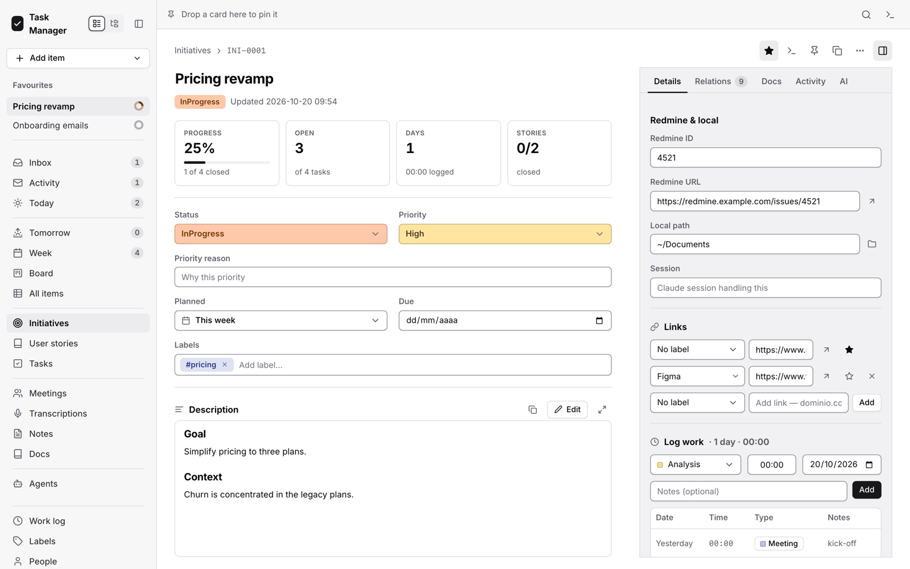
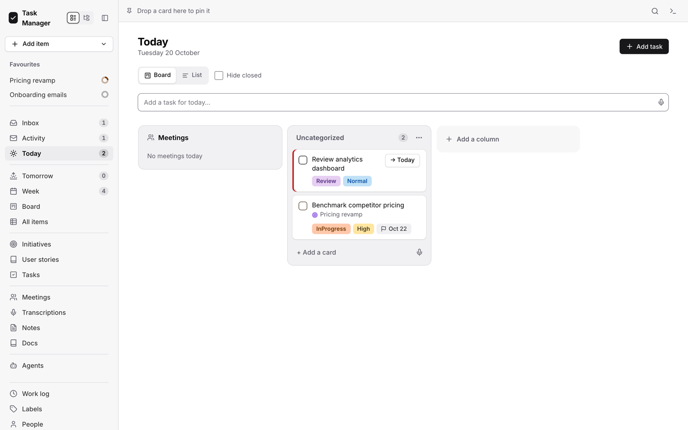
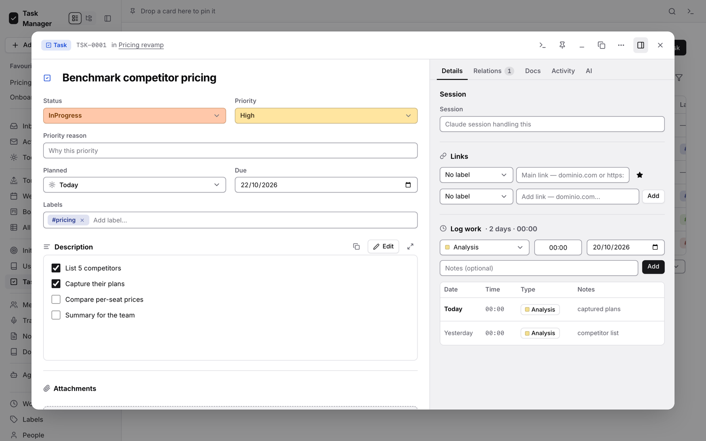
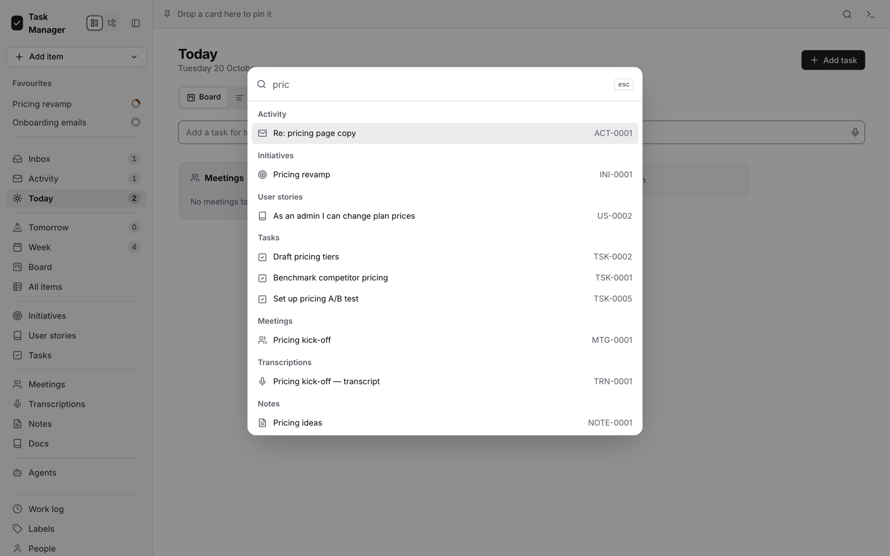
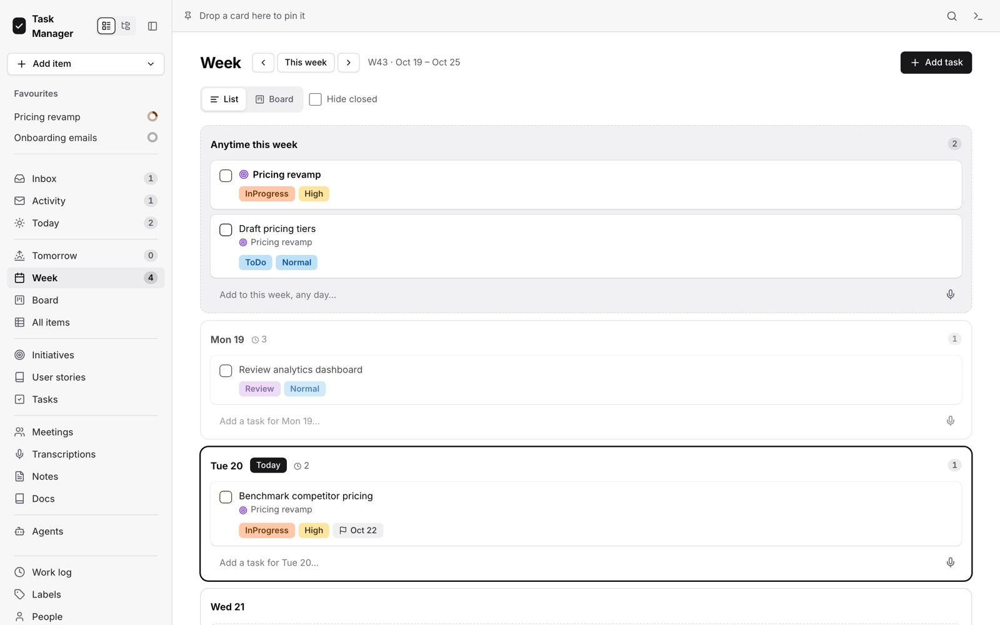
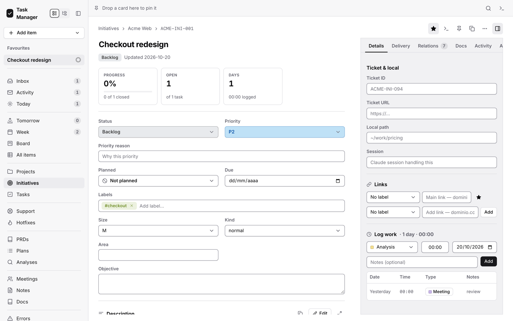
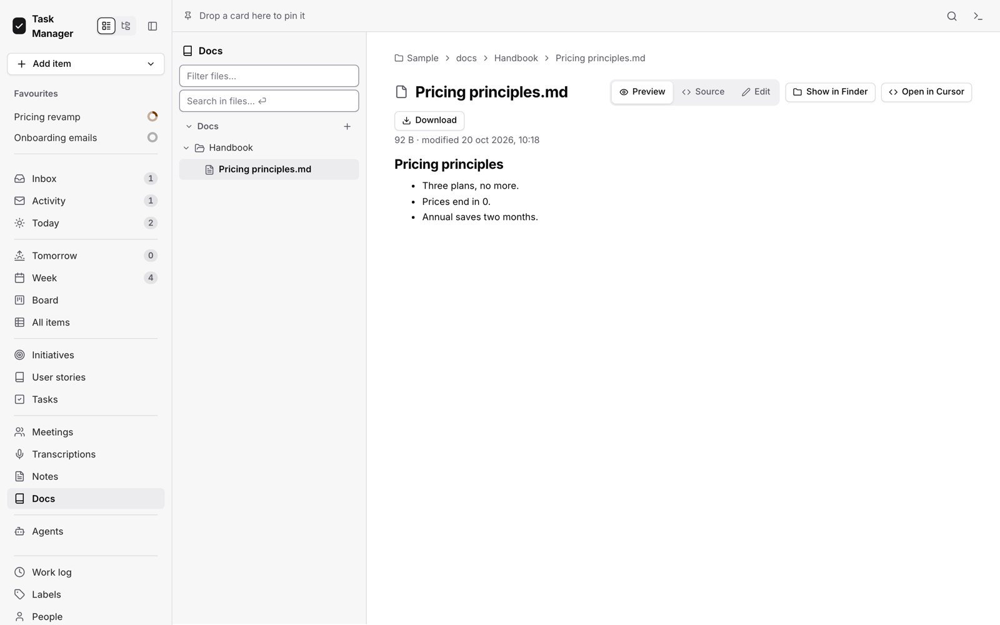

<div align="center">

# Local Task Manager

### Your tasks, projects and notes in plain Markdown — planned, searchable and private, on your own machine.

[](https://github.com/luisdomarco/local-task-manager/actions/workflows/tests.yml)


<picture>
  <source media="(prefers-color-scheme: dark)" srcset="docs/images/dark/initiative.png">
  
</picture>

**No account · no database · no cloud.** Just folders of `.md` files you already own,<br>
with a fast app on top and Claude Code one click away.

[Quick start](#quick-start) · [User guide](docs/user-guide.md) · [Install it with Claude](docs/install-with-claude.md)

</div>

## Why Local Task Manager

| 📁 **Yours, in plain files** | ⚡ **Built for the day** | 🤖 **Claude Code inside** |
|---|---|---|
| Every task, note and meeting is a Markdown file in a folder you choose. Open it in Obsidian, an editor or git; the app follows. | Capture in one line, plan today and the week, and see every project's progress at a glance. | Start a Claude session on any item: it gets the item as its prompt, and you can resume it later. |
| 🔒 **Private by design** | 🧩 **Two ways to organise** | 🪶 **Nothing to install** |
| It runs on `127.0.0.1`. Nothing leaves your machine unless you ask it to. | One folder per kind of item, or projects as folders with tickets, PRDs, plans and records. | Python's standard library and plain JavaScript: no `pip`, no `npm`, no build step. |

## A tour

### Plan your day, not your tool

Today is a board of your own columns. Drag work in, check it off, and anything left from yesterday comes back marked.

<picture>
  <source media="(prefers-color-scheme: dark)" srcset="docs/images/dark/today.png">
  
</picture>

### Everything about a task, in one card

Status, priority, plan and labels on top, a Markdown description with a live preview, and on the side its links,
the time you logged and its Claude sessions.

<picture>
  <source media="(prefers-color-scheme: dark)" srcset="docs/images/dark/card.png">
  
</picture>

### Find anything in a keystroke

⌘K searches every item by id, title or text, jumps to any view and creates new things.

<picture>
  <source media="(prefers-color-scheme: dark)" srcset="docs/images/dark/search.png">
  
</picture>

### Your week at a glance

Every day of the week with what is planned for it, plus what can happen any day.

<picture>
  <source media="(prefers-color-scheme: dark)" srcset="docs/images/dark/week.png">
  
</picture>

### Organise by project, like a ticket system

A Ticketing vault keeps each project in its own folder: initiatives and their stories, the specs of what the system
does today, support tickets, hotfixes, PRDs, plans, analyses, errors and learnings, each with its own fields and rules.

<picture>
  <source media="(prefers-color-scheme: dark)" srcset="docs/images/dark/ticketing.png">
  
</picture>

### Docs next to the work

Specs, guides and decisions live in the same vault as the tasks they explain, as trees you can browse and edit.

<picture>
  <source media="(prefers-color-scheme: dark)" srcset="docs/images/dark/docs.png">
  
</picture>

## Quick start

```bash
git clone https://github.com/luisdomarco/local-task-manager.git local-task-manager && cd local-task-manager
python3 tools/serve_sample.py --ticketing      # → http://127.0.0.1:3101, on copies of the two sample vaults
```

That is all it needs: Python 3.9 or newer, which comes with the Mac's Command Line Tools (`xcode-select --install`).
To set it up as a Mac app with your first
vault, paste the prompt in [`docs/install-with-claude.md`](docs/install-with-claude.md) into Claude Code. How to use it
day to day: [the user guide](docs/user-guide.md), also inside the app under **Settings → Documentation**.

[Contributing](CONTRIBUTING.md) · [Security](SECURITY.md) · [Changelog](CHANGELOG.md) · [MIT License](LICENSE)

---

The rest of this page is the full reference: setup in detail, the Mac app mode, every screen, the file formats and how
to develop the app.

## 1. What it is

A personal task manager whose only storage is **Markdown files** in folders you choose (*vaults*): no database, no
account, nothing sent anywhere. Each vault has a **structure** — *folder per type* (one folder per item type) or
*Ticketing* (projects as folders, `KEY-TYPE-NNN` ids) — and every `.md` that structure recognises becomes an item: initiatives,
tasks, notes, meetings, tickets… Edit the same files from Obsidian, an editor or Claude; the app picks the changes up.
A Python stdlib server plus vanilla JS, no build step, with Claude Code built in (launch a session on any item).

Contents: [1 What it is](#1-what-it-is) · [2 Setup](#2-setup-in-5-minutes) · [3 Mac app](#3-mac-app-mode) ·
[4 Feature map](#4-feature-map) · [5 Vault structures](#5-vault-structures) · [6 Development](#6-development) ·
[7 Reference](#7-reference). Working on the code with an agent? Start with [`CLAUDE.md`](CLAUDE.md).

## 2. Setup in 5 minutes

Rather have Claude do it? Paste the prompt in [`docs/install-with-claude.md`](docs/install-with-claude.md) into Claude Code.

### Requirements

- **Python 3.9 or newer** — the `python3` that ships with macOS (3.9) is enough. Nothing to `pip install` (see
  [Python version](#python-version)).
- **A modern browser** (Safari, Chrome, Firefox).
- **macOS** only for what opens other apps: *Open in Terminal / Claude Desktop / Cursor*, *Show in Finder* and the
  [Mac app mode](#3-mac-app-mode). Everything else, the embedded Claude terminal included, runs on Linux too.
- **Node 20+** only to run the frontend tests. The app never needs it.
- **[Claude Code](https://claude.com/claude-code)** (`claude` on your PATH, logged in with *your* account) only for
  [Work with Claude](#work-with-claude).

### Python version

- **Standard library only.** No `pip install`, no virtualenv, no `requirements.txt`: any Python 3 from **3.9** up
  runs the app and its tools.
- **On a Mac,** `/usr/bin/python3` (3.9.x) comes with the Command Line Tools. If `python3` is missing, run
  `xcode-select --install`. A python.org or Homebrew 3.x works too. `python3 --version` tells you which one your PATH
  picks first.
- **`python3 server.py`** runs with that first `python3` on the PATH. Name another explicitly if you prefer:
  `/usr/bin/python3 server.py`.
- **The [Mac app](#3-mac-app-mode)** runs with the interpreter that ran `tools/install_app.py`: the installer writes
  its real path into the LaunchAgent. To switch, run the installer again with the other one, e.g.
  `/usr/bin/python3 tools/install_app.py`.
- **The Python tests** run on 3.9 and on 3.12, and must keep running on 3.9: no 3.10+ syntax (`match`) and no 3.11+
  APIs (`unittest`'s `enterContext`, for one). **Node 20+** is only for the JS tests.

### Run it

```bash
python3 server.py                          # → http://127.0.0.1:3100 (TM_PORT=3105 python3 server.py for another port)
```

Without a `config.json` it opens the bundled `sample-vault/`. That folder is versioned, so anything you create there
shows up in `git status`; to look around without writing into anything of yours, use a throwaway copy instead:

```bash
python3 tools/serve_sample.py              # → :3101, a temp copy of sample-vault/ with its own temp config.json
python3 tools/serve_sample.py --ticketing  # the same plus a temp copy of sample-vault-ticketing/
```

Both leave your `config.json` and your vaults alone: everything they write lives in a fresh folder of the system's
temp dir, whose path they print.

### Your first vault

1. **Make the folder** (`mkdir ~/Documents/my-vault`). An empty folder is the start of either structure; a folder
   already full of notes must already have the structure's shape (see [5](#5-vault-structures)).
2. **Settings → Vaults → Add vault** (Settings is at the foot of the sidebar): a name, the folder (absolute, `~/…`, or
   relative to this app's folder; it must exist) and its **structure**: **Folder per type** or
   `Ticketing`. Optionally untick the item types you will not use, and tick *Default* for the one that opens first.
3. **Save settings.** This writes `config.json` (git-ignored; the first save keeps a copy of the old one in
   `backups/`).
4. **Switch to it** with the vault selector at the foot of the sidebar. A new vault opens in the **Explorer** (the
   sidebar's file view): click **Project**, the first of the two buttons at the top of the sidebar, to see the vault
   as items (see [Sidebar modes](#sidebar-modes)). Until its folders exist, that page says *does not match its structure* and offers **Create the N missing
   folders** — empty folders only, no file is touched.
5. **Ticketing only:** every ticket lives in a project, so start with **Add item → Project** (a name and a key of 2–4
   capital letters, e.g. `DP`). The project's folder and its type folders are made with it.

Several vaults are fine: each is independent (its items, labels, people, statuses and view preferences are its own),
and the address says which one you are on (`?vault=<id>`). Two vaults cannot overlap (one inside the other), and
removing a vault from the list only forgets it: its files stay on disk.

### `config.json`, field by field

Settings writes it; you rarely need to edit it by hand. [`config.example.json`](config.example.json) shows the shape.
Every field is optional.

| Field | What it is | Set from |
|---|---|---|
| `vaults` | `[{id, name, path, structure, folders?, disabled_types?}]`. `id` is made from the name on the first save and never changes (it is in the address and in each vault's export). `structure` is `folders` (folder per type) or `ticketing`. `folders` (folder per type only) moves a type's folder: `{"task": "work/tasks"}`. `disabled_types` hides types (Ticketing's `project` cannot be). | Settings → Vaults |
| `default_vault` | The id of the vault that opens when the address names none. | Settings → Vaults |
| `root`, `folders` | The default vault's path and folders, kept equal to it on every save, for the tools in `tools/` and for a config written before there were vaults (its `root` becomes the one vault). | automatic |
| `port` | Where `server.py` listens (default 3100). `TM_PORT` in the environment wins. | by hand |
| `work_kinds` | The kinds of work a work-log entry can have. | Settings → General |
| `editor_app` | What *Open in …* in the Explorer uses: Cursor, Visual Studio Code, Zed, Sublime Text, BBEdit or TextEdit. | Settings → General |
| `claude_command` | How Claude Code is started (`claude`; extra flags allowed). Give the full path if the server's PATH does not have it. | Settings → Claude |
| `claude_paths`, `claude_cwd`, `claude_path_names` | The saved folders Claude may start in (a closed list: the browser picks one, never types one), the default among them (`""` = this app's folder) and a display name for each. | Settings → Claude |
| `claude_model`, `claude_effort` | Default model and effort for a launch (`""` = Claude's own default). | Settings → Claude |
| `terminal` | `Terminal` or `iTerm`, for *Open in Terminal*. | Settings → Claude |
| `sync` | Settings for commands of your own that sync the vault with outside systems (your email, which calendar…). The app itself never reads it. See [Your own commands, skills and agents](#your-own-commands-skills-and-agents). | by hand, or by those commands |

Secrets never go in `config.json`: a token for an external system goes in `.env` (copy
[`.env.example`](.env.example); git-ignored), and connectors (a calendar, a chat) belong to your own Claude account.

## 3. Mac app mode

The app as something you open from the Dock, without a developer account, a database, or a terminal left running
`python3 server.py`:

```bash
python3 tools/install_app.py               # install (or reinstall) and start it → http://localhost:3200
python3 tools/install_app.py --update      # copy this checkout's code over the app's, and restart it
python3 tools/install_app.py --uninstall   # stop it and take it out (its config.json stays, for a later install)
python3 tools/install_app.py --dry-run     # say what it would do, do nothing
```

- **Why a separate folder.** The installer copies the code to `~/Library/Application Support/TaskManager/app` (copied,
  never linked), so the app you use every day never runs a half-finished change from this checkout. Work in progress
  reaches it only when you run `--update`. It copies only what runs (`server.py`, `tm/`, `static/`, `docs/`, `tools/`,
  `sample-vault/`, `sample-vault-ticketing/`, `README.md`, `package.json`, `config.example.json`): no `.git`, `tests/`, `plans/` or `.claude/`.
- **Its own settings, the same vaults.** Its `config.json` is made once from this checkout's, with port **3200** (so
  the checkout on 3100 and the app can run at once) and relative vault paths made absolute; it is never overwritten
  after, not even by `--update`. The vaults stay where they are, so both see the same files.
- **On when you open it, off when you stop it.** A LaunchAgent (`~/Library/LaunchAgents/com.taskmanager.app.plist`)
  has launchd listen on 127.0.0.1:3200 while the app is off: nothing runs. Opening the page is the first connection;
  launchd starts the server and hands it that socket (`tm/launchd.py`). It runs with the `python3` that ran the
  installer, and a PATH that includes `~/.local/bin`, `/opt/homebrew/bin` and `/usr/local/bin` (where `claude` usually
  is).
- **Settings → App** shows how the server runs (on demand or by hand, since when, which port) with **Stop server** and
  **Restart**. Once stopped, nothing runs until the next opening starts it again.
- **In the Dock.** Open `http://localhost:3200` in Safari and choose *File → Add to Dock*, or in Chrome *⋮ → Cast,
  save and share → Install page as app*. It gets its own window and the check icon (`static/manifest.json`,
  `static/icons/`).
- **Logs:** `~/Library/Logs/TaskManager/server.log` (output and errors).
- **`install.json` points back at the checkout.** The installer writes the path of the checkout it came from into the
  app's folder. Two things use it, because the copy has no `.git`, `tests/` or `.claude/`: **Settings → Export** makes
  the system and agents zips from that checkout and keeps them in its `versions/` (both the app and the checkout list
  the same zips), and **Claude** starts in that checkout when neither the item nor Settings names a folder. If the
  checkout is moved or deleted, the app exports only vaults; reinstall from the new place to fix it.
- **Port in use.** If 3200 (or 3100 for `server.py`) is taken, the server says which address already answers and exits
  instead of failing with a traceback: open that one, or start yours with `TM_PORT=<another port>`. To see who holds
  it: `lsof -iTCP:3200 -sTCP:LISTEN`.

## 4. Feature map

One line per area; each links to its reference section.

- **Views** — Inbox, Today (a board of your own columns), Tomorrow, Week, Next week, Month, one list per type, an initiative's (or
  Ticketing project's) page, Board, All items, Work log, Labels, Contacts, Trash, Settings. → [Views](#views)
- **Items and their cards** — the card, relations (parent, children, related), pins, minimized cards, comments, Undo.
  → [Views](#views), [Data model](#data-model)
- **Search and keyboard** — ⌘K searches items (grouped by type), views and files, and runs commands; `g` + a key
  jumps to a view. → [Search and keyboard](#search-and-keyboard)
- **Quick add and Inbox** — `q` captures a line; tokens set its type, plan, priority and parent; Inbox items convert
  to any type. → [Quick add](#quick-add), [Inbox items](#inbox-items)
- **Planning** — Today / Tomorrow / Week / Next week / Month by date, carried-over items, free boards for the week, Board
  lists mapped to statuses. → [Week / Today](#week--today), [Board lists ↔ status](#board-lists--status)
- **Statuses** — per vault and per type, each in a fixed group (Not started · In progress · Closed).
  → [Statuses and their groups](#statuses-and-their-groups)
- **Work log** — time per item per day, one file per day, suggestions of what you forgot to log. → [Work log](#work-log)
- **Explorer** — the vault as files: preview, edit, search in files, CSV as a table, drag files in from Finder.
  → [The Explorer](#the-explorer)
- **Sidebar modes** — Project (the views) and Explorer (the files), remembered per vault. → [Sidebar modes](#sidebar-modes)
- **Docs** — a view (⌘⇧D) of the vault's documents, which are never items: trees on the left, the doc and its
  properties on the right. → [Docs](#docs)
- **Work with Claude** — launch Claude Code on any item, in the embedded terminal dock or in Terminal, Claude Desktop,
  Cursor or Antigravity; sessions are recorded on the item and resumable. → [Work with Claude](#work-with-claude)
- **Dictation** — the mic in the description editor writes what you say at the cursor (the only field of an item with one;
  the quick adds of Inbox, Today, Week and Board keep theirs).
  → [Description editor](#description-editor)
- **Your own commands** — add Claude Code commands, skills and agents that work on the vaults (syncs, briefs,
  triage). → [Your own commands, skills and agents](#your-own-commands-skills-and-agents)
- **Export** — the system, the agents or a vault as zips to carry between machines; backups are kept apart.
  → [Exporting the system](#exporting-the-system)
- **Trash and safety** — delete goes to a trash you can restore from; atomic writes; a description changed on disk is
  never silently overwritten; ids are never reused. → [Deleting](#deleting), [Safe against edits from
  outside](#safe-against-edits-from-outside)

## 5. Vault structures

A vault is a folder plus the name of its structure. The structure (`tm/structures/`) says which folders it has, which
files are items and what their ids look like. The app **shows a vault only while its folder matches**; until then it
reads nothing from it and writes nothing into it, and says why.

### Folder per type

```
my-vault/
├── initiatives/     INI-0001-….md   the project or epic; the only type with a page of its own
├── stories/         US-0001-….md    user story, hangs from an initiative
├── tasks/           TSK-0001-….md   hangs from an initiative or a story
├── notes/           NOTE-0001-….md
├── meetings/        MTG-0001-….md   date, time, duration, attendees
├── transcriptions/  TRN-0001-….md   hangs from a meeting
├── activities/      ACT-0001-….md   an email or message pasted in, closed once resolved
├── inbox/           INB-0001-….md   quick captures
├── prompts/         PRM-0001-….md   reusable prompts for Claude
├── agents/          AGT-0001-….md   optional: made with the first agent
├── worklog/2026/    2026-10-19.md   the work log, one file per day
├── docs/                            documents, never items (the Docs view)
└── .task-manager/                   the app's own: board, pins, labels, people, groups, statuses, trash…
```

The default structure, and the one `sample-vault/` has. An item is any `.md` with `type: <type>` in its frontmatter; its id is `PREFIX-NNNN`. Folder names can be moved per
vault (Settings → Vaults → *Folders for new items*). Statuses Backlog · ToDo · OnHold · Blocked · InProgress · Review
· Done · Discarded; priorities Urgent · High · Normal · Low; external reference: a ticket system (an id and a URL field on initiatives and stories).

### Ticketing — projects as folders

The native format of the *ticketing second brain*, Obsidian-friendly (`fileClass` instead of `type`, wikilinks):

```
my-tickets/
├── Demo Product/                    a project: key DP, kind product
│   ├── 00 Demo Product.md           the project note: fileClass Ticket Project, project_key, enabled_types…
│   ├── Initiatives/  DP-INI-001 <Title>.md
│   ├── Stories/      DP-STY-001 <Title>.md  an initiative's deliveries (made with the first story)
│   ├── Specs/        DP-SPEC-001 <Capability>.md  what the system does today (made with the first spec)
│   ├── Support/      DP-SUP-001 <Title>.md
│   ├── Hotfixes/     DP-HFX-001 …       (when the project enables hotfix: product projects)
│   ├── PRDs/         DP-PRD-001 …       (when it enables prd)
│   ├── Plans/        DP-INI-001 Plan.md  no id of its own: its item's
│   ├── Analyses/     2026-10-19 <Title>.md
│   ├── Records/Errors/     DP-ERR-001 …
│   ├── Records/Learnings/  DP-LRN-001 …
│   └── Docs/                        the project's documents (optional)
├── Tasks/  Notes/  Meetings/  Inbox/  Activities/    the app's own types, TSK-001 …, with or without a project
├── Agents/                          optional
├── Work log/
└── Docs/                            optional
```

A ticket's file is named `<ID> <Title>.md`; its project is its folder and the key of its id, so it is chosen on
creation and never changes. Statuses are written `status_ticket: "5. Review"` and their names and order are fixed
(only colours and the Not started / In progress split can change); priorities P0–P3; the format's rules (support
levels and due dates, Promote, Escalate, the ToDo gates, discard reasons, hotfix rollback and post-mortem) are enforced
in `tm/structures/ticketing/rules.py`. **The allowed moves and their gates bind a script or an agent**, which says so
when it writes (`"by": "agent"` in `POST /api/item/update`); **in the app you move a status anywhere**, and the
status log records who did (`by: owner` or `by: agent`). The automatic moves below happen either way.

An initiative is the objective; what gets delivered are its **stories** (`DP-STY-001`, one branch and one pull request
each, linked to it by `initiative:`). An initiative is ready (ToDo) with its size, regime, a verified premise and at
least one story; a story is ready with its initiative approved (ToDo or later), at least one acceptance scenario
written under `## Acceptance criteria` (a `- **WHEN** …` line that says something) and its spec impact declared
(the specs it changes, or `none: <why>`). The initiative follows its stories: it goes In progress
when the first one starts, and Done when the last one closes with at least one done; it cannot be put in Review or
Done by hand while a story is open. In a serial project, *one at a time* counts stories, support tickets, hotfixes and
PRDs, never the initiative that groups them. Stories replace the initiative's old `kind: umbrella / slice`; a PRD
names the initiative it became in `initiative:` (an older `umbrella:` is still read).

A **spec** (`DP-SPEC-001`, its own section in the sidebar) says what one capability of the project's system does today,
as it is in production: `## Requirements`, each `### Requirement:` with SHALL or MUST and at least one
`#### Scenario:` with a written **WHEN** and **THEN** (the format of OpenSpec, kept in the vault). Its statuses are its
own — draft · active · retired — and it is active only when that text is valid (`ticketing/specs.py` says what is
wrong). A story's *Spec delta* is what will change; when the story ships it is merged into the spec, which records the
commit (`synced_sha`, `synced_date`) and the stories that changed it (`stories`). Writing a file changes only the keys the app changed (`codec.py`): key order,
comments, unknown keys and the body stay as they were.

### What the check blocks and what it only warns about

`tm/structures/check.py` (folder per type) and `tm/structures/ticketing/check.py` compare the folder with its structure. Hidden
folders (`.task-manager`, `.obsidian`, `.git`), `node_modules`, `__pycache__`, `Attachments/` and the Docs folders are
never looked into.

| Blocks the vault (not shown, nothing written) | Only warns (shown in the notice, the vault works) |
|---|---|
| The vault folder does not exist | A file that is not Markdown (ignored) |
| A folder the structure needs is missing — **the only case the app can fix** (*Create the missing folders*) | A `.md` with no `type` / no known `fileClass` (ignored) |
| A top-level folder the structure does not know (Ticketing: one that is not a project either) | An item outside its type's folder (folder per type) |
| A file whose `type` is not part of the structure | A loose file at the top of a Ticketing vault |
| An id that is malformed, of another type or project, or used twice | An item put inside a Docs folder (the app does not see it there) |
| An iCloud placeholder (`.Name.md.icloud`: not downloaded yet) or an unreadable file | A work-log day outside the work-log folder |
| Ticketing: a project folder without a valid `00 <Folder>.md` (fileClass Ticket Project, unique 2–4 letter key), a type folder a project needs missing or one it does not know, a ticket in another type's folder, a ticket without an id, a ticket file not named `<ID> <Title>.md` | |

In a folder-per-type vault an item without an id is fine (Settings → Maintenance assigns ids). Settings also refuses to save a new vault
whose folder clearly holds the *other* structure, and the notice of an existing one says which structure it looks like.

## 6. Development

### Code layout

```
server.py               HTTP server and routes (127.0.0.1 only; POSTs need the X-Task-Manager header); config.json
tm/store.py             one vault: scan, ids, CRUD, validation, board, work log, files, trash
tm/frontmatter.py       parse / build / patch frontmatter (a patch keeps the lines it does not know)
tm/fsutil.py            crash-safe (atomic) writes
tm/structures/          what a vault looks like: __init__.py (Structure, TypeDef, statuses and groups, the registry),
                        the folder-per-type structure, agents.py (the Agent type, shared), check.py (its check)
tm/structures/ticketing/  definition.py (types, folders, fields), check.py, codec.py (files ↔ items), rules.py,
                        wikilinks.py, templates/ (a new file of each fileClass)
tm/attachments.py       files attached to an item (Attachments/)
tm/people.py            contacts: who an attendee or a sender is, and groups
tm/launch.py            the command lines and scripts that start Claude; tm/pty.py the embedded terminal
tm/launchd.py           the socket launchd hands the installed app; tm/export.py the zips of Settings → Export
static/index.html       the page; static/css/app.css; static/vendor/ (marked, DOMPurify, highlight.js, xterm.js, Inter — no CDN)
static/js/              ES modules, no build step: main.js (routing, keys), state.js (state and every mutation),
                        api.js, structure.js (the default structure as the server describes it), rules.js, views/*.js (one per view),
                        sidebar.js · explorer.js · treepane.js · filetree.js (the sidebar's modes, the file trees),
                        palette.js · search.js (⌘K), claude.js · term.js (Work with Claude), …
tests/                  Python unittest (stdlib only), one file per area; tests/js/*.test.mjs for the pure JS modules
tools/                  serve_sample.py, install_app.py, seed_sample_vault.py, seed_demo_vault.py, migrate_statuses.py,
                        make_icons.py, and the scripts behind the project's own commands
.claude/                commands/ and resources/ (the project's commands), launch.json (preview servers)
plans/                  design notes of features in progress
sample-vault/           the bundled folder-per-type example: every type, people, labels, docs, work log
sample-vault-ticketing/ the bundled Ticketing example: two projects and every type (tools/seed_sample_vault.py
                        rebuilds both with fresh dates; tests/test_samples.py keeps them complete)
```

No dependencies besides Python 3.9+ and a browser. `marked`, `DOMPurify` (SHA-384 checked against the values in
`index.html`), highlight.js (BSD-3), xterm.js (MIT) and Inter (SIL OFL, see `static/vendor/fonts/OFL.txt`) live in `static/vendor/`, so the
app works offline and sends nothing to a third party (the one exception you opt into: dictation in Chrome, whose
speech recognition is Google's).

### Tests

```bash
python3 -m unittest discover -s tests -t .     # the server, the store, the structures, the tools (~30 s)
TZ=UTC node --test tests/js/*.test.mjs         # the pure frontend modules (Node 20+; also: npm run test:js)
```

Both use temp folders and `sample-vault/`; neither touches your vaults or `config.json`. Both must be green before a
PR. `tests/test_structures.py` also checks that `static/js/structure.js` is exactly what the server says the default
structure is: a change to that structure fails there until `python3 tools/sync_structure_js.py` mirrors it (see [Adding an item
type or a structure](#adding-an-item-type-or-a-structure)).

### Preview servers (`.claude/launch.json`)

| Name | Port | What it serves |
|---|---|---|
| `task-manager` | 3100 | `server.py` with **your** `config.json`: your real vaults |
| `task-manager-sample` | 3101 | `tools/serve_sample.py`: a temp copy of `sample-vault/` |
| `task-manager-3102` | 3102 | `server.py` with your config, on another port (next to a running 3100) |
| `task-manager-sample-3103` | 3103 | `tools/serve_sample.py --ticketing`: both samples, folder per type and Ticketing |

Check changes on 3101 or 3103: they never write into a real vault.

### Adding an item type or a structure

Folders, item types, ids, statuses and fields are **data** in `tm/structures/`. The Store, the server and the page
read them from there (the page through `GET /api/structure`, which is `Structure.public()`), so a type is declared in
one place and the sidebar link, its list, the create form, quick add and the `g` key follow from it.

**A type is a `TypeDef`** (`tm/structures/__init__.py`). What each field does:

| Field | What it decides |
|---|---|
| `name`, `prefix`, `folder` | `type:` in the frontmatter, the id prefix (`TSK` → `TSK-0001`), the folder new ones are written to |
| `label`, `plural`, `icon`, `route` | how it is called, its icon (a name of `ICONS` in `static/js/ui.js`), its view `#/<route>` |
| `fields` | the keys written on creation, in this order, after `id`/`type`/`subject`; a key not here is dropped on save |
| `parents`, `parent_label` | the types it may hang from (`related_to`), and what the Relations tab calls that parent |
| `statuses`, `closed`, `closed_when` | its statuses (`()` for none), the ones that close it, or a field that closes it (`resolved_at`) |
| `nav` | its sidebar link: `{group: capture · types · tools, order, section}`; `None` for no link |
| `list` | its list view: `columns`, `sort`, `scopes` (status · date · resolution · archive), `relation`, `group_by`; `None` for no list |
| `page`, `children` | it opens as a page of its own (`#/<name>/<id>`) with a table of each child type, instead of a card |
| `props` | its own fields on the card: `{key, label, kind}` with kind text · textarea · select · checks · number · date · link · links · readonly · map, and `tab`: main (the properties), delivery, details or relations |
| `plannable`, `counted`, `go_key`, `tokens` | Today / Week / Board; its sidebar count (all · open · none); `g` + key; quick-add tokens (`/task`) |
| `has_id`, `creatable`, `convertible`, `folder_optional`, `body` | ids or not; offered by the create form; an inbox item converts to it; its folder may be missing; a new item's body |

**In the folder-per-type structure** (its module in `tm/structures/`) a type is a row in each of its tables: `ITEM_TYPES`
(prefix), `DEFAULT_FOLDERS`, `TYPE_FIELDS`, `PARENT_TYPES`, `LISTS`, `SHOWN` (label, plural, icon, route, nav, counted,
go key, tokens), and where it applies `PLANNABLE` and `PARENT_LABEL`; `_type()` turns the row into a `TypeDef`. A new
folder becomes one the check requires (an existing vault then shows *Create the missing folder* until it exists),
unless the type is `folder_optional`, as the Agent type is (`tm/structures/agents.py`, shared by both structures).

**In Ticketing** (`tm/structures/ticketing/definition.py`) the file format comes first: `SPEC[type]` says its
`file_class`, its `scope` (project · root · note), `folder`, id `code`, how its file is `title`d, its `status_key`, the
field that is its `parent` and its wikilink fields (`links`, `multi_links`); then `OWN_FIELDS`, `PROPS` and `TABS`
(its own fields and the tab each sits in), `PARENTS`, `PAGES`, `PARENT_LABEL`, `LISTS`, `SHOWN` and `PLANNABLE`. It
also needs a template, `templates/Ticket <Name>.md` (a new file is that template, filled in), and a project-scoped type
must be added to the lists of a project's folders in `ticketing/check.py` (`_project_folders`) and `codec.py`
(`project_folders`, `enabled_types`).

**Then mirror the default structure in the page.** `static/js/structure.js` is `Structure.public()` of the
folder-per-type structure, verbatim: what the page shows before it has the vault's, and what the node tests run on.
`tests/test_structures.py` fails until it matches. Rewrite it with:

```bash
python3 tools/sync_structure_js.py           # --check only says whether it is up to date
```

**A new structure** is a `Structure` (`tm/structures/__init__.py`): an `id` and `label`, its `types`, `priorities`,
`id_re` (group 1 the prefix, group 2 the number) and `id_pad`, `external_ref` (the outside tracker's id and url keys),
`statuses` and `closed`, `worklog_folder`, `defaults` for a new item, `required` (types a vault cannot turn off),
`statuses_locked` (names fixed by the file format) and the Docs folders (`docs_folder`, and `docs_in_projects` /
`docs_not_projects` when each project has its own). Two hooks for a format of its own:

- `checker(root, load)` → the same answer as `tm/structures/check.py` (`ok`, `blocking`, `warnings`,
  `missing_folders`, `can_create_folders`), when the generic one-folder-per-type check does not fit;
- `codec`: how its files map to items and back, when they are not `type:` plus the app's keys. The Store calls it
  where `tm/store.py` says *a structure with its own file format* (`classify`, `decode`, `resolve`, `apply`,
  `encode`, `new_file`, and the project helpers); `TicketingCodec` is the one to follow, and it must write only the
  keys that changed.

Register it in `_registry()` at the end of `tm/structures/__init__.py`. That is all a vault needs to pick it: Settings
→ Vaults lists every registered structure by its `label`, and `config.json` stores its `id` in the vault's
`structure`. Nothing in `tm/structures/` may import the Store or the server.

**Tests to add:** in `tests/test_structures.py`, the new type or structure as `public()` shows it (folders, ids,
statuses, pages); in `tests/test_check.py` (or `test_ticketing.py`), a vault that matches and one that is blocked;
a Store round trip — create, update, reopen — in a temp folder; and for a codec, that an update changes only the keys it
meant to (`tests/test_ticketing.py` `changed_keys`). If the type can be turned off, `tests/test_types_toggle.py`.

### Checking a layout change

The item modals, the create form and the sidebar change shape with the window. After touching `app.css`, open an
item and the create form at **375, 820, 1000 and 1303 px** wide: nothing may overlap or be clipped, the header of the
create form stays on one row from 820 px up, every sidebar link is reachable at 375 px (on a phone the sidebar is a
drawer), and editing a field while scrolled keeps the scroll position.

### Branches and PRs

One `feat/<topic>` (or `fix/<topic>`) branch per change, one or two commits, a PR against `main`. The PR is merged as
`merge: <title> (#N)`, and only once the owner says so. Risky work goes in a git worktree (`.claude/worktrees/` is
git-ignored and never exported).

## 7. Reference

The detailed behaviour of every screen and file. Where a type or a folder is named (`TSK-0001`, `tasks/`), it is
the folder-per-type structure's; Ticketing has the same screens with its own types (Projects, Support, Hotfixes, PRDs, Plans, Analyses,
Errors, Learnings) and its own folders (see [5](#5-vault-structures)).

### Views

| View | What it shows |
|---|---|
| **Inbox** | Captured items (`type: inbox`), newest first, each with *Convert to* any type an inbox item can become, and a *Related to…* picker. Unrelated tasks, notes, meetings and activities are found in **All items** with the *Not related* filter. |
| **Today** | Only what is planned for today or *carried over* from a past day (red marker, `→ Today` on the card) — on a **board whose columns are yours**: *Uncategorized* by default, add *Morning* / *Waiting*…, drag cards between them and **up or down to order them by hand** (cards never placed follow, carried over first, then by priority), drag a header to reorder. Columns organise the day and never change a status. The board opens with a fixed **Meetings** column — the meetings dated today, with their time — that cannot be renamed, moved or deleted, and whose cards do not drag. **List** mode shows the same as two groups (carried over · today). |
| **Tomorrow** | Planned for tomorrow · due tomorrow · pick from tomorrow's week, each with "→ Tomorrow". |
| **Week** | Three layouts, remembered in this browser. **List**: an agenda — *Anytime this week* then one section per day, Mon–Sun, with full-width cards and a quick add per day. Drag a card onto a day to plan it, at the place you drop it: cards keep the order you give them, in List, Board and on Today (the same `plan_order` for a day); those never placed follow, by priority. Previous/next week. Carried over from past weeks on top. **Board**: the same as columns side by side (Carried over · Anytime · Mon–Sun); its **days** filter (several at once, *All days* when none is ticked) keeps the board to the weekdays you pick — Carried over and Anytime always show (remembered too). **Free board**: the week's cards (carried over, anytime and every day) on a **board whose columns are yours**, like Today's — *Uncategorized* by default and fixed, add *Waiting* / *Deep work*…, rename, move (drag a header, or ⋯ → Move) and delete them (a deleted column's cards go to *Uncategorized*). Dropping a card on a column, or up and down in it, changes only its column and its place there, never its day; each card shows what it is **planned** for (Mon 2, W45), in red when that has passed. **One set of columns for Week and Next week**: a card keeps its column when it moves to another week. A card added from a column's *+ Add a card* is a task planned for that week, placed there. |
| **Next week** | The Week view fixed on next week, with the same three layouts (remembered apart from Week's) and the same Free board columns. |
| **Month** | This month on one board, a column per horizon: **Today** (with what is carried over from past days, as on Today) · **Tomorrow** · **This week** (the rest of it) · **Next week** · **Later this month** — and first, when there is any, **Carried over** from past weeks or months. What goes where: an item's day, else its week, else its month (*This month* in *Planned*); a week counts in the month of its Thursday, so next week shows here even when it starts the next month. Drag a card onto a column to plan it there — Today or Tomorrow give it that day, This week and Next week that week with no day, *Later this month* the month with neither — at the place you drop it (`plan_order`, as on Today and Week). Every card shows what it is planned for. *+ Add a card* adds a task planned for that column. |
| **Initiatives · User stories · Tasks · Notes · Transcriptions · Meetings · Activity** | One sortable table per type with **Add ‹type›** top right, which opens a form. On top, always visible: **Open / Closed / All** — **Today / Tomorrow / Week / All** for meetings, by their date — and the search. The **filter** icon on the right opens a side panel (closed on every visit; a badge on the icon counts the filters on) with the rest: **Group by** (initiative, status, priority, planned — what applies to the type; Initiatives by initiative: each top one heads its group, first, with its sub-initiatives under it), **status** and **priority** (several at once), relation (an initiative takes in everything under it, the tasks of its stories too), **plan** (today, tomorrow, this week, next week, this month, overdue, unplanned), **labels** (several at once, matching any of them — OR — or all of them — AND), and for meetings a **from – to** date (the same day in both is that day). Each list remembers its scope, filters, grouping and sort between visits. Initiatives show their ticket's **Ticket ID** and **Tracker** (Story, Epic…) side by side. Status and priority are edited in the row; a click elsewhere opens the item. |
| **User stories** | Every user story is a real item (`US-0001`, folder `stories/`), listed in a table filtered by initiative, status, plan and label. It belongs to an initiative or to none; tasks, notes and meetings can hang from it. A row opens its card, which has the same blocks as a task's plus the external ticket and local path. |
| **Initiative page** | `#/initiative/INI-0001`, two panels. Left: stats · properties · description · attachments, then what hangs from it as **tabs**, each with its count: **Epics** (its sub-initiatives whose tracker is Epic, in any case; first, and only once it has one — its quick add makes the new one an Epic), **User stories**, **Tasks**, **Notes**, **Meetings** (in each, its quick add with Open / Closed / All beside it, then its table; the tab shown is remembered per item type). Every sub-initiative, Epic or not, is in the Relations tab under Children, as its stories and tasks are. Right, with tabs: **Details** (external ticket & local · session · links · log work), **Relations**, **Activity** (comments) and **AI**. With folders per type only initiatives have a page; in Ticketing, projects (`#/project/<KEY>`), initiatives and PRDs do (an initiative's first tab is its **Stories**), and tickets have a **Delivery** tab too, one field per row in titled groups — Readiness, Execution, Spec and release, Triage, Paused or discarded — with only the ones the type has (`DELIVERY_GROUPS` in `ticketing/definition.py`). The side panel folds with the button at the right end of its tabs: folded, it is a narrow strip with that button to open it again (on a card, in the create form and on a page alike; the choice is remembered per kind of screen). |
| **Card** | Every item without a page opens as a Trello-style modal, a little clear of the window's edges: status, title, plan, properties, description, attachments, then what hangs from it as tabs with their counts (a task's Notes and Meetings…, as on a page), links; on the side, **what it hangs from** (the parent and on up to its initiative, each a link, above the links), **Watchers** (initiatives, user stories and tasks: the people and groups of Contacts to tell when its status changes — a prompt for Claude lists them with how to reach each and when to use them), work log, related items and **Activity** — what happened to the item plus your comments, oldest first, with the composer at the bottom (Enter adds; `@` mentions a person). Files dropped on a card or page are attached to the item (kept in the vault's `Attachments/`): the drop zone comes first, then **Attachments** with its count, which folds the list of files under it (*No attachments yet* when there are none; folded or not, it is remembered for every item). **📌 Pin** (left of ⋯) fixes the item to the top bar; **▁ Minimize**, right of it, sets the card aside on the top bar; **Expand**, left of ×, gives it the whole content area. |
| **Top bar** | Always across the top of every view. Left, the button that shows a hidden sidebar (always there on a phone), then the **pinned items** (`<root>/.task-manager/pins.md`): a chip opens its item; drag chips to reorder them; drop any card (Week, Board, Inbox…) on the bar to pin it; × or the pin icon in the item unpins. Keyboard: Shift+←/→ moves a focused chip, Delete unpins it. Right, **🔍 Search** (the same as ⌘K, see *Search and keyboard*) and the **Claude terminal** icon: a prompt with no item behind it, with a *History* tab of the terminals opened from there (see *Work with Claude*). |
| **Board** | Tasks as cards in lists, Trello-style, with the same filter bar as All items (type, relation, plan, labels, text, show closed, show archived); it starts with tasks only, and initiatives or stories can be ticked in to sit in the list of their status. Drag a task up or down to order it by hand (its `order`, within its list: Today and Week keep their own); drag a list by its header to reorder it; **⋯** sets the status it maps to, a WIP limit, rename, delete. **Each list maps to a status.** |
| **All items** | Everything, sortable by any column; filters by type (a multi-select), relation (initiative, story, task, or *Not related*), plan, labels (any or all of those ticked), text, closed and archived — the same bar as the Board (`filterbar.js`), four to a row on a desktop, two on a tablet and one on a phone; each view keeps its own state. |
| **Work log** | A table grouped by day with the time of each day totalled, filtered by a from–to date range. Click a row to edit or delete it. Dashed rows are *suggestions*: work you probably did but did not log (see Work log below). Rows marked **Tentative** (a clock, a coloured edge) were proposed by a worklog proposal (your own command, from the activity journal and your Claude sessions): they are not counted until you **Confirm** them — one by one, or **Confirm day** — or **Discard** them. |
| **Labels** | Every label as a table: add one, rename it, delete it. A rename or delete reaches every item that carries it. |
| **Contacts** | Two tabs, **People** (`#/contacts`; `#/people` still leads there) and **Groups** (`#/contacts/groups`). **People**: everyone named as the sender of an activity or an attendee of a meeting who is not a group. Each person has a **public name** (what the items store and the app shows), the **name their calendar** gives them, their **emails** (one person, several addresses; an address belongs to one person), their ticket-system and Slack users, **When to use** (when and how to reach them: instructions an agent follows) and **Notes**, the last two on several lines. A click edits them. A new public name reaches every activity and meeting that names them, and the groups they are in; renaming onto someone else merges the two, emails included. A person's chip shows their Calendar name and emails on hover. **Make it a group** (when editing a person) moves one who is really an email list or a channel — a Squad's list that Calendar invited, say — to Groups under the same name: their first email becomes its address, and the meetings and activities that name it keep it. **Groups**: people reached as one — an **email list**, a **Slack channel** or other — with its address, its **members**, **When to use** and **Notes**. A group's name is never a person's. A group can be a meeting's attendee, an activity's sender or a watcher, like a person: those fields suggest both, and the **Items** column counts every one (the breakdown on hover); renaming or deleting a group reaches all of them. A group's chip shows its address and members on hover. People and groups can be @mentioned; a prompt for Claude lists each one mentioned with how to reach them, when to use them and their notes. |
| **Transcriptions** | The text of a meeting (`TRN-0001`, folder `transcriptions/`): the body is the transcript, and each one hangs from a **meeting** (*Meeting* field). Create one from its own section, from **+ Add item**, or from the meeting's card, where a **Transcriptions** table with a quick add sits under the description (as Notes do on a task). Like a note it has links, work log and comments, and no status. Quick add: `/transcription` or `/trn`. |
| **Agents** | A backlog of AI agents (`AGT-0001` with folders per type, folder `agents/`; `AGT-001` in Ticketing, folder `Agents/`). An agent moves through its own statuses — **Idea → Design → Build → Test → Live → Retired** (Retired closes it) — and is not planned: no Today, Week or Board. It has a priority and its reason, **Platform** (Claude Code subagent · Agent SDK · Managed Agent · n8n · Other), **Model**, **Trigger** (manual · scheduled · event) and **Tools & MCP**, and may hang from an initiative. Created with an empty description, its body starts from the sections Purpose · Inputs · Outputs · Tools · Prompt · Evaluation · Runbook. **Its folder is optional**: a vault without it still matches its structure, and the folder is made with the first agent. Quick add: `/agent` or `/agt`. |
| **Prompts** | Reusable prompts as a table (`PRM-0001`, folder `prompts/`): subject, state, labels, created and updated, with filters (Active / Archived / All, label, text) and **Add prompt**. The body of the file is the prompt itself. Like a note it has no status: it is **active** until you archive it (⋯ → Archive). It relates to nothing, has no side panel (no links, work log or comments) and does not appear in All items, the Board or the Work log suggestions. |
| **Trash** | Everything you delete, as a table: id, subject, type, when it went, where it was and how many related items were detached. **Restore** puts an item back in its folder and relinks what the delete detached; **Delete forever** (per row) and **Empty trash** ask first, in place. The trash is the folder `<root>/.task-manager/trash/` — plain `.md` files, each with a `.meta.json` beside it (original path, deleted at, detached children). Nothing is purged automatically, and ids in the trash are never handed out again, so a restore cannot collide. Labels, people, columns and work-log entries are not items and are deleted outright. |
| **Settings** | Tabs (`#/settings/<tab>`, the last one remembered): **Vaults** (the folders this app shows, each with its structure, item types on/off and, with folders per type, the folders for new items; the default — see [Setup](#your-first-vault)), **Item type status** (see *Statuses and their groups*), **General** (work kinds, the editor of *Open in …*), **Claude** (how it starts, saved folders, model and effort), **Maintenance** (assign ids to hand-written items), **Keyboard**, **Export** (see *Exporting the system*), **App** (the installed app: stop, restart), **Documentation** (the user guide, [`docs/user-guide.md`](docs/user-guide.md)). Vaults, General and Claude are one form: *Save settings* at the foot of any saves all three. |

**Add item** (sidebar) opens a menu: *Capture to Inbox* (one line, `q`) or a form for any type the vault's structure
can create (folder per type: Initiative, Story, Task, Note, Meeting, Transcription, Agent, Activity, Prompt; Ticketing: Support,
Initiative, Task, Hotfix, PRD, Plan, Analysis, Error, Learning, Meeting, Note, Agent, Activity, Project). The form is the same card as the item editor (same width, header,
plan row, properties, description and side column), so creating and editing look alike. Its header lists the types to
switch between, on one row: when they do not fit they scroll sideways, and the panel and × buttons stay put. Opened
from a list's own **Add ‹type›** (Projects, Tasks, Today, Week, Board…) it offers that type only. On a phone the side
column goes under the main one, and its tabs scroll sideways when they don't fit.

**Relations** (a tab of the side panel, with how many there are) are what an item is linked to: its **Parent** (and the
chain above it), its **Children** and what it is **Related** to as an equal. Every row opens that item and its **×**
undoes the link, with Undo in the toast. The row at the foot adds one: *Parent* · *Child* · *Related*, then the item,
from a searchable list. A parent never comes from under the item (no cycles); a child that hangs elsewhere moves here
(the list says from where). A related link is kept on one of the two items and shows on both. Between initiatives,
user stories and tasks (folder per type), *Related* is an issue tracker's list instead — **Related to · Is duplicate of · Has
duplicate · Blocks · Blocked by · Precedes · Follows · Copied to · Copied from** — read as "this item *Blocks* that
one"; each related row starts with its kind, a select that changes it, and the other item sees the inverse (*Blocked
by*). A note, a meeting… is only ever *Related to*. Inbox items and prompts are linked to nothing. The create form keeps its
*Related to* field (there is no side panel yet); an existing item has its parent, and its Session, in the side panel.

#### Search and keyboard

**`⌘K` / `Ctrl+K`, or 🔍 in the top bar, is the global search.** Items match by id or title and are grouped by type,
in the sidebar's order, each group with *Show all*; *In the text* finds them by what their description says. Below
come the files whose path matches, the views, *Claude terminal* / *Work on … with Claude*, and *New …* to create.
Arrow keys move, Enter runs, Esc closes (`palette.js`; what matches and in what order is `search.js`).

Keys: `q` capture · `/` focus the filter · `Esc` close the top layer · `⌘\` hide or show the sidebar · `⌘⇧E`
Explorer · `⌘⇧D` Docs · `g` then a key to go to a view. The `g` keys are the app's (`t` Today, `r` Tomorrow, `w` Week,
`b` Board, `a` All items, `l` Work log, `h` Labels, `e` Contacts, `d` Trash) plus each type's — folder per type: `i` Inbox,
`n` Initiatives, `s` User stories, `k` Tasks, `o` Notes, `x` Transcriptions, `m` Meetings, `c` Activity, `p` Prompts;
Ticketing: `i` Inbox, `j` Projects, `n` Initiatives, `k` Tasks, `u` Support, `f` Hotfixes, `v` PRDs, `y` Plans,
`s` Analyses, `m` Meetings, `o` Notes, `x` Errors, `z` Learnings, `c` Activity. Settings → Keyboard lists the set of
the vault in use. Every table row, card and menu is reachable with Tab and opens with Enter.

#### Undo, addresses, the dock and minimized cards

Completing, reopening, archiving and deleting show a toast with **Undo**.

**Every item has an address**: `#/initiative/INI-0001` for an initiative's page, `#/item/TSK-0001` for the rest (its list,
with its card open). So **⌘/Ctrl-click or middle-click** anything that opens an item — a table row, a card, a parent
link, a pin — opens it in a new browser tab, and a row's subject offers *Open in new tab* in its context menu.

**The dock** (Claude inside the app) lists its sessions down its left side, each with a dot for what it is doing —
amber *needs you* (a permission card is waiting), blue *working*, green *your turn*, grey *terminal* or *ended*, red
when it *ended with an error* — and
shows the one picked on the right, **as a chat or as a terminal** (*Chat | Terminal* in its head; the choice is
remembered for the next launch). The dock takes **Claude Code's own theme**: the `theme` in
`~/.claude/settings.json`, the one picked when Claude was installed and changed with `/theme` (dark when unset).
It never follows the app's theme, because Claude draws its screen for its own one. Drag its top edge (or ↑/↓ on
it) to resize it. Double-click the edge, or use its ⌃ button, to fill it up to the top bar. Its height is
remembered.

The dock is **one layer for every session**, wherever it was opened (the top bar, a card, a history): across the
bottom of the content, above the pages and above an open card, which shrinks to end where the dock begins. It never
covers the top bar. In a narrow dock the list shrinks to its dots.

**A session is about an item, or about none.** One opened from a card is about that item; one from the top bar about
none. The **item chip** in the dock's head (*TSK-0001 · title ▾*, or *No item ▾*) changes it: search the vault's items
by id or title, or pick *No item (general history)*. The session's record moves with it — to that item's **AI** tab, or
to the general **History** — and the session takes the item's name; a chat also gets the item as a chip for its next
message, to send its context along if you want. Each row of the list shows its item's id under its name. A session
opened in another vault keeps its chip greyed out until you switch to that vault. The same move is **→** on each row of
a history (the card's AI tab, the top bar's History).

**Minimize a card** with the button right of its pin. It closes into a dashed chip on the top bar, after the pins.
A click brings it back on the same tab and scrolled where it was, and × forgets it. Minimized cards are
remembered between visits, at most 8.

**Expand a card** with the button left of its ×: it takes the whole content area, under the top bar and beside the
sidebar, which stay in reach; the same button brings it back to its size. The next card opens the way the last one
was left. Going to another view from the sidebar closes an expanded card (saving, as Esc does).

#### Sidebar modes

The sidebar shows the vault in one of **two modes**, the two buttons at its top (`⌘⇧E` switches between them):

- **Project** — first **Favourites**, right under *Add item*: the initiatives starred on their page (the ☆ in the
  page's header; a new one is not until you star it), each with its progress ring, in the order you drag them
  (or Shift+↑/↓). Then the views built from the vault's structure: Inbox, Today, Tomorrow, Week, Next week, Month, Board and All items, then
  one link per item type the structure has and the vault has on, without a count (Inbox, Activity and the days keep
  theirs; `static/js/main.js` builds them
  from `GET /api/structure`: a type's `nav`, `route` and `counted`), then **Docs** (under Notes), Work log, Labels,
  Contacts and Trash. Turning a type off in Settings → Vaults takes its link away.
- **Explorer** — the vault's folders and files as a tree: open, **Edit**, create, rename, move, upload and duplicate
  files, filter by name or **search in files** (see [The Explorer](#the-explorer)). It shows the files even of a
  vault that does not match its structure.

Switching never navigates: the page stays where it is. **The mode is remembered per vault** (in this browser,
`tm.v.<vault>.sidebar.mode`), and **a vault starts in the Explorer** until you pick Project once — so a new vault
opens on its files, and its *Create the missing folders* notice is one click away, in Project.

The vault selector and the theme switch sit at the sidebar's foot. **On a phone it is a drawer**: ☰ in the top bar
opens it over the page, and picking a link or tapping outside closes it. On a wider screen it can
be resized (drag its right edge, or ←/→ on it; double-click resets it) and hidden (the button in its
header or `⌘\`; the button at the left of the top bar brings it back). Its width and state, and how every table is
sorted, are remembered in this browser (`localStorage`, `tm.ui.*` — `static/js/prefs.js`), never in the vault.

#### The Explorer

**The Explorer** shows the vault as files. In the middle, a file opens as follows:
- **Markdown**: *Preview* (rendered, frontmatter as a table), *Source* (coloured) or *Edit*.
- **Code and text**: *Source* or *Edit*.
- **Image**: fitted at first. A click shows it at 100 %; ⌘ + wheel or a pinch zooms around the pointer; dragging
  moves it; a double click or `0` fits it again; − · % · + · Fit sit in its bar.
- **PDF**: shown in the browser's viewer.

**Edit** opens the description editor, with the text coloured as you type (a fenced block in the language it names), and saves as you type
(`POST /api/files/save`). ⌘↵, Done or Esc save what is pending and go back to reading. If the file changed on disk
meanwhile (Obsidian, a sync), the editor asks: *Reload (drop mine)* or *Keep mine*. An item's file can be edited too.
A save that would leave the vault out of its structure (an id or a type changed in its frontmatter) is undone and
refused.

**Files from the tree**:
- **New file**: the button in the tree's header, or *New file inside* on a folder's menu. A name without an extension
  is Markdown (`.md`), starts with its name as a heading, and opens in *Edit*.
- **New folder**, **Upload files…** and, on a file that is not an item, **Duplicate** ("name copy.ext").
- **Files dragged in from Finder** onto a folder of the tree, the tree's empty space or a folder's view come into that
  folder. A name already taken becomes "name (2).ext": nothing is ever written over.

**Finding files**:
- **By name**: the tree's filter. **⌘K** also lists the files whose path matches (an item's file is already among the
  items).
- **By what they say**: *Search in files…* under the filter, or the palette's *Search "…" in files*, opens
  `#/find/<text>`. It lists, file by file, the lines of the vault's text files that hold it, case and accents aside, at
  most 200. A line opens its file in *Source*, scrolled to it, with that line lit.

**A note's links**: a Markdown *Preview* opens with **On this page**, its headings to jump to (when it has two or more).
It ends with **Linked from**: the notes that link to it with a `[[wikilink]]`, by its name as Obsidian resolves them,
frontmatter included, so an initiative lists its tickets. Each one opens at that line. A Markdown file's menu in the
tree has **Copy [[wikilink]]**.

**Open in your editor**: *Open in Cursor* on a file's or folder's header and in the tree's menu hands it to the editor of
*Settings → General* (Cursor, Visual Studio Code, Zed, Sublime Text, BBEdit or TextEdit; a closed list, run as
`open -a`). **CSV and TSV** open as a table (the first row is the header; commas or semicolons, whichever the first line
has more of; the first 1,000 rows), beside *Source* and *Edit*.

#### Docs

**Docs are the vault's documents: files, never items**, whatever their frontmatter says — specs, guides, decisions.
They live in a structure's Docs folders: `docs/` at the top of a folder-per-type vault; `Docs/` at the top of a
Ticketing vault and `<Project>/Docs/` inside each project. The structure check and the item scan never look inside
them (a ticket put there by hand is a warning: the app does not see it).

**Docs is a view, not a sidebar mode**: the **Docs** link under Notes, or `⌘⇧D`, opens `#/docs`
(`static/js/views/docs.js`):

- **On the left, its own tree panel**: one section per project (dimmed until its `Docs/` exists; an archived project
  only when it holds docs), then the vault's own (*No project*; just *Docs* in a structure without projects). Each
  folder in a Docs folder is a root; **+** on a section starts one, making the Docs folder with it. Rows, their menu,
  rename, drag and the keys are the Explorer's (`treepane.js`). On a phone the panel goes above the doc.
- **On the right, the doc**, as the Explorer shows a file (*Preview · Source · Edit*), at `#/docs/<path>`. A doc
  (`fileClass: Doc`) shows its **properties** as fields that save as they change (`POST /api/docs/props`,
  `Store.update_doc`): **Status** (Draft · Published), **Owner** (a person, written `[[Name]]`), **Tags**, and
  **Project** — picking another moves the file to that project's `Docs/`, at the same place under it, and × moves
  it to the vault's own; the page follows it. `updated_date` becomes today.
- **A new Markdown doc** starts with the Doc frontmatter (`fileClass: Doc`, its project from its folder,
  `doc_status: draft`, owner, tags, dates).
- **Manual order** (PR #61): drag a row onto the upper or lower half of another to put it before or after, or into a
  folder's middle to move it inside. The order is kept in the folder as a hidden `.order` (a JSON list of names), so it
  travels with the folder however it is moved; names it does not list follow in the usual order.

**Every table pages**: 20 rows on a main list (Initiatives, Tasks, All items, Trash, Labels…), 5 on a table inside
an item; the bar under it moves between pages and picks 5 · 10 · 15 · 20 · 50 · 100. That size, and a table's
Open / Closed / All and sort, are remembered per *kind* of table — for the tables on an item, the item's
type and the listed type (a task's notes, an initiative's notes) — never per item: 5 for the notes of one task is
5 on every task. The page itself lasts the visit, and goes back to the first when a filter changes the count.

Every table shares one width per column (`WIDTH` in `datatable.js`): ID, Status or Updated measure the same in a list,
on an initiative's page, in All items or in the Trash; the subject takes what is left.

#### Statuses and their groups

Every status of every type falls in one of three fixed groups: **Not started**, **In progress** and **Closed**. An
item is *open* while its status is in the first two and *closed* in the last; the lists' Open / Closed scopes, the
Board, Today, Week, the sidebar counts and the progress rings all read it from there.

**Settings → Item type status** arranges them per vault and per type:
- which statuses each type has;
- their order within a group;
- their group;
- their colour (one per status name, the same in every type).

It is saved in the vault, in `.task-manager/statuses.json`, so it travels with the vault's zip. Without the file a
vault has the statuses it always had:
- the type's closed ones (Done, Discarded, Retired, resolved) are **Closed**;
- Backlog, ToDo, Idea and open are **Not started**;
- the rest are **In progress**.

What changes along with the arrangement:
- A new item starts in its type's first status.
- Closing an item (its checkbox) sets the first Closed status; reopening it sets the last Not started one.
- **Renaming** a status takes its items and the Board's lists with it. A renamed closed status keeps each item's
  `completed_at`.
- **Removing** one that items still have opens a dialog: how many items have it and which of the type's other
  statuses they move to. **Delete and move** saves at once (with any other change pending in the tab): the items take
  the new status, `completed_at` following its group, and so do the Board's lists. One no item has is just struck out
  until *Save statuses*. The server itself refuses with a 409 and the counts whenever it is not told where they go.
- **Ticketing** fixes its statuses' names and order: they are its file format (`status_ticket: "5. Review"`, the
  number being the position) and its rules name them. There only the colours change, and a status moves between Not
  started and In progress; nothing in its files is rewritten.

The filters (a list's filter panel; the bar of Board and All items) pick by **Group → Status**. Ticking a group ticks
its statuses. All items starts on the open groups, the Board on every status.

To write each vault's current arrangement down, or to rename a status from the command line:

```bash
python3 tools/migrate_statuses.py                                   # plan: per vault, statuses by group and what uses them
python3 tools/migrate_statuses.py --apply                           # write statuses.json where a vault has none
python3 tools/migrate_statuses.py --vault work --remap task:Review=InReview --apply   # rename, after a backup
```

The seed rewrites no item. A vault where an item has a status its type does not have is reported and left alone.

#### Exporting the system

**Settings → Export** makes zips to carry things to another machine while they are being iterated on two of
them. There are three kinds, each with its own section, button and list of versions:

- **System**: the app, meaning `server.py`, `tm/`, `static/`, `tests/`, `tools/`, `plans/`, `sample-vault/`, `sample-vault-ticketing/`,
  `README.md`, `package.json`, `config.example.json`, `.env.example` and `.gitignore`.
- **Agents**: what Claude works with here, meaning `.claude/` (commands, settings, launch configs; not
  `settings.local.json`, this machine's permissions) and every `CLAUDE.md`.
- **Vault**: the vault the page shows (`?vault=`, wherever it is), whole, `.task-manager/` and its trash included,
  under `vault-<its id>/` inside the zip. Only `.DS_Store`, `__pycache__` and symlinks pointing out of it stay out.
  Its `VERSION.json` names the vault, its structure and the item types turned off. The Vault list shows this page's
  vault; *Every vault* shows them all, each in its Vault column.

For the system and the agents what goes in is a whitelist (`tm/export.py` `INCLUDE`). **Always out of those two:**
the vault you work in (wherever it is, even `sample-vault/` when it is the one in use; it has its own zip),
every other vault in Settings → Vaults, `vault/`, `backups/` (and the older `vault.backup-*`), `config.json` (each machine has its
own paths), `.env` (secrets), `.claude/settings.local.json`, `.git`, `versions/`, `.claude/worktrees/`, `__pycache__`,
`.DS_Store`, and symlinks pointing out of the app.

**The installed app** (`tools/install_app.py`) runs from a copy that holds only what it needs to run: no `.git`,
`tests/`, `plans/` or `.claude/`. So it exports the checkout it was installed from (the installer writes its path in
the copy's `install.json`), as that checkout is now, and keeps the zips in that checkout's `versions/`: the app on
:3200 and the checkout on :3100 list the same zips. If that checkout is gone, the installed app exports only vaults.

**Backups are not versions.** What the app and its tools set aside before overwriting something goes to `backups/`,
next to `config.json` (gitignored, never exported): the config as it was before the first save of the vault list
(`config.json.bak-<stamp>`), and a vault copied before `tools/migrate_statuses.py --remap --apply` or moved aside by
`tools/seed_demo_vault.py --force` (`<vault folder>.backup-<stamp>`). Each vault's own `.task-manager/backup/` (copies
before a rename, earlier `statuses.json`) stays inside the vault.

The zips go to `versions/` (gitignored), named `<system|agents|vault>-task-manager-system-<date>_<time>-<sha>[-dirty]-<machine>.zip`
(older ones, `task-manager-<kind>-…`, still list).
The lists download, show in Finder or delete each one. Inside each zip, **`VERSION.json`** says:
- its kind, when, and on which machine;
- the branch and commit, and whether there were uncommitted changes (and which);
- your note;
- the top-level entries left out. If a new file should travel, add it to `INCLUDE`.

To restore on the other machine: unzip the system and the agents over a checkout of the app (then
`tools/install_app.py --update` for the installed app); `config.json`, `.env` and the vaults there are in neither,
so they stay as they are. Unzip a vault zip anywhere and add its `vault-<id>/` folder in Settings → Vaults with the
structure its `VERSION.json` names. A zip cut off mid-write (the server stopped) is a `.zip.part`, removed after an hour.

#### Description editor

Markdown, kept byte for byte: the toolbar (heading, bold, italic, strike, lists, checklist, link, code, quote)
only wraps or prefixes the selection. `⌘B` `⌘I` `⌘K` `⌘⇧C`, Enter continues a list or checklist, Tab / Shift+Tab
indents, `⌘↵` saves, Esc leaves the editor. Three modes: **Markdown** (the default), **Both** (a live preview beside
the text) and **View**.

While you type, the Markdown is coloured as in Cursor or Obsidian's source view: headings, bold and italic, links,
quotes and `code`, and a fenced block that names its language (```` ```python ````, ```` ```js ````, ```` ```sh ````…) in
that language's colours. The marks stay visible and the font keeps one width, so the caret always sits on its letter;
**View** shows it rendered.

**Dictation:** the mic in the toolbar types what you say at the cursor (the browser's speech recognition; Esc stops).
Chrome sends the audio to Google to transcribe it; Safari needs Siri or Dictation on (System Settings → Keyboard);
Firefox has no recognition, so no mic. macOS Dictation (Fn / 🌐) works in any field without it.

#### Labels and colours

Labels are chips with a stable colour per name; the label field suggests labels already in use as you type
(Enter or `,` adds, Backspace removes the last). A label or people field (Labels, Attendees, From, a file's Tags)
keeps to **one line**: the chips that do not fit wait behind a **+N** chip; a click on it or on the field, or Tab into
it, opens the whole list over the field to add and remove, and clicking away or Esc folds it back. Every list, the Board
and All items filter by labels: tick one or several, and pick **Any (OR)** or **All (AND)** at the top of the menu
(OR unless you change it). Statuses and
priorities are coloured pills (the same colours in every view); each type has its own colour on its icon and on
the card's left edge.

Theme: light / dark / system, from the switch at the bottom of the sidebar (remembered per browser).

Links: any url field takes a bare host — `dominio.com` is saved as `https://dominio.com`.

#### Quick add

One line, Todoist-style, wherever a list, the Week, Today, the Board or an item's table has an *Add* field, and in
the `q` capture (which makes an inbox item unless a type token says otherwise). Tokens become fields (`quickadd.js`):

| Token | Sets |
|---|---|
| `/task` `/note` `/meeting` `/ini` `/story` `/trn` `/agt` `/act`… (each type's own; Ticketing `/sup`, `/hfx`, `/prd`…) | the type (the field's own type when none) |
| `#INI-0003` | the parent (`related_to`) |
| `!1`…`!4`, `!urgent` `!high` `!normal` `!low` | the priority |
| `@today` `@tomorrow` `@week` `@nextweek` `@month` `@mon`…`@sun` | the plan |
| `due:2026-10-20`, `due:today`, `due:fri` | the due date |
| `+label` | a label |
| `https://…`, `www.…` | the main link (a second one goes to the links) |
| `session:name` | the session handling it |

#### Inbox items

`type: inbox` (`INB-0001`, folder `inbox/`) is a capture: subject, content, links and labels — no status, no
relation. **Convert** turns it into another type: it gets that type's id (`TSK-0012`), moves to that type's folder and
keeps subject, content, links, labels and `created_at`; `converted_from: INB-0001` records where it came from, and
that inbox id is never handed out again. Only inbox items convert: the other types' ids are referenced by relations
and the work log.

#### Activity items

`type: activity` (`ACT-0001`, folder `activities/`) is an **incoming message pasted as-is** — an email, a chat
message, a comment — so that something (you, or an agent) can resolve it and leave the resolution next to it.
Fields: `source` (email, chat, comment or other), `from`, `url` (link to the original), `related_to` (**any**
type: initiative, task, note or meeting — "About" in the UI), the body as the message, and `resolution`. Writing a
resolution stamps `resolved_at` (the server sets it, like `completed_at`); clearing it reopens the activity.
Quick add: `/activity` or `/act`. An unresolved activity related to nothing shows in All items → *Not related*.

#### Session name

Every type has `session_name`: the Claude (or any) session where the matter is being handled. Free text, shown as a
`>_` chip on cards, as a column in the tables, and editable in the card / page. Quick add: `session:name`.

### Data model

One `.md` per item. Values in the frontmatter are written in JSON-compatible YAML (valid for any
YAML reader); the body is the item's **Content**. Relations use stable ids, never paths, so files
can be renamed or moved freely.

| Field | note | task | initiative | meeting | activity | Notes |
|---|:-:|:-:|:-:|:-:|:-:|---|
| `id` | ✓ | ✓ | ✓ | ✓ | ✓ | `NOTE-0001`, `TSK-0001`, `INI-0001`, `US-0001`, `MTG-0001`, `ACT-0001` (and `INB-0001` inbox, `TRN-0001` transcription, `AGT-0001` agent, `PRM-0001` prompt). Assigned by the app. |
| `subject` | ✓ | ✓ | ✓ | ✓ | ✓ | Legacy `title:` is read too. |
| `created_at` / `updated_at` | ✓ | ✓ | ✓ | ✓ | ✓ | Automatic. |
| `archived` | ✓ | ✓ | ✓ | ✓ | ✓ | Hidden everywhere except Table → "Show archived". |
| `url` + `links` | ✓ | ✓ | ✓ | ✓ | ✓ | One main link + N `{label, url}`. |
| `related_to` | ✓ | ✓ | ✓ | ✓ | ✓ | The parent. task → initiative or story · story → initiative (or nothing) · note/meeting → initiative, story or task · initiative → initiative · transcription → meeting · agent → initiative · activity → initiative, story, task, note or meeting. No cycles. |
| `relations` | ✓ | ✓ | ✓ | ✓ | ✓ | Ids of items related as equals (any type but inbox and prompt), each once; shown on both items. |
| `relation_kinds` | | ✓ | ✓ | | | What each of its `relations` is, as an issue tracker names it: `{id: kind}`, kind one of relates · duplicates · duplicated · blocks · blocked · precedes · follows · copied_to · copied_from; an id it does not name is `relates`. Only towards an initiative, a story or a task; the other item reads the inverse. Stories have it too. |
| `session_name` | ✓ | ✓ | ✓ | ✓ | ✓ | The session (Claude or otherwise) handling the item. Inbox items have it too. |
| `status` | | ✓ | ✓ | | | Backlog · ToDo · OnHold · Blocked · InProgress · Review · Done · Discarded |
| `priority` | | ✓ | ✓ | | | Urgent · High · Normal · Low |
| `priority_reason` | | ✓ | ✓ | | | Why it has that priority. Free text (blank: none); stories have it too. |
| `date`, `attendees` | | | | ✓ | | |
| `time` | | | | ✓ | | When it starts, `HH:MM` on a 24 h clock (blank: not known, or all day). A calendar import can write it. |
| `duration` | | | | ✓ | | How long it lasts, `HH:MM` (blank: not known). |
| `event_id` | | | | ✓ | | The calendar event it was imported from, if any (blank for a meeting made by hand). |
| `source`, `from` | | | | | ✓ | Where the message came from and who sent it. |
| `resolution`, `resolved_at` | | | | | ✓ | What was done about it; `resolved_at` follows `resolution` (server-set). |
| `plan_week`, `plan_day`, `plan_month`, `due` | | ✓ | ✓ | | | Planning (see below). |
| `completed_at` | | ✓ | ✓ | | | Set by the server when the status enters its type's Closed group; cleared otherwise. |
| `list`, `order` | | ✓ | | | | Board placement. |
| the external ticket id and URL, `tracker`, `local_path` | | | ✓ | | | The item's ticket in an outside ticket system (the side panel's **Ticket** block: ID, **Tracker** — Story, Epic… —, URL), and its folder on disk. Stories have them too. |
| `user_stories` | | | ✓ | | | Legacy: stories used to live here. At startup they become story items (see *User stories*) and the list is left empty. |
| `labels` | ✓ | ✓ | ✓ | ✓ | ✓ | |
| `today_list` | | ✓ | ✓ | | | Column on the Today board; cleared when `plan_day` changes. |
| `week_list`, `week_order` | | ✓ | ✓ | | | Column on the Free board of Week and Next week, and the place in it; kept when the week changes. |
| `comments` | ✓ | ✓ | ✓ | ✓ | ✓ | `[{at, text}]`, oldest first. |
| `claude_sessions` | ✓ | ✓ | ✓ | ✓ | ✓ | `[{id, at, cwd, instruction, model?, effort?}]`, oldest first: one per "work on it with Claude" launch, resumable from the card's AI tab. Prompts have none. |

**Done** is not a field: an item is closed when its status is in its type's **Closed** group (by default `Done` and
`Discarded`; `Retired` for an agent; see *Statuses and their groups*) — an activity, when it has a `resolved_at`.

The table is the folder-per-type structure's. A **story** has a task's fields minus `list` and `order`, plus the external ticket id and URL and
`local_path`; a **transcription** has a note's; an **agent** has `status`, `priority`, `platform`, `model`, `trigger`,
`tools` and `local_path`; a **prompt** only `archived` and `labels`. **Ticketing** files keep their own keys
(`fileClass`, `status_ticket: "5. Review"`, `tags`, wikilinks…): `tm/structures/ticketing/codec.py` maps them to these
fields and back, writing only the keys that changed.

#### Week / Today

Planning is by date, not by a flag, so it rolls over on its own:

- `plan_week: 2026-W42` (ISO week) → the item is in **Week** for that week.
- `plan_day: 2026-10-14` → it is in **Today** on that day (and in that day's section in Week).
- `plan_month: 2026-10` → planned for that month with no week nor day yet: **Later this month** on **Month**. A day
  or a week says more and wins; planning one clears it.
- `today_list: morning` → the Today-board column it sits in (columns in `<root>/.task-manager/today.md`;
  *uncategorized* when empty or when the column no longer exists). Changing `plan_day` clears it: every day
  starts in *Uncategorized*.
- Still open after its day/week/month has passed → shown as **Carried over**, with a one-click "→ Today" /
  "→ This week".
- `week_list: waiting` → the Free board column it sits in on Week and Next week (columns in
  `<root>/.task-manager/week.md`, one set for both; *uncategorized* when empty or when the column no longer exists);
  `week_order` its place there. Changing its week keeps it.

#### Board lists ↔ status

Lists live in `<root>/.task-manager/board.md`. Each list has a `status`: dropping a card on a list sets
the task's `list` and `status`. Changing the status anywhere else moves the card to the first list
mapped to that status. By default there is one list per status.

#### User stories

`type: story`, `US-0001`, folder `stories/`. Status, priority, plan, due, labels, links, log work, comments and
the external ticket and local path work as on a task or an initiative. It may relate to an initiative (`related_to`) or to nothing, and
tasks, notes, meetings and activities can relate to it; an initiative's progress counts the tasks of its stories.
Deleting a story leaves what hung from it unrelated (restoring it relinks them).

Stories that used to be embedded in an initiative (`user_stories: [{id, subject, status, …}]`) are
migrated once, at startup: each becomes a story item related to that initiative (`legacy_id` keeps its old `US-1`), and the
initiative file is copied to `<root>/.task-manager/backup/` first. Running it again changes nothing.

#### Work log

Independent of status: closing a task logs nothing. Any item can have work logged on it — task, story, initiative, note,
meeting, activity or inbox — and its **Log work** section is in the right panel of every card and page. The right panel of every card and of the create form folds away with the panel button in the header (open by default; the choice is remembered in this browser). You log work explicitly from the item panel
("Log work" → type, time spent as `HH:MM` (`00:00` when left blank), day, notes), as many days as you work on it.
Entries can be edited from the item or from the **Work log** table (`POST /api/worklog/update`; changing the day
moves the entry to that day's file). One file per day: `<root>/worklog/YYYY/YYYY-MM-DD.md`, entries in the
frontmatter, a readable diary in the body (regenerated on every change).

**Suggestions.** For each day in the range, an item "had activity" when it was created, closed or resolved that day,
a comment was added, it was last edited, or (a meeting) it took place. If you logged no work for that item that day,
it is suggested, with a guessed kind (meeting → Meeting, activity → Management, note → Definition, task closed or in
Review → Testing, otherwise Analysis) and the reasons as the note. It is a heuristic: an item only remembers its last
edit, so older days show less. Accept one as it is, adjust it first, or dismiss it (dismissals live in this browser's
local storage). Nothing is saved until you accept.

#### Labels and Contacts

Labels and people live on items (`labels`, an activity's `from`, a meeting's `attendees`) and in a history file of their
own, `<root>/.task-manager/labels.md` and `people.md`, so a name can exist before any item uses it and outlive the items
that had it. The Labels and Contacts screens rename or delete a name on every item that carries it without touching
their `updated_at` (`/api/labels`, `/api/people`, each with `/rename` and `/delete`). Groups are records in
`<root>/.task-manager/groups.md` (`/api/groups`, with `/update` and `/delete`): `{name, channel, address, members, notes,
when_to_use}`, `channel` one of email · slack · other; the same in both structures. An initiative, a user story or a task names
its **watchers** (TSK-051) in `watchers`, a list of names of people or groups; renaming or deleting a contact reaches it.
`from` and `attendees` take a group's name too: a name on an item is the group's when a group has it, else a person's
(it is never remembered in `people.md`). `/api/people/to-group` makes a person a group under the same name, their
first email its address; the items that name them stay as they are. The calendar sync names an attendee by the group
whose address or name it has, and never makes a group a person.

#### Activity journal

What is done through the app is written down, one file per day, in `<root>/.task-manager/journal/YYYY/YYYY-MM-DD.md`
(tm/journal.py): `type: journal`, `entries: [{at, until?, actor, action, id, type, title, detail, count?}]` in the
frontmatter, the same as a readable list in the body ("09:42–09:55 · app · edited TSK-0012 «…» — description — ×14").
Only the server writes it, after a request that went well: `actor` is `app` for the page (it sends `X-TM-Actor: app`),
`api` for anything else that calls the API, or the `X-TM-Actor` it sends (`claude:<session>`). What runs through a
Store of its own — the syncs, the commands, a script — is never in it. The page's own arrangements (pins, sidebar,
the Board's and Today's columns, settings) are not either. The same thing done again within 10 minutes (the
description saving as you type) is one entry whose `until` and `count` grow; a status change never merges.

A work-log entry may be `status: tentative` (with its `source`): proposed, not counted until confirmed
(`/api/worklog/confirm` and `/api/worklog/discard`, `{date, index?}`: one entry, or every tentative one of the day).

#### The browser tab's title

The tab says where you are: the screen's name (*Tasks*, *Board*, *Contacts*…) or, on an item's page, the item's title. A
card open over it names its item instead, and closing it brings back the screen's name; a screen with no name leaves
*Task Manager*. Renaming the item renames the tab (`static/js/tabtitle.js`).

#### Pinned items

`<root>/.task-manager/pins.md` holds `items: [ids]` in bar order (`GET/POST /api/pins`). Ids of items that no
longer exist are skipped when rendering and dropped on the next save.

#### Comments

`comments: [{at, text}]` in the frontmatter of any item, oldest first. Added and removed from the card's
*Activity* column or the initiative page (`POST /api/item/comment`, `/api/item/comment/delete`).

#### Work with Claude

Every item has a terminal button in its header (and **⌘K → "Work on … with Claude"**). It opens a dialog that shows,
before anything runs, the folder Claude will start in and the exact prompt it will receive; **Open in Terminal**
then opens Terminal (or iTerm) in that folder with `claude` already started on the item. **Copy prompt** works on any
system. The prompt is the item as text — type, status, priority, plan, due, relation, labels, external ticket, links, the path of its
`.md` file and its description — followed by your optional *Extra instruction* (without one, Claude is asked to say what it
understood and wait for your go-ahead).

- **Open here — the dock.** Every launch (and every *Resume*) can run **inside the app** instead of Terminal.app: the
  server starts `claude` in a pseudo-terminal (`tm/pty.py`, stdlib `pty`/`fcntl`) and a panel across the bottom of the
  main column shows it with [xterm.js](https://github.com/xtermjs/xterm.js) — the one third-party library in this app,
  vendored under `static/vendor/xterm/` (MIT, no build step) and loaded the first time a terminal opens. One tab per
  terminal; the output comes on a Server-Sent Events stream (`GET /api/term/stream?id=`), keystrokes and resizes go back
  as POSTs (`/api/term/input`, `/api/term/resize`). It is a real terminal: Claude's permission prompts are answered in it.
  Closing a tab ends the process (`/api/term/close`); the conversation stays in Claude Code and *Resume* brings it back.
  A page reload reattaches to the terminals the server still runs, screen included (`/api/term/list`). The process
  inherits the **server's** environment, not your shell's: if `claude` is not on that PATH, set its full path in
  Settings → Claude → *Command*. Works wherever the server runs (not macOS only); *Open in Terminal* stays macOS.
- **The dock as a chat.** By default a session in the dock is a **chat**: the server runs `claude -p --input-format
  stream-json --output-format stream-json --permission-prompt-tool stdio` (no pty, `tm/chat.py`) and the page draws its
  messages (`static/js/chat.js`, `chat-model.js`): Claude's text as Markdown, each tool call on one line that opens to
  its command, output or diff (an edit opens by itself), and **each permission request as a card** — *Allow* (Enter),
  *Allow for this session* (the rules Claude suggests, added to this session only, never to a settings file) or
  *Deny* (Esc). Two requests have a card of their own: Claude's **questions** (AskUserQuestion) show their options —
  one click answers a single question, several are picked and sent together, *Other* takes your own words, *Skip*
  (Esc) declines — and its **plan** (ExitPlanMode, in Plan mode) shows as Markdown with *Approve, accept edits*,
  *Approve, ask before edits* (the mode it goes on in) and *Keep planning* with what to change. A **subagent**
  (Agent / Task) stays on its call's line — how many tools it ran, what it runs now — and opens to its steps; it never
  mixes into the thread. Thinking, when the model shows it, is folded under *Thought*; a compaction says how much it
  saved. Each reply and message has a **copy** button. The composer sends with Enter (Shift-Enter for a new line) and grows with what you type up to a third
  of the dock; **↑** in an empty box brings back the last message, and one sent while Claude works says so (it is
  taken in when Claude can). **Images** go by pasting, dropping them on the box or its image button (PNG, JPEG, GIF,
  WebP; five at most, one larger than 2000 px scaled down first): claude gets them as image blocks, and the chat keeps
  only a thumbnail to show. **`/`** at the start of a message offers the session's commands (those Claude listed in its first
  reply); **`@`** anywhere offers the files and folders of the session's folder (`GET /api/chat/files?id=` — what git
  lists in a checkout, else a walk without hidden folders): the name first, best match on top, a folder picked shows
  what is in it, ↑↓ and Enter or Tab to pick. The path goes in as text, `@static/js/chat.js`: Claude reads it when it
  needs it (a chat does not attach the file the way the terminal does), and here `@` never mentions a person. The `/`
  and `@` buttons do the same as typing them. **`#`** (or the paperclip) **attaches an item of the vault** the page
  shows, found by its id or title: it goes as a chip above the text (× or Backspace at the start takes it off, ten at
  most), and claude gets its context after the message — what an item's own prompt says of it (its facts, links and
  description, cut at 16 KB), inside `<attached-items>` — so "what is left on this?" needs no copying. The message
  shows its items as chips, also when the chat is resumed. The composer carries the **permission mode** (Ask, Accept
  edits, Plan, Auto — `bypassPermissions` is not offered), the **model** — claude's own list, each with its version
  (*Opus 5.5*, *Haiku 4.5*…, the default saying which one it is), so a new model shows up without a change here — the
  **effort** (Low to Max, those the model takes; set as a flag setting of claude's for the rest of the session, never
  written to a settings file), the plan's progress (TodoWrite; its chip opens the list), **how full the context is**
  (a percentage of the model's window, asked of claude after each turn) and the cost so far, and **Stop** (interrupts
  the turn, the session goes on). A session that needs you, or finishes its turn, while you cannot see it — the dock
  folded, another session shown, another browser tab — says so: a toast, a mark in the tab's title until you come back
  and, in another tab, a browser notification (asked for the first time a chat opens). Messages come on
  `GET /api/chat/stream?id=` (Server-Sent Events); the rest are POSTs: `/api/chat/open`, `/resume`, `/send` (text,
  item keys, images), `/permission` (with `answers` for a question, `mode` for a plan), `/interrupt`, `/control` (mode,
  model, effort), `/close`, and `GET /api/chat/list`. A request's body is at most 32 MB.
  **Chat | Terminal** hands the same session (same id) from one to the other: the server ends the one running it and
  `--resume`s it in the other, so it is never driven twice; a chat resumed this way (or from *Resume*) starts with
  what was said before, read from Claude Code's transcript (`tm/transcript.py`, only read). The server keeps a chat's
  messages for a page reload; a long tool output is kept cut at 20 000 characters.
  `python3 tools/probe_chat_protocol.py` checks that the installed `claude` still speaks this protocol (it runs one
  short session in a temp folder, on Haiku by default).
- **Open in ▾ — Terminal, Claude Desktop, Cursor, Antigravity.** When any of those apps is installed (macOS), *Open in
  Terminal* becomes **Open in ▾**, a menu above the button. It opens the session in the same folder as Terminal would:
  - **Claude Desktop**: `claude://code/new?folder=…&q=…`, so it shows in Desktop's sidebar.
  - **Cursor and Antigravity**: `open -a <App> <folder>`, then `<scheme>://anthropic.claude-code/open?prompt=…`, Claude
    Code's own extension.

  In those apps the prompt is written, not sent: press Enter there. They pick the session's id, model and effort
  themselves, so such a launch is **not recorded** on the item. A recorded session's arrow (in History and in an item's
  AI tab) opens the same menu to resume it there:
  - Desktop: `claude --desktop --resume <id>`. Not while it still runs in the dock: the item is greyed out there, its
    hover says why (and the server answers 409).
  - The IDEs: `…/open?session=<id>`.

  The menu's heading says it is the Claude session that opens (Cursor there is its Claude Code extension; the Explorer's
  *Open in <editor>* is another thing, it opens a file). The server offers only the apps it finds in /Applications
  (`open_targets`); any other target is a 400.
- **Claude terminal (no item):** the terminal icon at the right of the top bar (and **⌘K → "Claude terminal"**) opens the same
  dialog with two tabs. *New request* sends **only the prompt you write** (or a saved prompt): no item block, run in the
  *Default folder* from Settings (else this app's folder). *History* lists the terminals opened from there, each resumable.
- **Conversations stay with the item.** Every launch starts `claude` with a fresh `--session-id` (and a `--name` of
  `<id> · <title>`, so it is recognisable in `claude --resume`'s picker) and records it: on the item as `claude_sessions:
  [{id, at, cwd, instruction, model?, effort?}]`, or, for the top bar's terminal, in `<root>/.task-manager/claude-sessions.md`.
  Changing a session's item (the dock's item chip, or **→** in a history) moves that entry from one to the other
  (`POST /api/claude/associate {session_id, from_key, to_key}`, `to_key` null for the general list); the new place is
  written before the old one is cleared, and a dock session that was never recorded gets its entry then.
  The card's **AI** tab (last tab of the side panel, after Details, Relations and Activity) lists them newest first with **Resume**,
  which opens Terminal again in the **same folder** with `claude --resume <id>` — the conversation continues where it was,
  terminal closed or not, because Claude Code keeps every session on disk, indexed by folder. **×** forgets the entry here;
  the session itself stays in Claude Code. The folder and the id a resume runs with come from the record, never from the
  browser (`POST /api/claude/resume {key?, session_id}`; `GET /api/claude/sessions`; `POST /api/claude/forget {key?, index}`).
- **Saved prompt:** under *Extra instruction*, a searchable selector lists the **active** prompts (open, not archived) from A to Z; picking one loads its text into the extra instruction, where you can still edit it.
- **Folder:** by default the item's *Local path*, else its parent's (up to five levels), else its project's
  (Ticketing), else the **default** among the *Saved folders* in Settings, else this app's checkout (where `server.py`
  lives — for the installed app, the checkout it was installed from). The dialog's **Folder** selector
  can pick any of the saved folders for this launch instead; the server accepts only those (`claude_paths` in `config.json`,
  `claude_cwd` being the default one), never a folder typed in the browser. Settings holds the list: add as many as you want,
  give each a name the dialog shows instead of its path, mark one as default, remove them.
- **Model and effort:** two selectors in the dialog (model: Fable, Opus, Sonnet, Haiku; effort: low, medium, high, extra high, max) become
  `--model` and `--effort`. They start at the defaults chosen in Settings ("Claude's default" adds no flag) and can be changed for one launch
  without touching Settings. The dialog shows the exact command line. Only values from those lists are accepted by the server.
- **Settings:** default folder, the command (`claude`; extra flags allowed), the terminal app, and the default model and effort.
- **Safety:** the browser only sends the item's key and the extra instruction; the server rebuilds the prompt from the file.
  It is written to a private temporary file and read by the script, never pasted into a command line, so quotes, `$(…)` or
  backticks in a description are plain text; every path is shell-quoted, and the temporary folder deletes itself once the
  prompt is read. No auto-approve flag is added: Claude asks for permissions as it always does. Prompts are capped at 100 KB.
  Opening in another app (Terminal, Claude Desktop, the IDEs) is macOS only; the dock runs anywhere
  (`POST /api/item/claude`; preview: `POST /api/item/claude/preview`).

#### Your own commands, skills and agents

The vaults are plain Markdown and the app has an HTTP API, so you can teach Claude Code your own ways of working with
them. Put them in this folder and they are there whenever Claude is started here (from a terminal, or from
[Work with Claude](#work-with-claude) when its folder is this app's):

- **Commands** — `.claude/commands/<name>.md`, run as `/<name>`: a prompt with a frontmatter (`description`,
  `argument-hint`, `allowed-tools`…).
- **Skills** — `.claude/skills/<name>/SKILL.md`: instructions Claude loads when a task matches their description.
- **Subagents** — `.claude/agents/<name>.md`: a specialist with its own prompt and tools.
- **Shared reference** that several of them read — `.claude/resources/`.

They travel in the *Agents* zip of [Settings → Export](#exporting-the-system); `.claude/settings.local.json` (your own
permissions) never does.

**A pattern that holds up:** Claude only *reads* the outside source (a connector of your Claude account, or an API)
and saves what it got as it is; a script in `tools/` decides what changes and writes it through the app's store
(`tm.store.Store`) or its HTTP API, never by editing files by hand, so the structure checks, ids, atomic writes and
backups apply. It shows the plan first and writes only once you approve it. Its `allowed-tools` stay narrow, and no
email, path or secret is written in the files: they come from `config.json` (`sync`) and `.env`.

Ideas, each one command:

- `/meetings-from-calendar` — this week's calendar events become meetings, never twice, nothing deleted.
- `/people-tidy` — every person gets their emails and the name the other systems know them by.
- `/tracker-status` — initiatives and stories take the status of their ticket in an external issue tracker.
- `/daily-brief` — a summary of Today, what is carried over and the week ahead.
- `/triage-inbox` — each inbox item proposed as a task, note or meeting with a parent, converted on approval.
- `/notes-to-tasks` — the action items of a meeting's notes or transcription become tasks related to the meeting.

#### Safe against edits from outside

The `.md` files are meant to be edited elsewhere too (Obsidian, an editor, Claude working on an item), so the app is careful with them:

- **Writes are atomic.** Every file is written to a hidden temporary file next to it and swapped in, so a crash or a request that
  arrives mid-save never sees (or leaves) a half-written item. A hidden `.name.tmp-…` left by a hard crash is ignored and reused.
- **A description is never silently overwritten.** Each item carries a `body_rev` (a hash of its text). The card sends the one it
  started from when it saves the description; if the file changed on disk meanwhile the server answers 409 and the card offers
  **Reload (drop mine)** or **Keep mine**. When the window regains focus and nothing is being edited, a changed description is simply reloaded.
- **Ids are never reused.** `.task-manager/ids.json` keeps the highest number handed out per prefix (also counting the trash and the work
  log), so an id freed by emptying the trash or deleting a file by hand does not come back and attach old work-log entries to a new item.
- **Fields foreign to a type are dropped** on create, update and convert (a note has no priority, a prompt has no status), so a stray
  field from an API call or a hand edit cannot make an item inconsistent.

#### Deleting

Delete moves the file to `<root>/.task-manager/trash/` — never unlinked. The toast's **Undo** moves it back
(`POST /api/item/restore`); the **Trash** view lists what is there (`GET /api/trash`) and restores or purges it
(`POST /api/trash/restore`, `/purge`, `/empty`).
