<div align="center">

# Local Task Manager

### Your tasks, your docs and your Claude Code agents — in one local workspace, on plain Markdown you own.

[](https://github.com/luisdomarco/local-task-manager/actions/workflows/tests.yml)


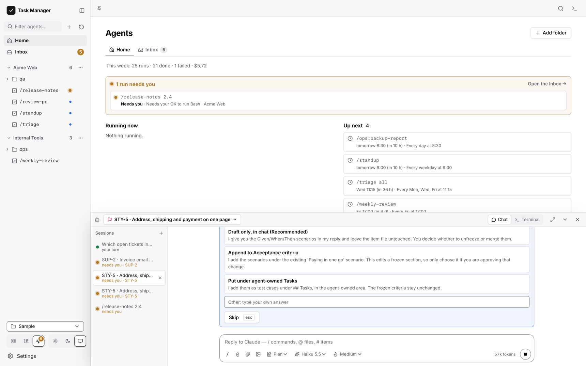

**Plan the work. Hand it to an agent. Review what it did.** All in the same place,<br>
on Markdown files in folders you choose — no account, no database, no cloud.

[Quick start](#quick-start) · [Agents](#agents-built-in) · [Plan and track](#plan-and-track) · [User guide](docs/user-guide.md) · [Install it with Claude](docs/install-with-claude.md)

</div>

## Why Local Task Manager

| 🤖 **Agents where the work is** | 📁 **Yours, in plain files** | 🧭 **Plan like a team** |
|---|---|---|
| Launch Claude Code on any task, or ask it anything from anywhere. Every session is kept with its work, to resume, review or reopen in another app. | Every task, note, meeting and doc is a Markdown file in a folder you choose. Open it in Obsidian, an editor or git: the app follows. | Boards, lists with filters and groups, day / week / month planning, goals on a canvas and a graph of how it all connects. |
| 🔒 **Private by design** | 🧩 **Structure that scales** | 🪶 **Nothing to install** |
| It listens on `127.0.0.1` and runs Claude Code with *your* login. Nothing leaves your machine unless you send it. | Projects as folders, with initiatives, stories, specs, support, hotfixes and records — and the rules that keep them honest. | Python's standard library and plain JavaScript: no `pip`, no `npm`, no build step. Clone it and run it. |

## Agents, built in

Your Claude Code commands, skills and subagents become **agents you can run, watch and schedule** — next to the
tickets they work on. Point the app at any folder with a `.claude/` and its commands show up, ready to run.

### Launch an agent from any task

**Work on it with Claude** starts a session with the item as its prompt: its fields, its description, its parent and
what it relates to. The session runs in the dock at the bottom of the page — a full chat with Claude Code, where you
answer its questions, approve or deny each tool it wants to use, attach any other item with `#`, a file with `@` or a
command with `/`, and switch model, effort and permission mode as you go.

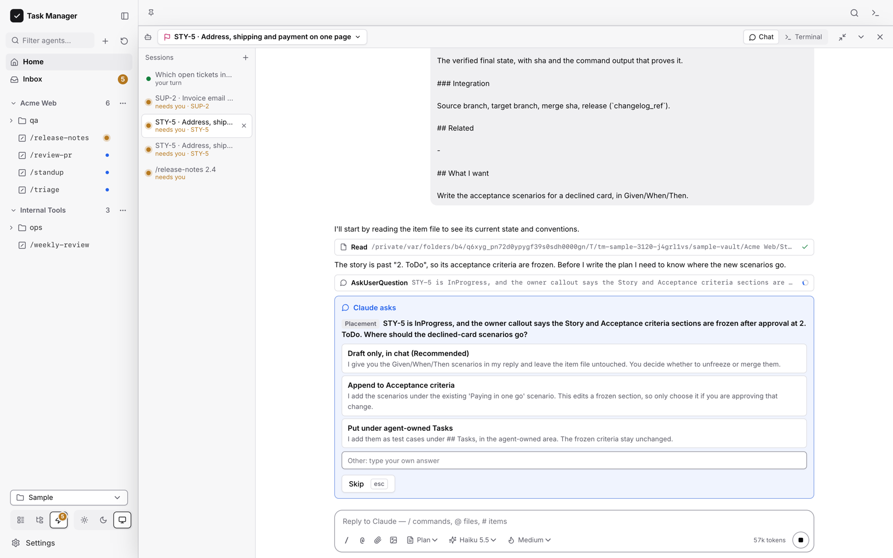

### …or ask anything, from anywhere

The Claude button in the top bar takes any prompt — or one of your saved prompts — in the folder, model and effort
you pick, with a preview of exactly what will be sent. Run it here, in the dock, or **Open in** Terminal, Claude
Desktop, Cursor or Antigravity.

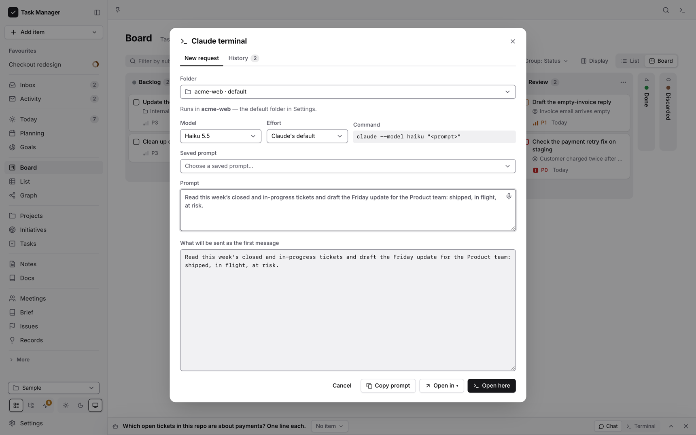

### Every session, kept with its work

An item's **AI Agents** tab is its history with Claude: each session, what was asked, when it last moved and where it
ran. Resume one in a click, star the main one, move it to another item — and **Add existing session** brings in one
you started outside the app, in a terminal or an editor, so nothing gets lost. The top bar's **History** does the
same for sessions that belong to no item.

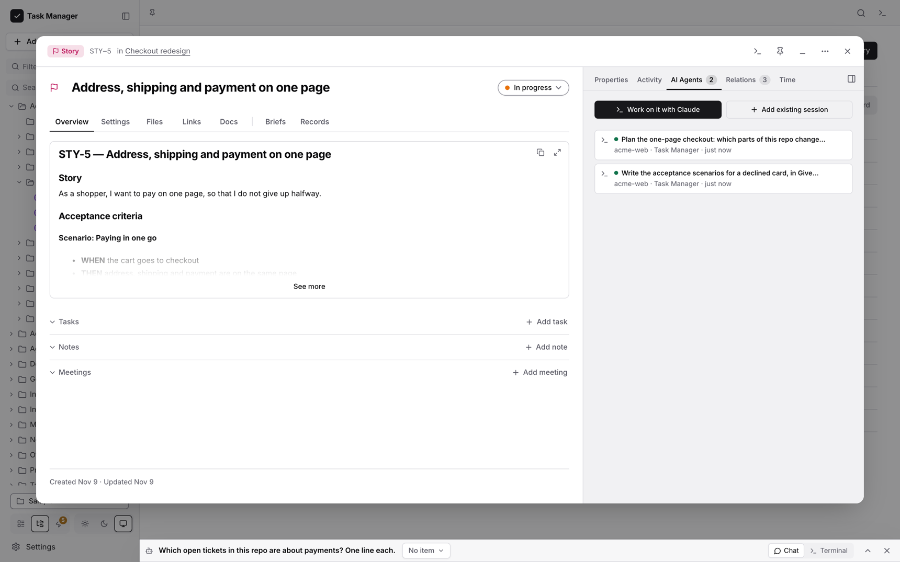

### One inbox for every run

Runs started here, from a terminal or by a schedule all land in the **Inbox**: what needs you first, what is still
running, what finished since you last looked. It is a full table — filter by status, agent, folder or where it
started, sort by any column, group by attention, status, agent, folder or day, or switch to a board. Each run shows
its time and cost, and opens with its transcript and the files it changed, diff by diff.

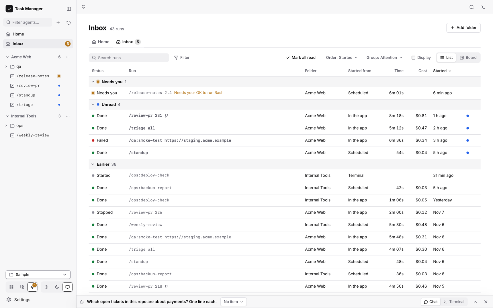

### Agents as first-class pages

Each agent has its own page: its instructions with a live preview and an editor, the skills and subagents it uses,
and its figures — runs in the last 30 days, success rate, usual time, cost and cost per run. **Run** it here or in a
fresh **git worktree** so it never touches your checkout, **Schedule** it in plain words (*every weekday at 9:00*),
or open it in another app.

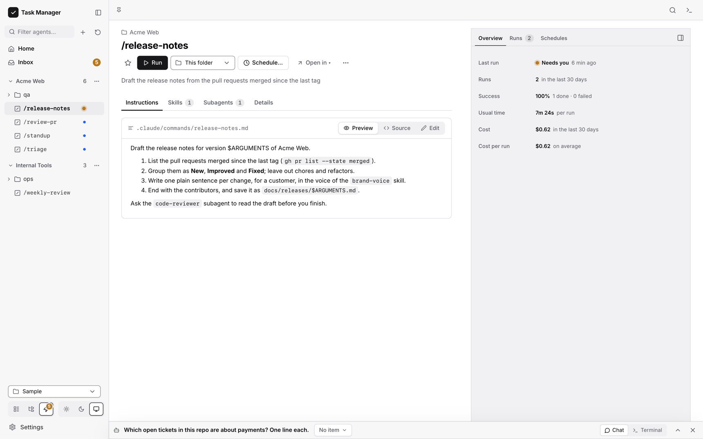

The **Agents home** (top of this page) puts it together: the runs that need your OK, what is running now, what runs
next, your most-used agents and the latest results with their cost.

## Plan and track

### Boards

Any list becomes a board: a column per whatever it groups by — status, priority, project, initiative, plan or goal —
cards you drag between them, columns you reorder and fold.

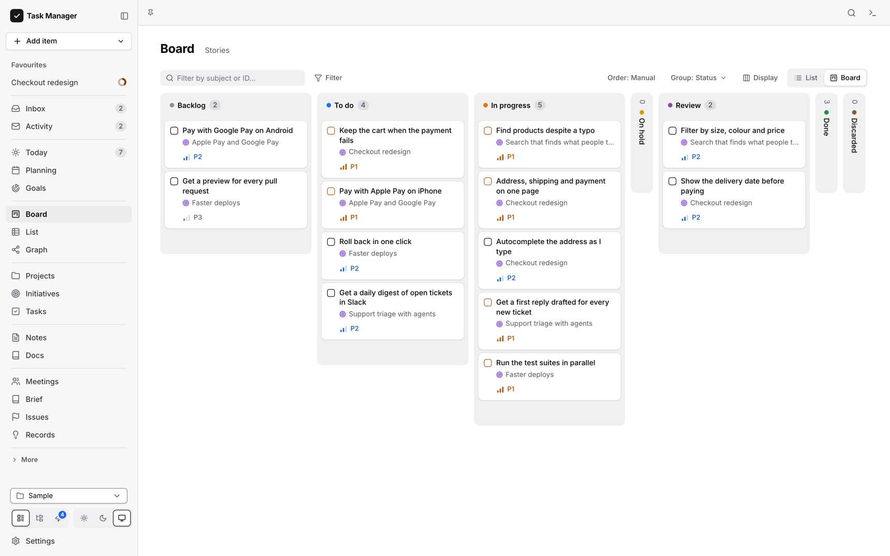

### Lists with filters, groups and saved views

Filter by any field with chips, order by any column, group by initiative, project, status, priority, plan or goal,
pick the columns to show — and save the result as a view of its own.

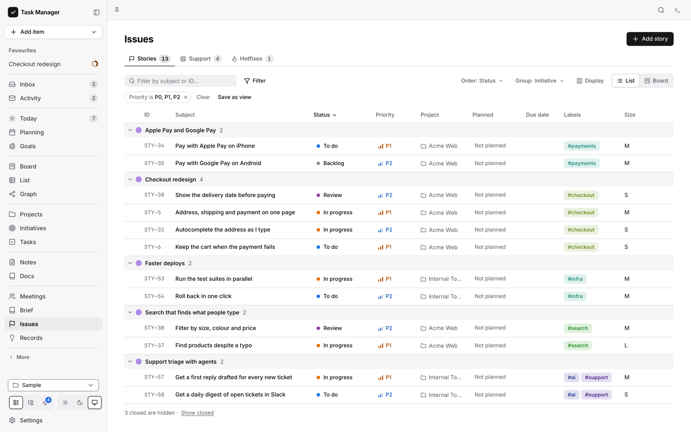

### Planning: the day, the week, the month

What is planned, what came over from before and what can happen any day, with meetings in their slot — as a list, a
board or a free board you arrange yourself.

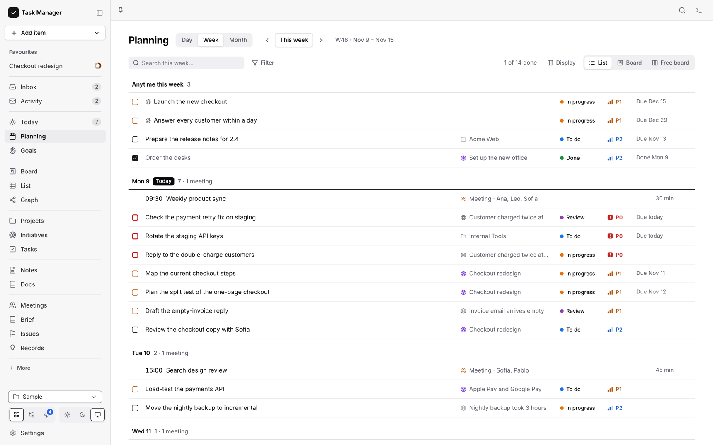

### Goals, as a board or a canvas

Goals gather the projects, initiatives, stories and tasks that move them. See them as a board, or lay them out on a
**canvas** — an Excalidraw whiteboard where goals are live cards next to your notes, shapes and arrows, saved in the
vault in the format Obsidian's Excalidraw plugin reads.

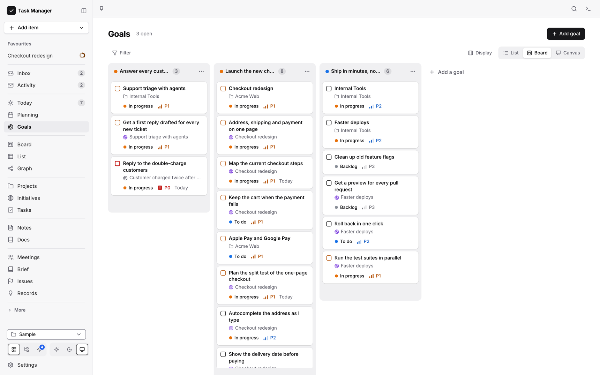

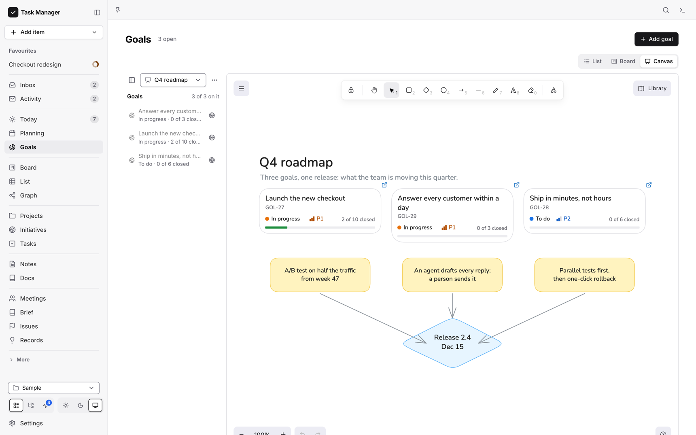

### The graph of your work

Every item and doc as a node, every link between them as an edge — coloured by type, filtered by project, grouped by
your own queries, like Obsidian's graph.

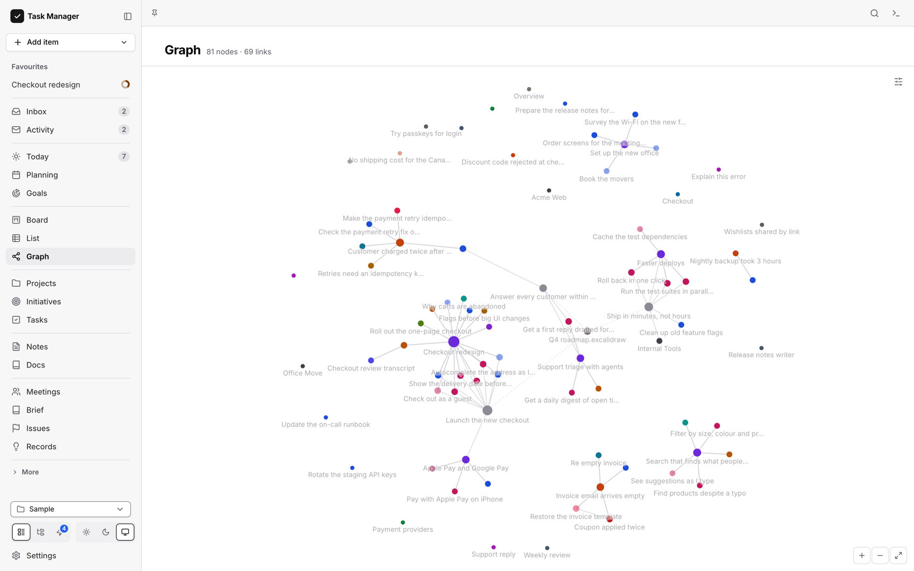

### Everything about an item, on one page

Its status on top, a Markdown description with a live preview, its stories, tasks, notes and meetings; on the side its
properties, activity, AI sessions, relations and the time logged.

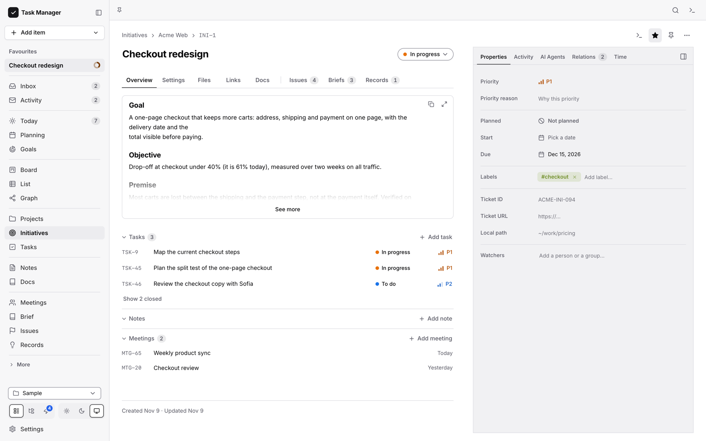

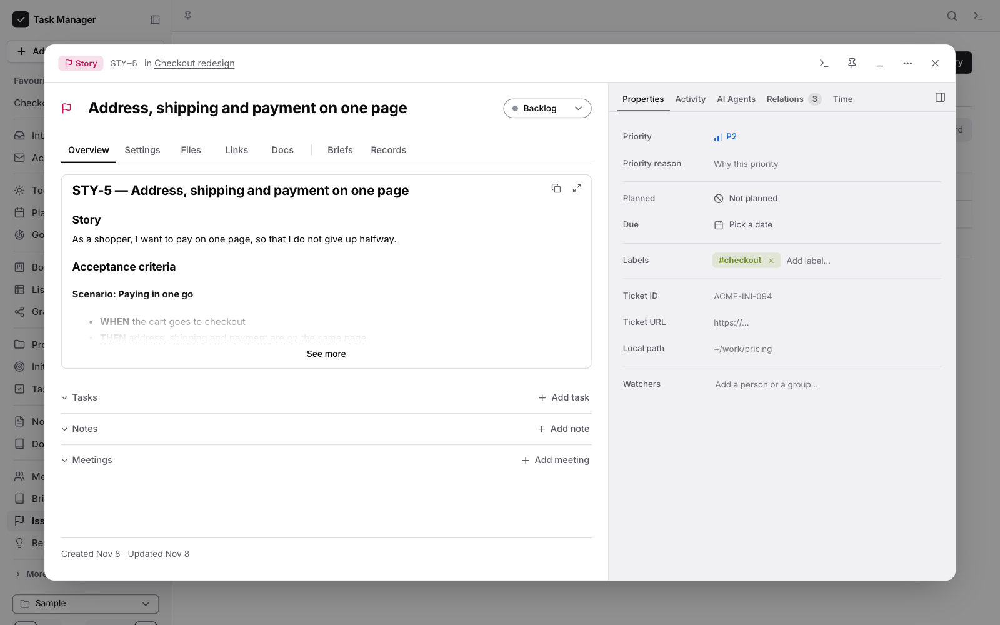

### Docs next to the work

Specs, guides and decisions live in the same vault as the tasks they explain: browse them as a tree, read them with
their outline, edit them in place or open them in your editor.

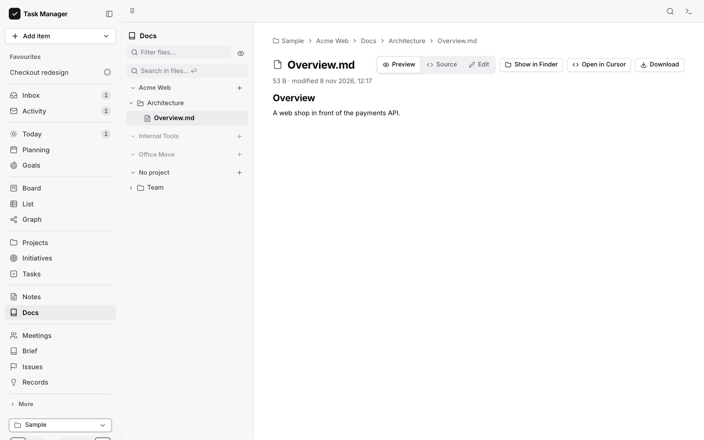

### Find anything in a keystroke

⌘K searches every item by id, title or text, jumps to any view and creates new things.

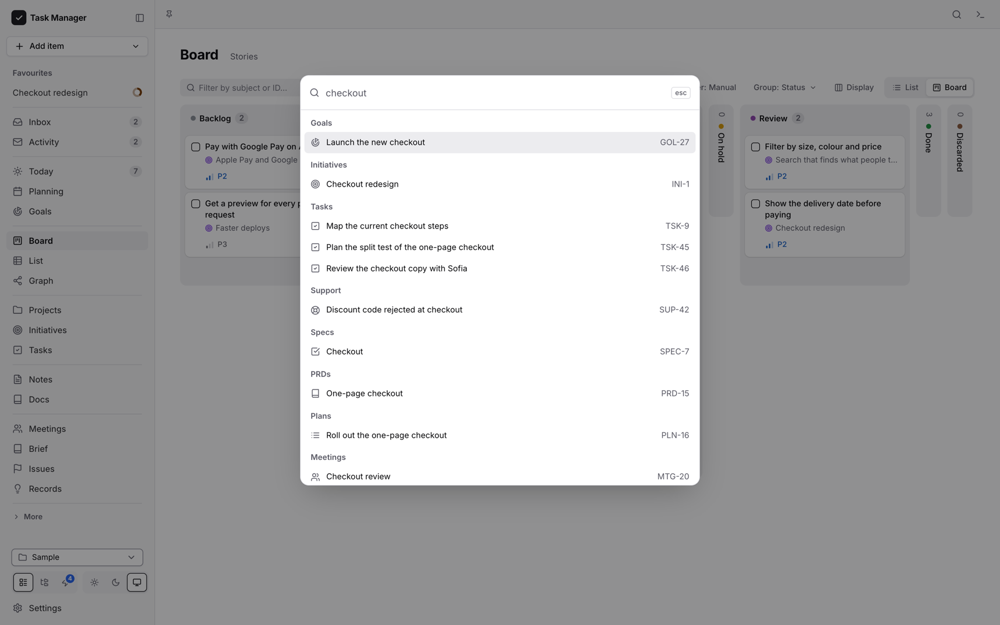

### And the rest

Today and Inbox for capture, meetings with their transcripts, contacts and groups to notify, labels, a work log with
the time spent, activities from email and Slack, a trash with undo, several vaults one switch away, light and dark themes,
an `AGENTS.md` and a command-line tool (`tools/vault.py`) so any agent can read and write the vault the way the app does.

## Quick start

```bash
git clone https://github.com/luisdomarco/local-task-manager.git local-task-manager && cd local-task-manager
python3 tools/serve_sample.py                  # → http://127.0.0.1:3101, on a copy of the sample vault
```

That opens the sample vault — a small product team's real week: three projects, goals, stories and tasks in every
status, meetings, docs and agents' prompts — on a throwaway copy, so try anything. That is all it needs: Python 3.9 or
newer, which comes with the Mac's Command Line Tools (`xcode-select --install`). For the agents, add a folder with a
`.claude/commands/` in **Settings → Agents**; Claude Code must be installed and logged in.
To set it up as a Mac app with your first
vault, paste the prompt in [`docs/install-with-claude.md`](docs/install-with-claude.md) into Claude Code. How to use it
day to day: [the user guide](docs/user-guide.md), also inside the app under **Settings → Documentation**.

[Contributing](CONTRIBUTING.md) · [Security](SECURITY.md) · [Changelog](CHANGELOG.md) · [MIT License](LICENSE)

---

The rest of this page is the full reference: setup in detail, the Mac app mode, every screen, the file formats and how
to develop the app.

## 1. What it is

A personal task manager whose only storage is **Markdown files** in folders you choose (*vaults*): no database, no
account, nothing sent anywhere. Each vault has a **structure** — *Initiatives* (one folder per item type, with user
stories), *Tasks* (the same without stories) or *Projects* (projects as folders, short ids: a number drawn `TSK-482`) — and every `.md`
that structure recognises becomes an item: initiatives,
tasks, notes, meetings, tickets… Edit the same files from Obsidian, an editor or Claude; the app picks the changes up.
A Python stdlib server plus vanilla JS, no build step, with Claude Code built in (launch a session on any item).

Contents: [1 What it is](#1-what-it-is) · [2 Setup](#2-setup-in-5-minutes) · [3 Mac app](#3-mac-app-mode) ·
[4 Feature map](#4-feature-map) · [5 Vault structures](#5-vault-structures) · [6 Development](#6-development) ·
[7 Reference](#7-reference). Working on the code with an agent? Start with [`CLAUDE.md`](CLAUDE.md).

## 2. Setup in 5 minutes

Rather have Claude do it? Paste the prompt in [`docs/install-with-claude.md`](docs/install-with-claude.md) into Claude Code.

### Requirements

- **Python 3.9 or newer** — the `python3` that ships with macOS (3.9) is enough. Nothing to `pip install` (see
  [Python version](#python-version)).
- **A modern browser** (Safari, Chrome, Firefox).
- **macOS** only for what opens other apps: *Open in Terminal / Claude Desktop / Cursor*, *Show in Finder*, a file's
  *Open in <its app>* and the
  [Mac app mode](#3-mac-app-mode). Everything else, the embedded Claude terminal included, runs on Linux too.
- **Node 20+** only to run the frontend tests. The app never needs it.
- **[Claude Code](https://claude.com/claude-code)** (`claude` on your PATH, logged in with *your* account) only for
  [Work with Claude](#work-with-claude).

### Python version

- **Standard library only.** No `pip install`, no virtualenv, no `requirements.txt`: any Python 3 from **3.9** up
  runs the app and its tools.
- **On a Mac,** `/usr/bin/python3` (3.9.x) comes with the Command Line Tools. If `python3` is missing, run
  `xcode-select --install`. A python.org or Homebrew 3.x works too. `python3 --version` tells you which one your PATH
  picks first.
- **`python3 server.py`** runs with that first `python3` on the PATH. Name another explicitly if you prefer:
  `/usr/bin/python3 server.py`.
- **The [Mac app](#3-mac-app-mode)** runs with the interpreter that ran `tools/install_app.py`: the installer writes
  its real path into the LaunchAgent. To switch, run the installer again with the other one, e.g.
  `/usr/bin/python3 tools/install_app.py`.
- **The Python tests** run on 3.9 and on 3.12, and must keep running on 3.9: no 3.10+ syntax (`match`) and no 3.11+
  APIs (`unittest`'s `enterContext`, for one). **Node 20+** is only for the JS tests.

### Run it

```bash
python3 server.py                          # → http://127.0.0.1:3100 (TM_PORT=3105 python3 server.py for another port)
```

Without a `config.json` it opens the bundled `sample-vault/`. That folder is versioned, so anything you create there
shows up in `git status`; to look around without writing into anything of yours, use a throwaway copy instead:

```bash
python3 tools/serve_sample.py              # → :3101, a temp copy of sample-vault/ with its own temp config.json
python3 tools/serve_sample.py --legacy     # the same plus a temp copy of sample-vault-legacy/ (Initiatives)
```

Both leave your `config.json` and your vaults alone: everything they write lives in a fresh folder of the system's
temp dir, whose path they print.

### Your first vault

1. **Make the folder** (`mkdir ~/Documents/my-vault`). An empty folder starts a **Projects** vault; a folder
   already full of notes must already have the structure's shape (see [5](#5-vault-structures)).
2. **Settings → Vaults → New vault** (Settings is at the foot of the sidebar). The dialog has three tabs:
   - **General:** a name, the folder (absolute, `~/…`, or relative to this app's folder; it must exist; on a Mac,
     *Choose…* beside it picks it in a Finder dialog, and in the iPhone app in Files, iCloud Drive included), its
     **structure**, **Projects**, and *Default* for the one that opens first. *Initiatives (legacy)* and *Tasks (legacy)*
     are there only to open a folder that already is one of their vaults: on an empty folder the save is refused.
   - **Item types:** untick the types you will not use.
   - **Features:** untick what this vault does without — AI Agents, Canvas, Inbox, Activity, Goals, Graph, Meetings &
     transcription, Work log, Contacts (see [Features per vault](#features-per-vault)).
   - **Default texts:** once the vault is added, a Projects vault sets here the text each type starts with (see
     [What a new item starts with](#what-a-new-item-starts-with)).
3. **Add vault.** The name, the folder and the default go to `config.json` (git-ignored; the first save keeps a copy
   of the old one in `backups/`): they are this device's. The item types and the features go into the vault, in
   `.task-manager/settings.json`: every device that opens the same folder (the Mac, the iPhone app over iCloud Drive)
   shows the same types. A vault whose folder is later moved or deleted outside the app stays in the list with
   *Folder not found*: edit it to give its new place, or remove it.
4. **Switch to it** with the vault selector at the foot of the sidebar. A new vault opens in the **Explorer** (the
   sidebar's file view): click **Project**, the first of the two buttons at the foot of the sidebar (under the vault selector), to see the vault
   as items (see [Sidebar modes](#sidebar-modes)). Until its folders exist, that page says *does not match its structure* and offers **Create the N missing
   folders** — empty folders only, no file is touched.
5. **Projects only:** tickets usually live in a project, so start with **Add item → Project** (a name and a key of 2–4
   capital letters, e.g. `DP`). The project's folder and its type folders are made with it. A ticket may also be in
   no project: it then lives in its type's folder at the top of the vault (`Initiatives/`, `Stories/`…).

Several vaults are fine: each is independent (its items, labels, people, statuses and view preferences are its own),
and the address says which one you are on (`?vault=<id>`). Two vaults cannot overlap (one inside the other), and
removing a vault from the list only forgets it: its files stay on disk.

### `config.json`, field by field

Settings writes it; you rarely need to edit it by hand. [`config.example.json`](config.example.json) shows the shape.
Every field is optional.

| Field | What it is | Set from |
|---|---|---|
| `vaults` | `[{id, name, path, structure, folders?, disabled_types?}]`. `id` is made from the name on the first save and never changes (it is in the address and in each vault's export). `structure` is `ticketing` (Projects), or one of the legacy `folders` (Initiatives) and `tasks` (Tasks): the ids never changed when the structures were renamed. A vault saved without one is read as `folders`, which it was when it was written; a config with no `config.json` at all opens `sample-vault/` as Projects. `folders` (Initiatives and Tasks only) moves a type's folder: `{"task": "work/tasks"}`. `disabled_types` is where a vault's hidden types were kept before they moved into the vault (`.task-manager/settings.json`): read only while the vault keeps no settings of its own, moved into it when the app starts, and dropped from here at the next save. | Settings → Vaults |
| `default_vault` | The id of the vault that opens when the address names none. | Settings → Vaults |
| `root`, `folders` | The default vault's path and folders, kept equal to it on every save, for the tools in `tools/` and for a config written before there were vaults (its `root` becomes the one vault). | automatic |
| `port` | Where `server.py` listens (default 3100). `TM_PORT` in the environment wins. | by hand |
| `work_kinds` | The kinds of work a work-log entry can have. | Settings → General |
| `editor_app` | What *Open in …* in the Explorer uses: Cursor, Visual Studio Code, Zed, Sublime Text, BBEdit or TextEdit. | Settings → General |
| `claude_command` | How Claude Code is started (`claude`; extra flags allowed). Give the full path if the server's PATH does not have it. | Settings → Claude |
| `claude_paths`, `claude_cwd`, `claude_path_names` | The saved folders Claude may start in (a closed list: the browser picks one, never types one), the default among them (`""` = this app's folder) and a display name for each. | Settings → Claude |
| `claude_model`, `claude_effort` | Default model and effort for a launch (`""` = Claude's own default). | Settings → Claude |
| `terminal` | `Terminal` or `iTerm`, for *Open in Terminal*. | Settings → Claude |
| `agent_dirs`, `agent_dir_names` | The agent folders of the sidebar's Agents mode (absolute, existing; a closed list, apart from `claude_paths`: the page names a folder by its id, never by its path) and the name the sidebar shows for each. | Settings → Agents, or **+** in the sidebar's Agents mode |
| `sync` | Settings for commands of your own that sync the vault with outside systems (your email, which calendar…). The app itself never reads it. See [Your own commands, skills and agents](#your-own-commands-skills-and-agents). | by hand, or by those commands |

Secrets never go in `config.json`: a token for an external system goes in `.env` (copy
[`.env.example`](.env.example); git-ignored), and connectors (a calendar, a chat) belong to your own Claude account.

## 3. Mac app mode

The app as something you open from the Dock, without a developer account, a database, or a terminal left running
`python3 server.py`:

```bash
python3 tools/install_app.py               # install (or reinstall) and start it → http://localhost:3200
python3 tools/install_app.py --update      # copy this checkout's code over the app's, and restart it
python3 tools/install_app.py --uninstall   # stop it and take it out (its config.json stays, for a later install)
python3 tools/install_app.py --dry-run     # say what it would do, do nothing
```

- **Why a separate folder.** The installer copies the code to `~/Library/Application Support/TaskManager/app` (copied,
  never linked), so the app you use every day never runs a half-finished change from this checkout. Work in progress
  reaches it only when you run `--update`. It copies only what runs (`server.py`, `tm/`, `static/`, `docs/`, `tools/`,
  `sample-vault/`, `sample-vault-legacy/`, `README.md`, `CHANGELOG.md` (the version Settings → Documentation shows), `package.json`, `config.example.json`): no `.git`, `tests/`, `plans/` or `.claude/`.
- **Its own settings, the same vaults.** Its `config.json` is made once from this checkout's, with port **3200** (so
  the checkout on 3100 and the app can run at once) and relative vault paths made absolute; it is never overwritten
  after, not even by `--update`. The vaults stay where they are, so both see the same files.
- **On when you open it, off when you stop it.** A LaunchAgent (`~/Library/LaunchAgents/com.taskmanager.app.plist`)
  has launchd listen on 127.0.0.1:3200 while the app is off: nothing runs. Opening the page is the first connection;
  launchd starts the server and hands it that socket (`tm/launchd.py`). It runs with the `python3` that ran the
  installer, and a PATH that includes `~/.local/bin`, `/opt/homebrew/bin` and `/usr/local/bin` (where `claude` usually
  is).
- **Woken for scheduled agent runs.** A second LaunchAgent (`com.taskmanager.app.wake`) runs `tools/agents_wake.py`
  every 5 minutes: when an agent's schedule is due (§7 *Agents*), it connects to the app, which starts it; with none
  due it does nothing and the app stays off. `--update` adds it to an app installed before it existed; its log is
  `~/Library/Logs/TaskManager/wake.log`.
- **Settings → Desktop app** shows how the server runs (on demand or by hand, since when, which port) with **Stop server** and
  **Restart**. Once stopped, nothing runs until the next opening starts it again.
- **In the Dock.** Open `http://localhost:3200` in Safari and choose *File → Add to Dock*, or in Chrome *⋮ → Cast,
  save and share → Install page as app*. It gets its own window and the check icon (`static/manifest.json`,
  `static/icons/`).
- **Logs:** `~/Library/Logs/TaskManager/server.log` (output and errors).
- **`install.json` points back at the checkout.** The installer writes the path of the checkout it came from into the
  app's folder. Two things use it, because the copy has no `.git`, `tests/` or `.claude/`: **Settings → Export** makes
  the system and agents zips from that checkout and keeps them in its `versions/` (both the app and the checkout list
  the same zips), and **Claude** starts in that checkout when neither the item nor Settings names a folder. If the
  checkout is moved or deleted, the app exports only vaults; reinstall from the new place to fix it.
- **Port in use.** If 3200 (or 3100 for `server.py`) is taken, the server says which address already answers and exits
  instead of failing with a traceback: open that one, or start yours with `TM_PORT=<another port>`. To see who holds
  it: `lsof -iTCP:3200 -sTCP:LISTEN`.

## 4. Feature map

One line per area; each links to its reference section.

- **Views** — Inbox, Today (a board of your own columns), Planning (Week, Next week, Month), one list per type, an initiative's (or
  a Projects vault's project's) page, Board, List (every item), Graph, Work log, Labels, Contacts, Trash, Settings. → [Views](#views)
- **Graph** — every item and doc as a node and every link between them as an edge (parent, project, link fields,
  relations, [[links]] in the text), as Obsidian's graph view; each item's Relations has its own small one. → [Views](#views)
- **The vault from the shell** — `tools/vault.py` reads and writes a vault with the app closed (overview, find, show,
  graph, new, set, move, link, comment), through the app's own rules: for agents and scripts. An opt-in `AGENTS.md`
  tells any agent opened in the vault's folder how. → [The vault from the shell](#the-vault-from-the-shell), [The vault's
  guide for agents](#the-vaults-guide-for-agents)
- **Items and their cards** — the card, relations (parent, related, their kinds), pins, minimized cards, comments, Undo.
  → [Views](#views), [Data model](#data-model)
- **Search and keyboard** — ⌘K searches items (grouped by type), views and files, and runs commands; `g` + a key
  jumps to a view. → [Search and keyboard](#search-and-keyboard)
- **Quick add and Inbox** — `q` captures a line; tokens set its type, plan, priority and parent; Inbox items convert
  to any type. → [Quick add](#quick-add), [Inbox items](#inbox-items)
- **Planning** — Today / Week / Next week / Month by date, carried-over items, free boards for the week, Board
  lists mapped to statuses. → [Week / Today](#week--today), [Board lists ↔ status](#board-lists--status)
- **Statuses** — per vault and per type, each in a fixed group (Not started · In progress · Closed).
  → [Statuses and their groups](#statuses-and-their-groups)
- **Work log** — time per item per day, one file per day, suggestions of what you forgot to log. → [Work log](#work-log)
- **Explorer** — the vault as files: preview, edit, search in files, CSV as a table, drag files in from Finder.
  → [The Explorer](#the-explorer)
- **Sidebar modes** — Project (the views), Explorer (the files) and Agents (your Claude Code commands), remembered per
  vault. → [Sidebar modes](#sidebar-modes)
- **Agents** — the commands in the `.claude/commands` of any folder you add (a repository, a system, outside every
  vault), each with its page, run from the app as a chat in the dock. → [Agents](#agents)
- **Docs** — a view (⌘⇧D) of the vault's documents, which are never items: trees on the left, the doc and its
  properties on the right. → [Docs](#docs)
- **Work with Claude** — launch Claude Code on any item, in the embedded terminal dock or in Terminal, Claude Desktop,
  Cursor or Antigravity; sessions are recorded on the item and resumable. → [Work with Claude](#work-with-claude)
- **Dictation** — the mic in the description editor writes what you say at the cursor (the only field of an item with one;
  the quick adds of Inbox, Today, Week and Board keep theirs).
  → [Description editor](#description-editor)
- **Your own commands** — add Claude Code commands, skills and agents that work on the vaults (syncs, briefs,
  triage). → [Your own commands, skills and agents](#your-own-commands-skills-and-agents)
- **Export** — the system, the agents or a vault as zips to carry between machines; backups are kept apart.
  → [Exporting the system](#exporting-the-system)
- **Trash and safety** — delete goes to a trash you can restore from; atomic writes, one writer at a time even across
  programs; a description changed on disk is never silently overwritten; ids are never reused. → [Deleting](#deleting), [Safe against edits from
  outside](#safe-against-edits-from-outside)

## 5. Vault structures

A vault is a folder plus the name of its structure. The structure (`tm/structures/`) says which folders it has, which
files are items and what their ids look like. The app **shows a vault only while its folder matches**; until then it
reads nothing from it and writes nothing into it, and says why.

Three structures, by the name Settings → Vaults shows (and the id `config.json` stores): **Projects** (`ticketing`),
the one a new vault gets, which holds every kind of project; and the **legacy** **Initiatives** (`folders`) and **Tasks**
(`tasks`). A legacy vault works as ever, but a quiet line under the vault selector (*Legacy structure · move to
Projects*) leads to its row in Settings → Vaults, which says how to move it ([Moving a vault to
Projects](#moving-a-vault-to-projects)). A legacy structure is offered only for a folder that already is one of its
vaults; both leave the app once every vault is moved.

### Initiatives (legacy) — one folder per type

```
my-vault/
├── initiatives/     INI-0001-….md   the project or epic; the only type with a page of its own
├── stories/         US-0001-….md    user story, hangs from an initiative
├── tasks/           TSK-0001-….md   hangs from an initiative or a story
├── notes/           NOTE-0001-….md
├── meetings/        MTG-0001-….md   date, time, duration, attendees
├── transcriptions/  TRN-0001-….md   hangs from a meeting
├── activities/      ACT-0001-….md   an email or message pasted in, closed once resolved
├── inbox/           INB-0001-….md   quick captures
├── prompts/         PRM-0001-….md   reusable prompts for Claude
├── agents/          AGT-0001-….md   optional: made with the first agent
├── worklog/2026/    2026-10-19.md   the work log, one file per day
├── docs/                            documents, never items (the Docs view)
└── .task-manager/                   the app's own: board, pins, labels, people, groups, statuses, trash…
```

The structure this app was built on, and the one `sample-vault-legacy/` has. An item is any `.md` with `type: <type>` in its frontmatter; its id is `PREFIX-NNNN`. Folder names can be moved per
vault (Settings → Vaults → *Folders for new items*). Statuses Backlog · ToDo · OnHold · Blocked · InProgress · Review
· Done · Discarded; priorities Urgent · High · Normal · Low; external reference: a ticket system (`ticket_id`, `ticket_url` and `tracker`,
with a `local_path`, on initiatives, stories, tasks and agents).

### Tasks (legacy) — Initiatives without user stories, with projects

The same files, ids, folders and statuses as Initiatives, less `stories/` and the Story type: a task hangs straight
from an initiative, and an initiative's page has Epics, Tasks, Notes and Meetings. Its types are Project, Initiative,
Task, Note, Meeting, Transcription, Activity, Inbox, Prompt and Agent. A folder with a `stories/` folder is an
Initiatives vault, not a Tasks one (and a Tasks vault lacks the `stories/` an Initiatives one needs).

**Projects** are a simple version of a Projects vault's: `projects/PRJ-0001-<slug>.md`, a folder that is optional
(made with the first project, so a Tasks vault from before still matches). A project has a **key** of 2–4 capital
letters, unique in the vault and fixed once made; its own statuses **Backlog → ToDo → OnHold → InProgress → Done**, or **Discarded**
(Done and Discarded close it); planned like the work it holds (Planned · Start · Due on one row, so it shows in Today,
Week and Month); a priority and its reason, an **area** and an **objective**, a **start** and a **due** date, a **local path** (where Claude
starts for any of its work that has none of its own), its ticket, links, labels, docs, watchers and comments; and a
body that starts from Goal · Scope · Notes. Initiatives, tasks, notes, meetings, transcriptions, agents and activities
are **in a project by its key** (`project: WEB`), next to `related_to`, which stays the hierarchy: a task can be in a project without an
initiative, and moves to another project by changing that one field (the key is not part of any id). Their lists get a
Project column and *Group by project*; a project's page (`#/project/PRJ-0001`) shows its key in the crumbs, and tabs of its Tasks, Initiatives, Notes and Meetings, each with its quick add.

### Projects — projects as folders

The structure a new vault gets, and the one `sample-vault/` has (a project of each kind). The native format of the
*ticketing second brain*, Obsidian-friendly (`fileClass` instead of `type`, wikilinks):

```
my-tickets/
├── Demo Product/                    a project: key DP, kind product
│   ├── 00 Demo Product.md           the project note: fileClass Ticket Project, project_key, enabled_types…
│   ├── Initiatives/  INI-1 <Title>.md
│   ├── Stories/      STY-2 <Title>.md  an initiative's deliveries (made with the first story)
│   ├── Specs/        SPEC-3 <Capability>.md  what the system does today (made with the first spec)
│   ├── Support/      SUP-4 <Title>.md
│   ├── Hotfixes/     HFX-5 …            (when the project enables hotfix: product projects)
│   ├── PRDs/         PRD-6 …            (when it enables prd)
│   ├── Plans/        PLN-7 <Title>.md   one from before plans had ids: INI-1 Plan.md (its item's)
│   ├── Analyses/     ANL-8 <Title>.md   one from before: 2026-10-19 <Title>.md
│   ├── Records/Errors/     ERR-9 …
│   ├── Records/Learnings/  LRN-10 …
│   └── Docs/                        the project's documents (optional)
├── Tasks/  Notes/  Meetings/  Inbox/  Activities/    the app's own types, TSK-11 …, with or without a project
├── Agents/  Prompts/  Transcriptions/   optional: each is made with its first item (AGT-12, PRM-13, TRN-14)
├── Goals/   GOL-15 <Title>.md      optional, made with the first goal: what to put first, across projects
├── Initiatives/  Stories/  Support/ …  optional: the tickets in no project, each in its type's folder (made with the first)
├── Work log/
└── Docs/                            optional
```

**Ids are short.** An item's `id` is a plain number from one counter per vault, shared by every type and never
reused (`id: 482`); the app draws it with its type's prefix, `STY-482` — in tables, cards, the file name, the work
log and links. Search and the address bar take `482`, `STY-482` or an id from before (`ACME-STY-001`, kept in the
item's `aliases`); an API ref with the wrong prefix (`TSK-482` for a story) is not found and the error names the
right one. A vault made before short ids keeps its long ids (`ACME-STY-001`) and keeps working until it is moved
(below).

A project's **kind** (`project_kind`) is chosen when it is made and never changes; it decides which types of its own
folders it has (`tm/structures/kinds.py`):

| Kind | Its own types | Settings it has |
|---|---|---|
| **Product** (`product`) | initiatives, stories, support, specs, plans, analyses, errors, learnings; hotfixes and PRDs unless it turns them off | execution, support due days, repo, managed by |
| **Agentic system** (`system`) | the same without hotfixes (an urgent fix is a C1 support ticket, fixed in place) and PRDs | the same |
| **Simple** (`simple`) | initiatives; analyses when it turns them on | none of those: nothing is delivered |

Tasks, notes, meetings, transcriptions and agents are the vault's own and go in a project of any kind. A ticket of a
type its project does not have is refused (an optional one says to turn it on in the project's Types), and so is a
change of kind once its note names one (a note that names none, or one not known, may be given one; until then it reads
as Product and the vault check warns). A simple project's initiative has no readiness (size, regime, premise), no PRD nor
plan, and its gate to ToDo asks for no story; the settings its kind lacks are neither written in its note nor kept from
the create form, and an edit of them is refused. A type its kind lacks in a note's `enabled_types` (a system project's
`hotfix`, from before kinds) is dropped when the project is saved; the files already in that type's folder are still
read, and the vault check warns that no new one can be added.

The page follows the kind. The create form offers a project's Types only for the kind's optional types (an agentic
system has none, so no Types), and switching the Kind redraws the form with that kind's settings. A ticket's Project
lists only the projects that may hold its type, and once a project is chosen the type picker offers only what that
project holds: choosing a project that does not hold the chosen type goes back to a task, and choosing a type the
project does not hold leaves the project to choose again. A list's *Add …* button fills in its project only when that
project holds the type. A card, a page and the create form leave out the fields its project's kind hides (a simple
initiative shows no Readiness, PRD, Plan or Origin), and a card or page lists no table of a type its project's kind
lacks unless it already holds some (a system's support ticket shows no Hotfixes; one written before kinds lists them,
with no *Add*). The sidebar, *Add item* and the ⌘K palette leave out a type that no project of the vault may hold and
the vault has none of: a vault of simple projects lists no Stories, Support or Specs. A vault with no project yet keeps
them all.

A new project's note gets everything its create form filled in — its settings (checked as an edit of them is), sessions, labels,
links — and the folders of the types it has (the optional ones it ticks, else its kind's). A ticket's file is named `<ID> <Title>.md`; its project is its folder: chosen on creation, and moved
from its Relations (*Move to another project*) in a vault with short ids, with what hangs from it in that project. Statuses are written `status_ticket: "5. Review"` and their names and order are fixed
(only colours and the Not started / In progress split can change); priorities P0–P3. A project's note is the same
container a Tasks project is: Backlog → ToDo → OnHold → InProgress → Done, or Discarded, in `status_project`, a priority,
an area and an objective, a start and a due date, planned like its work, watchers and docs. The format's rules (support
levels and due dates, Promote, Escalate, the ToDo gates, discard reasons, hotfix rollback and post-mortem) are enforced
in `tm/structures/ticketing/rules.py`. **The allowed moves and their gates bind a script or an agent**, which says so
when it writes (`"by": "agent"` in `POST /api/item/update`); **in the app you move a status anywhere**, and the
status log records who did (`by: owner` or `by: agent`). The automatic moves below happen either way.

An initiative is the objective; what gets delivered are its **stories** (`DP-STY-001`, one branch and one pull request
each, linked to it by `initiative:`). An initiative is ready (ToDo) with its size, regime, a verified premise and at
least one story; a story is ready with its initiative approved (ToDo or later), at least one acceptance scenario
written under `## Acceptance criteria` (a `- **WHEN** …` line that says something) and its spec impact declared
(the specs it changes, or `none: <why>`). The initiative follows its stories: it goes In progress
when the first one starts, and Done when the last one closes with at least one done; it cannot be put in Review or
Done by hand while a story is open. In a serial project, *one at a time* counts stories, support tickets, hotfixes and
PRDs, never the initiative that groups them. Stories replace the initiative's old `kind: umbrella / slice`; a PRD
names the initiative it became in `initiative:` (an older `umbrella:` is still read).

A **spec** (`DP-SPEC-001`, a tab of **Brief** in the sidebar) says what one capability of the project's system does today,
as it is in production: `## Requirements`, each `### Requirement:` with SHALL or MUST and at least one
`#### Scenario:` with a written **WHEN** and **THEN** (the format of OpenSpec, kept in the vault). Its statuses are its
own — draft · active · retired — and it is active only when that text is valid (`ticketing/specs.py` says what is
wrong). A story's *Spec delta* is what will change; when the story ships it is merged into the spec, which records the
commit (`synced_sha`, `synced_date`) and the stories that changed it (`stories`). Writing a file changes only the keys the app changed (`codec.py`): key order,
comments, unknown keys and the body stay as they were.

A **goal** (`GOL-15`, in `Goals/` at the vault's root) says what to put first, across projects: it is made of
projects, initiatives, stories and tasks, each of which names it in `goal: "[[GOL-15 <Title>]]"` (one goal at most)
and keeps its place among the goal's items in `goal_order`. A goal has a subject, a description (`description:`, Markdown
in that one field; the file's body is not used), labels, a start, a due date, a plan, a priority and its reason, and the basic statuses in `status_goal` — To do,
In progress, Done, Discarded —, moved by hand: closing its items does not close it. Notes hang from it by
`related_to`, as from any item. Deleting a goal clears `goal` and `goal_order` on its items; restoring it puts them
back. Only a Projects vault has goals.

#### What a new item starts with

A new item's file is its frontmatter and the **default text** of its type in that vault — never its title (that is
its file's name) nor an empty `## Related`. The texts live in the vault, one file per type in
`.task-manager/templates/<type>.md`, so every device that opens it (the Mac, the iPhone app) and every agent and
command line that writes to it start alike. A Projects vault gets them **once**, at its first write, from
`tm/structures/ticketing/default_texts/` (a story's, a spec's, a PRD's sections…; a task, a note or an inbox item has
none and starts empty); after that they are the vault's own: change or empty them in **Settings → Vaults → ✎ → Default
texts**, and an emptied or deleted one never comes back. The create form starts its Description with
it and follows the type while you have not typed in it; sent as it is, the server fills its placeholders —
`{{ref}}`, `{{id}}`, `{{title}}`, `{{project}}`, `{{key}}`, `{{date}}`, `{{slug}}`, and a plan's `{{item_ref}}` and
`{{item_title}}`, the item it executes. A quick capture, `tools/vault.py new` without `--body` and an agent that sends
no body get it too; an inbox item converted keeps what was captured, then the new type's text, as does a task promoted
with `/dev:promote`. A legacy vault keeps each type's own sections and has no default text to set.

### What the check blocks and what it only warns about

`tm/structures/check.py` (Initiatives and Tasks) and `tm/structures/ticketing/check.py` (Projects) compare the folder with its structure. Hidden
folders (`.task-manager`, `.obsidian`, `.git`), `node_modules`, `__pycache__`, `Attachments/` and the Docs folders are
never looked into.

| Blocks the vault (not shown, nothing written) | Only warns (shown in the notice, the vault works) |
|---|---|
| The vault folder does not exist | A file that is not Markdown (ignored) |
| A folder the structure needs is missing — **the only case the app can fix** (*Create the missing folders*) | A `.md` with no `type` / no known `fileClass` (ignored) |
| A top-level folder the structure does not know (Projects: one that is not a project either) | An item outside its type's folder (Initiatives, Tasks) |
| A file whose `type` is not part of the structure | A loose file at the top of a Projects vault |
| An id that is malformed, of another type or project, or used twice | An item put inside a Docs folder (the app does not see it there) |
| An iCloud placeholder (`.Name.md.icloud`: not downloaded yet) or an unreadable file. A note iCloud has only by name (written on another device, its content not here yet) is downloaded when the app reads it, the app on :3200 and the iPhone app too (`fsutil.download_on_read`); offline, it says *Not downloaded from iCloud yet* | A work-log day outside the work-log folder |
| Projects: a project folder without a valid `00 <Folder>.md` (fileClass Ticket Project, unique 2–4 letter key), a type folder a project needs missing or one it does not know, a ticket in another type's folder, a ticket without an id (but a plan or an analysis from before they had ids, named as it was), a ticket file not named `<ID> <Title>.md` | |

In an Initiatives or Tasks vault an item without an id is fine (Settings → Maintenance assigns ids). Settings also refuses to save a new vault
whose folder clearly holds *another* structure, and the notice of an existing one says which structure it looks like.

### Moving a vault to Projects

Projects holds every kind of project in one vault, so an Initiatives or Tasks vault can be moved into it.
`tools/migrate_structures.py` writes a **new** folder and never touches the old one. It runs in three steps:

1. `--plan` proposes the projects (a Tasks project, or an initiative with sub-initiatives) and asks where the rest go.
2. `--apply` writes the new vault, once each project is confirmed and each question answered.
3. `--check` compares the new vault with the source.

Ids keep their number (`INI-0001` → `KEY-INI-0001`, `US-0001` → `KEY-STY-0001`, `TSK-0001` stays). A changed id is
kept in the item's `aliases`. Blocked becomes On hold. [docs/migrate-structures.md](docs/migrate-structures.md) is the
step-by-step guide, written for Claude to follow with you, with every mapping.

### Moving a Projects vault to short ids

`tools/migrate_short_ids.py` gives every item of a Projects vault with long ids (`ACME-INI-001`) its number, in a
**new** folder, the source never written: `--plan` numbers them oldest first, starting above every old number (so
`TSK-12` is never an old `TSK-012`), and lists the texts that name an old id in passing; `--apply` writes the new
vault — each file renamed to `INI-482 <Title>.md` and every wikilink to it rewritten, its id patched in place and the
old one added to its `aliases`, the work log, history and pins moved over —; `--check` compares it with the source.
[docs/migrate-short-ids.md](docs/migrate-short-ids.md) is the guide, written for Claude to follow with you.

## 6. Development

### Code layout

```
server.py               HTTP server and routes (127.0.0.1 only; POSTs need the X-Task-Manager header); config.json
tm/store.py             one vault: scan, ids, CRUD, validation, board, work log, files, trash
tm/frontmatter.py       parse / build / patch frontmatter (a patch keeps the lines it does not know)
tm/fsutil.py            crash-safe (atomic) writes
tm/structures/          what a vault looks like: __init__.py (Structure, TypeDef, statuses and groups, the registry),
                        folders.py (Initiatives and Tasks), agents.py (the Agent type, shared), check.py (their check),
                        kinds.py (what a Projects project may be and the types its kind gives it)
tm/structures/ticketing/  Projects: definition.py (types, folders, fields), check.py, codec.py (files ↔ items), rules.py,
                        wikilinks.py, templates/ (a new file's frontmatter, per fileClass), default_texts/ (the text
                        each type starts with, seeded into a vault once)
tm/graph.py             the vault as a graph (items and docs, every link between them): GET /api/graph, the local graph
tm/attachments.py       files attached to an item (Attachments/)
tm/people.py            contacts: who an attendee or a sender is, and groups
tm/launch.py            the command lines and scripts that start Claude; tm/pty.py the embedded terminal
tm/launchd.py           the socket launchd hands the installed app; tm/export.py the zips of Settings → Export
static/index.html       the page; static/css/app.css; static/vendor/ (marked, DOMPurify, highlight.js, xterm.js, Excalidraw, Inter — no CDN)
static/js/              ES modules, no build step: main.js (routing, keys), state.js (state and every mutation),
                        api.js, structure.js (the default structure and the legacy one, as the server describes them), rules.js, views/*.js (one per view),
                        sidebar.js · explorer.js · treepane.js · filetree.js (the sidebar's modes, the file trees), resizer.js (every resize grip),
                        palette.js · search.js (⌘K), claude.js · term.js (Work with Claude),
                        graphlayout.js · graphmodel.js (the graph's layout and filters, pure) · graphcanvas.js (its canvas) · graphstyle.js,
                        canvas/ (a page's whiteboards: canvasfile.js · anchors.js · drawio.js (export to draw.io) pure, shapes/ (the shapes panel's catalog: kit.js · general.js · bpmn.js · flowchart.js · thumb.js, pure), shapepanel.js, whiteboard.js, anchorlayer.js, canvasview.js, loader.js), …
tests/                  Python unittest (stdlib only), one file per area; tests/js/*.test.mjs for the pure JS modules
tools/                  vault.py (a vault from the shell, for agents), serve_sample.py, install_app.py, seed_sample_vault.py, seed_demo_vault.py,
                        migrate_statuses.py, migrate_structures.py (an Initiatives or Tasks vault → Projects), make_icons.py, and the scripts behind the project's own commands
.claude/                commands/ and resources/ (the project's commands), launch.json (preview servers)
plans/                  design notes of features in progress
sample-vault/           the bundled Projects example: a team's week — a project of each kind, every type, goals, work in
                        every status, meetings, docs (tools/seed_sample_vault.py
sample-vault-legacy/    the legacy Initiatives example, every type it has: its tests and migrate_structures.py read it
                        rebuilds both with fresh dates; tests/test_samples.py keeps them complete)
```

No dependencies besides Python 3.9+ and a browser. `marked`, `DOMPurify` (SHA-384 checked against the values in
`index.html`), highlight.js (BSD-3), xterm.js (MIT), Excalidraw 0.18 with the React 18 it runs on (MIT: a one-off build,
vendored as files — `static/vendor/excalidraw/BUILD.md` says how it was made; loaded only when a canvas opens) and Inter
(SIL OFL, see `static/vendor/fonts/OFL.txt`) live in `static/vendor/`, so the
app works offline and sends nothing to a third party (the one exception you opt into: dictation in Chrome, whose
speech recognition is Google's).

### Tests

```bash
python3 -m unittest discover -s tests -t .     # the server, the store, the structures, the tools (~30 s)
TZ=UTC node --test tests/js/*.test.mjs         # the pure frontend modules (Node 20+; also: npm run test:js)
```

Both use temp folders and the samples; neither touches your vaults or `config.json`. Both must be green before a
PR. `tests/test_structures.py` also checks that `static/js/structure.js` is exactly what the server says the default
(Projects) and the legacy folder-per-type structures are: a change to either fails there until `python3 tools/sync_structure_js.py` mirrors it (see [Adding an item
type or a structure](#adding-an-item-type-or-a-structure)). The node tests run on Projects; a test of the legacy
structure sets `FOLDER_PER_TYPE` first.

### Preview servers (`.claude/launch.json`)

| Name | Port | What it serves |
|---|---|---|
| `task-manager` | 3100 | `server.py` with **your** `config.json`: your real vaults |
| `task-manager-sample` | 3101 | `tools/serve_sample.py`: a temp copy of `sample-vault/` (Projects) |
| `task-manager-3102` | 3102 | `server.py` with your config, on another port (next to a running 3100) |
| `task-manager-sample-3103` | 3103 | `tools/serve_sample.py --legacy`: the same sample plus the legacy Initiatives one (`sample-vault-legacy/`), to see what a legacy vault shows (its sidebar hint, Settings' note) |

Check changes on 3101 or 3103: they never write into a real vault. `TM_PLATFORM=ios python3 tools/serve_sample.py`
serves the page as the iPhone app shows it, without what a phone has none of ([7 → *On a phone*](#on-a-phone)).

### Adding an item type or a structure

Folders, item types, ids, statuses and fields are **data** in `tm/structures/`. The Store, the server and the page
read them from there (the page through `GET /api/structure`, which is `Structure.public()`), so a type is declared in
one place and the sidebar link, its list, the create form, quick add and the `g` key follow from it.

**A type is a `TypeDef`** (`tm/structures/__init__.py`). What each field does:

| Field | What it decides |
|---|---|
| `name`, `prefix`, `folder` | `type:` in the frontmatter, the id prefix (`TSK` → `TSK-0001`), the folder new ones are written to |
| `label`, `plural`, `icon`, `route` | how it is called, its icon (a name of `ICONS` in `static/js/ui.js`), its view `#/<route>` |
| `fields` | the keys written on creation, in this order, after `id`/`type`/`subject`; a key not here is dropped on save. Built by `traits.fields_for` from the type's traits and its props (below) |
| `parents`, `parent_label` | the types it may hang from (`related_to`), and what that parent is called: by `traits.parent_label`, the parent type's label when there is one, *Parent* when several |
| `statuses`, `closed`, `closed_when` | its statuses (`()` for none), the ones that close it, or a field that closes it (`resolved_at`) |
| `nav` | its sidebar link: `{group: capture · types · tools, order, section}`; `None` for no link |
| `list` | its list view: `columns`, `sort`, `scopes` (status · date · resolution · archive), `relation`, `group_by`; `None` for no list |
| `page`, `children` | it opens as a page of its own (`#/<name>/<id>`) with a table of each child type, instead of a card |
| `props` | its own fields on the card: `{key, label, kind}` with kind text · textarea · select · checks · number · date · link · links · readonly · map, and `tab`: main (the properties), delivery, details or relations; `slot: 'priority'` puts it where a priority would be (a support ticket's level), and the type then has no priority |
| `plannable`, `counted`, `go_key`, `tokens` | Today / Week / Board (true exactly for the types with the `work` trait); its sidebar count (all · open · none); `g` + key; quick-add tokens (`/task`) |
| `has_id`, `creatable`, `convertible`, `folder_optional`, `body` | ids or not; offered by the create form; an inbox item converts to it; its folder may be missing; a new item's body |

**What a kind of item carries is the same in every structure** (`tm/structures/traits.py`): a type is its traits plus
its props. `KINDS` gives each kind its traits — `base` (labels, links, archive, and its place in a board's column: `order`, for **Order → Manual**), `discussed` (comments, Claude sessions),
`child` (a parent and, where there are projects, a project), `related` (relations; needs an id), `work` (status,
priority, due, Today / Week / Month, watchers, docs), `tracked` (the outside ticket and a local path), `stateful`,
`prioritized`, `event`, `container`, `aimed` (area and objective) and `spanned` (a start date), the last two for projects and initiatives — and `OWN` the few fields one kind has alone (a task's list on the Board). A new kind
is a row there; a structure never lists the app's fields by hand. `tools/field_matrix.py` prints the result for every
structure (each type's fields and the section each shows in), and `tests/test_traits.py` fails when a kind differs
between structures.

**In the folder-per-type structure** (its module in `tm/structures/`) a type is a row in each of its tables: `ITEM_TYPES`
(prefix), `DEFAULT_FOLDERS`, `PARENT_TYPES`, `LISTS`, `SHOWN` (label, plural, icon, route, nav, counted, go key,
tokens), and `OWN_PROPS` where it has props of its own; its fields, `PLANNABLE` and parent label come from its traits.
`_type()` turns the row into a `TypeDef`. A new
folder becomes one the check requires (an existing vault then shows *Create the missing folder* until it exists),
unless the type is `folder_optional`, as the Agent type is (`tm/structures/agents.py`, shared by every structure). The
same tables make two structures (`_structure()`): Initiatives with every type, and Tasks with the story `off` — gone
from the types and from every parent, page table and list filter that named it.

**In Projects** (`tm/structures/ticketing/definition.py`, id `ticketing`) the file format comes first: `SPEC[type]` says its
`file_class`, its `scope` (project · root · note), `folder`, id `code`, how its file is `title`d, its `status_key`, the
field that is its `parent` and its wikilink fields (`links`, `multi_links`); then `PROPS` and `TABS` (its own fields
and the tab each sits in), `PARENTS`, `PAGES`, `LISTS` and `SHOWN`; the app's fields come from its traits, as above. It
also needs a template, `templates/Ticket <Name>.md` (a new file's frontmatter is that template, filled in), may have a
default text, `default_texts/<type>.md` (see [What a new item starts with](#what-a-new-item-starts-with)), and a project-scoped type
must be given to the project kinds that have it in `tm/structures/kinds.py`.

**A project's kind** (`project_kind`, chosen once when it is made) is a `Kind` in `tm/structures/kinds.py`: its `id`
and `label` (the create form's choice), the `types` of its own folders a project of it may have, the `optional` ones
it has only when its `enabled_types` names them, those `default_on` for a new project, and the fields of a type it
has not (`hidden`: a simple project's delivery settings, its initiatives' readiness). The Store (which kinds it
accepts, the folders it makes, the tickets it refuses), the codec, the vault check (the folders a project must have),
the rules (a gate on a field the kind hides does not apply) and the create form's options all read that table
(`Structure.kinds`, and `kinds` in `GET /api/structure`), so a kind or a type of one is declared there and nowhere
else (`tests/test_kinds.py`).

**Then mirror the structures in the page.** `static/js/structure.js` holds `Structure.public()` of Projects (`PROJECTS`)
and of the legacy folder-per-type structure (`FOLDER_PER_TYPE`), verbatim: what the page shows before it has the
vault's, and what the node tests run on.
`tests/test_structures.py` fails until it matches. Rewrite it with:

```bash
python3 tools/sync_structure_js.py           # --check only says whether it is up to date
```

**A new structure** is a `Structure` (`tm/structures/__init__.py`): an `id` and `label`, its `types`, `priorities`,
`id_re` (group 1 the prefix, group 2 the number) and `id_pad`, `external_ref` (the outside tracker's id and url keys),
`statuses` and `closed`, `worklog_folder`, `defaults` for a new item, `required` (types a vault cannot turn off),
`statuses_locked` (names fixed by the file format) and the Docs folders (`docs_folder`, and `docs_in_projects` /
`docs_not_projects` when each project has its own). Two hooks for a format of its own:

- `checker(root, load)` → the same answer as `tm/structures/check.py` (`ok`, `blocking`, `warnings`,
  `missing_folders`, `can_create_folders`), when the generic one-folder-per-type check does not fit;
- `codec`: how its files map to items and back, when they are not `type:` plus the app's keys. The Store calls it
  where `tm/store.py` says *a structure with its own file format* (`classify`, `decode`, `resolve`, `apply`,
  `encode`, `new_file`, and the project helpers); `TicketingCodec` is the one to follow, and it must write only the
  keys that changed.

Register it in `_registry()` at the end of `tm/structures/__init__.py`. That is all a vault needs to pick it: Settings
→ Vaults lists every registered structure by its `label`, and `config.json` stores its `id` in the vault's
`structure`. Nothing in `tm/structures/` may import the Store or the server.

**Tests to add:** in `tests/test_structures.py`, the new type or structure as `public()` shows it (folders, ids,
statuses, pages); in `tests/test_check.py` (or `test_ticketing.py`), a vault that matches and one that is blocked;
a Store round trip — create, update, reopen — in a temp folder; and for a codec, that an update changes only the keys it
meant to (`tests/test_ticketing.py` `changed_keys`). If the type can be turned off, `tests/test_types_toggle.py`.

### Checking a layout change

How the screens look — the tokens, the patterns (properties in rows, quiet controls, a status as a dot, rows not
boxes, *+ Add …*) and the helpers that draw them — is in [docs/design.md](docs/design.md).

The item modals, the create form and the sidebar change shape with the window. After touching `app.css`, open an
item and the create form at **375, 820, 1000 and 1303 px** wide: nothing may overlap or be clipped, the header of the
create form stays on one row from 820 px up, every sidebar link is reachable at 375 px (on a phone the sidebar is a
drawer), and editing a field while scrolled keeps the scroll position.

### Branches and PRs

One `feat/<topic>` (or `fix/<topic>`) branch per change, one or two commits, a PR against `main`. The PR is merged as
`merge: <title> (#N)`, and only once the owner says so. Risky work goes in a git worktree (`.claude/worktrees/` is
git-ignored and never exported).

## 7. Reference

The detailed behaviour of every screen and file. Where a type or a folder is named (`TSK-0001`, `tasks/`), it is
the Initiatives structure's (Tasks has the same, without user stories); Projects has the same screens with its own types (Projects, Support, Hotfixes, PRDs, Plans, Analyses,
Errors, Learnings) and its own folders (see [5](#5-vault-structures)).

### Views

| View | What it shows |
|---|---|
| **Inbox** | The capture box on top, then **Captured** and how many: captured items (`type: inbox`), newest first, one quiet row each (no box), with *Convert to* any type an inbox item can become, and a *Related to…* picker — both without a frame until the row is hovered. In a Projects vault *Related to* is kept on the item itself (`file_under:`, written as a link Obsidian reads, and shown in its card's **Properties**): **Convert to** — the row's or the card's, whose menu lists first the types that can hang from it — makes it the new item's parent (`related_to:`) when the new type can have one, and drops it otherwise; a parent named with the conversion wins. Unrelated tasks, notes, meetings and activities are found in **List** with the *Not related* filter. |
| **Today** | Only what is planned for today or *carried over* from a past day, under its date and a line of how the day goes — *2 of 5 done · 1h 30m logged · next: Pricing kick-off at 11:00* (`dayline.js`; what has nothing to say is left out) — and the view bar: **Filter**, **Display** (Show closed: None / All) and **List \| Board** (remembered in this browser; never picked, List on a phone and Board elsewhere). **List**: **Schedule** (today's meetings, by time), **Carried over** (each row with how late it is — *Yesterday*, *18 d late* — and an arrow that plans it for today; *Move all to today*), **Today** (what is planned, a line *+ Add a task for today…*), and *2 done today · Show*. Rows drag: one dropped in Today is planned for today, at that place. **Board**: a **board whose columns are yours** — *Uncategorized* by default, add *Morning* / *Waiting*…, drag cards between them and **up or down to order them by hand** (cards never placed follow, carried over first, then by priority), drag a header to reorder. Columns organise the day and never change a status. A fixed **Meetings** column — today's meetings, with their time — comes first, or folded last on a day without any; its cards do not drag. Each column adds with its own *+ Add a card*. |
| **Week** | **Planning's head**, on Week, Next week and Month: *Planning*, a **Day | Week | Month** switch (Day is Today), `‹ This week ›` (or month) and the range (*W46 · Nov 9 – Nov 15*); the sidebar's Planning link opens the last of Week or Month. The view bar: search, **Filter**, how the week goes (*3 of 7 done*), **Display** (Show closed: None / All; on the Board, the **days** to show) and three layouts, remembered in this browser. **List**: an agenda of sections — **Carried over** from past weeks (each row with how late it is, *2 wk late*, and an arrow to this week; *Move all to this week*), **Anytime this week**, then one section per day, today's underlined and tagged *Today*, past days grey, each day's meetings first with their time. Days in a row with nothing planned share one line (*Tue 10 · Wed 11 · Thu 12   Nothing planned*), each day on it a drop target. A section's **+** opens its quick add. Drag a row onto a day to plan it, at the place you drop it: items keep the order you give them, in List, Board and on Today (the same `plan_order` for a day); those never placed follow, by priority. At the foot, **Next week** and how full it is. **Board**: the same as columns (Carried over · Anytime · Mon–Sun), the meetings at the top of their day; past days and empty ones fold into strips, today's column is wider and in view. **Free board**: the week's cards on a **board whose columns are yours**, like Today's — *Uncategorized* by default and fixed, add *Waiting* / *Deep work*…, rename, move (drag a header, or ⋯ → Move) and delete them (a deleted column's cards go to *Uncategorized*). Dropping a card on a column, or up and down in it, changes only its column and its place there, never its day; each card shows what it is **planned** for (Mon 2, W45), in red when that has passed. **One set of columns for Week and Next week**: a card keeps its column when it moves to another week. A card added from a column's *+ Add a card* is a task planned for that week, placed there. |
| **Next week** | Week moved on one (`›` on Week, or `#/nextweek`), with the same layouts (remembered apart from Week's) and the same Free board columns; *This week* brings it back. |
| **Month** | **Planning's head**, on Week, Next week and Month: *Planning*, a **Day | Week | Month** switch (Day is Today), `‹ This week ›` (or month) and the range (*W46 · Nov 9 – Nov 15*); the sidebar's Planning link opens the last of Week or Month. Two layouts: **Calendar** (the default) and **Board**, remembered in this browser. **Calendar**: the month's six weeks, a week column (what is planned for that week with no day) and a column per day — a day's number in a circle, black today; its meetings, what is planned for it and what is due that day, three at most and then *+N more* (a click shows them all). On top, what is carried over (*Move all to today*) and *Anytime this month*. Drag an item onto a day or a week to plan it there. `‹ ›` moves a month. **Board**: this month as a column per horizon: **Today** (with what is carried over from past days, as on Today) · **This week** (the rest of it) · **Next week** · **Later this month** — and first, when there is any, **Carried over** from past weeks or months. What goes where: an item's day, else its week, else its month (*This month* in *Planned*); a week counts in the month of its Thursday, so next week shows here even when it starts the next month. Drag a card onto a column to plan it there — Today gives it that day, This week and Next week that week with no day, *Later this month* the month with neither — at the place you drop it (`plan_order`, as on Today and Week). Every card shows what it is planned for; a carried-over one, how late it is and the arrow to this week. *+ Add a card* adds a task planned for that column. |
| **Goals** | Prioritising, apart from Planning (a Projects vault; the sidebar's **Goals**, under Planning, `#/goals`). The head: *Goals*, how many are open and closed, **Add goal**. The view bar: **Filter** over the items (type, status, priority, project…), **Display** (Show closed items: None / Last week / All; *Closed goals*: Hide, the default, or Show) and **List \| Board \| Canvas**, remembered per vault in this browser. Goals go by priority, then the order you give them. **Board**: a column per goal — its status dot, its name (a click opens it), how many items, ⋯ (Open goal, Rename, Move earlier / later, Mark goal done / Reopen goal) — its projects, initiatives, stories and tasks as cards, in their order; last, **Add a goal**, as another board's *Add another list*: a name, and the goal is made (To do). Drag a card into a goal's column to put it there, at that place; drag a column by its head to move the goal, which takes the priority of the goals it lands among. *+ Add a card* adds a task to that goal; an item is put in a goal from the goal's page (**+ Add items**) or its own Relations. **List**: a section per goal — its name, count, *2 of 5 closed*, priority, **+** (a task in it) and ⋯ — with Planning's rows, dragged the same way. **Canvas**: a whiteboard (Excalidraw) with a column beside it that folds to a rail (its button, by the canvas picker), in two tabs. **Shapes** is draw.io's palette: *Search shapes*, then the families, each folding (General open) — **General** (rectangle, rounded rectangle, text, heading, ellipse, square, circle, process, diamond, parallelogram, hexagon, triangle, cylinder, cloud, document, internal storage, cube, step, trapezoid, tape, note, card, callout, actor, data storage, or, summing junction, cross, star, octagon, pentagon, container, sticky notes in four colours, and lines and arrows: plain, dashed, dotted, open, two-way, thick), **Arrows** (block arrows: right, left, up, down, double, notched, chevron, bend, U-turn, four-way), **BPMN 2.0 Activities** (task, user, service, send, receive, manual, business rule and script tasks, call activity, sub-process, loop, multi-instance parallel and sequential, ad-hoc, transaction, event sub-process, expanded sub-process), **BPMN 2.0 Events** (start, intermediate catching and throwing, and end events with their markers: message, timer, conditional, signal, escalation, link, error, cancel, compensation, terminate, multiple), **BPMN 2.0 Gateways** (exclusive, parallel, inclusive, complex, event-based, parallel event-based), **BPMN 2.0 Data and lanes** (data object, input, output, collection, data store, message, text annotation, group, pool, pool with lanes, lane), **BPMN 2.0 Flows** (sequence, default, conditional and message flows, associations) and **Flowchart** (terminator, process, decision, data, predefined process, document, multiple documents, database, direct data, internal storage, stored data, manual input, manual operation, preparation, delay, display, loop limit, merge, extract, collate, sort, or, summing junction, on-page and off-page connectors, punched card, paper tape, annotation, flow line). Hover a shape and it shows larger beside the panel, with its name. Drag a shape onto the whiteboard, or click it to add it in the middle of what you see. A shape is drawn as draw.io draws it — white, a thin black line, square corners (the rounded ones by name) —; it moves as one, arrows bind to it, and a double-click writes its label. Its colours, line and fill change as any shape's. The other tab has the open goals: drag a goal onto the whiteboard, or click it to add it in the middle; a goal already on it is greyed, and ⌖ (or a click) finds it there. A goal on a canvas is a card like a board's, as tall as its title needs: its title, its ID, its status and priority as the lists show them, *2 of 5 closed* and a progress bar; it keeps up with the goal (renamed, moved on, its items closed), and a goal deleted says *Deleted*. A click on the card's link (↗) opens the goal as a card over the canvas; close it and you are where you were. Around the cards, everything Excalidraw draws: rectangles, diamonds and ellipses with text in them (double-click), arrows that bind to what they start and end on and follow it (**elbow** by default; straight or curved in the arrow's properties) — an arrow leaves and meets a shape only at the middle of a side: hover a shape and its four blue dots show, drag from one to another shape and the dot it will meet turns green; an arrow drawn with the arrow tool goes to the nearest middle when you let go; to point an arrow somewhere else, click it (or the dot it leaves from) and drag one of its ends to another shape or side —, lines, text, colours, frames, groups, layers; Excalidraw's own tools draw with the same thin black line and square corners. The **Library** (top right) keeps what you add to it (in this browser; right-click a selection → *Add to library*). An arrow ends in a filled, notched head, draw.io's *classic*; a 1 px line is drawn sharp, one row of pixels. The menu (☰, bottom left) has **Download .excalidraw** (the file excalidraw.com opens), Export image…, **Export to draw.io…** (a `<Name>.drawio` file that draw.io opens or imports: each shape as draw.io's own — its BPMN events, tasks and gateways, its flowchart shapes —, with its label and colours, the arrows bound to the shapes they join, a card as a box with its title, ID and status), Find on canvas, Help and Reset the canvas, then the canvas's background colour and **Canvas pattern**, **Plain** or **Grid** (Ctrl+' too; shapes then snap to it), both kept in the canvas's file. Several canvases: the picker above the goals lists them, with *New canvas…*; ⋯ renames, opens it in the Explorer or moves it to the trash (with Undo). Each canvas is a file, `Docs/Canvases/Goals/<Name>.excalidraw.md` — the format of Obsidian's Excalidraw plugin, so it opens there too, a card's link a `[[wikilink]]` to the goal's note —, saved as you draw; edited meanwhile in Obsidian or another tab, it is read again from disk and a toast offers **Keep mine**. A drawing Obsidian saved compressed says how to decompress it. A goal's own page shows its description — the same box as any item's: Markdown, copy and full screen at its corner, **See more** when long, a click to write it — then a progress bar (*2 of 5 closed*), **+ Add items** (open projects, initiatives, stories and tasks in no goal), then a group for each kind it can hold, in order and even when empty — Projects, Initiatives, Stories, Tasks, Notes: *+ Add project / initiative / story* picks an open one in no goal, *+ Add task / note* writes a new one; an item's Relations tab has its **Goal**. Elsewhere a goal is an item like the rest: planned on Today and Planning, a type on the Board and List pages, its own list with **Group: Goal** on the lists of tasks, stories, initiatives and projects (a goal heads its group, *No goal* last), a **Goal** filter and a **Goal** column (off until Display turns it on). |
| **Initiatives · User stories · Tasks · Notes · Transcriptions · Meetings · Activity** | One table per type, its quiet rows 40px tall with a line between; **Add ‹type›** top right opens a form (not on the Board page, Today or Planning, which add from their columns and quick adds; in a section, Brief, Meetings, Issues, Records, the title is the section's and its tabs sit under it, each keeping its address). **One view bar on every list and board**, left to right: the **search**, **Filter**, then **Order** (the column to sort by, and its direction), **Group** and **Display**, and **List | Board**. A narrow bar drops words before anything runs past its edge: first *Order:* and *Group:* and List | Board's names (its icons stay), then the names of Filter and Display. **Filter** opens the fields the type has — status, priority (a support's level), project, initiative or parent, **Planned** (Today, This week, Next week, This month, Overdue, Unplanned), labels, a meeting's **Date** (Today, This week, Next week, This month), due date, Type on the List, an activity's source, and each select or checks field of the type (size, kind…) —, then its values with how many items hold each (grey at 0), ticked in any number, as *is* or *is not*. What is applied shows under the bar as chips (*Project is **Acme Web** ×*, *Clear*, **Save as view**). **Group** groups by what the type offers (status, priority, project, initiative, planned…) or by **Label** (an item with two labels is in both groups), with *Order in groups* and *Show empty groups*; a group's head folds it and its "+" adds an item with that value. Under the table, its pager — *1–18 of 18*, the pages and **Rows** per page (5 to 100, remembered per list) — always, even when every row fits on one page (the Inbox, Labels, Trash and Claude history too; a table inside an item shows it only once it has a second page). **Display** shows closed items (None, Last week, All; hidden ones are counted under the table: *12 closed are hidden · Show closed*, and once shown *12 closed shown · Hide closed* hides them again), picks the columns (on a board, **Show on cards**: Status, Priority, ID, Planned, Due, Labels, the parent, Project, the outside ticket), and at its foot resets the view or **saves it as a view**: a name, and the filters, grouping, order and display are kept under it, listed in the sidebar's **Views** (opening one draws its page as it was saved; × removes it, with Undo). Each list keeps its view per vault in this browser. The columns every list shares (ID, Subject, Status, Priority, Project, Initiative, Planned, Due, Labels…) have one width and one order everywhere; when the window narrows, the least needed give way (Due first) — a list never scrolls sideways, and still sorts by its **Order** when that column gave way. **Bulk actions**: a row's box shows on hover; once one is ticked every row shows it (a ticked row stays where it was) and the header ticks them all; a dark bar floats at the bottom: *N selected* · **Status** · **Priority** · **Plan** · **Labels** · **Project** (where every ticked item can change it: a task, a note, a meeting…, not a ticket, which lives in its project's folder; what it hangs from is let go when that is in another project) · trash · ×, each in one change with one **Undo** (`bulk.js`); Esc unticks. Status and priority are edited in the row (their controls show their frame on hover); a click elsewhere opens the item. **On a phone** each row is two lines — its status dot, subject and when (Planned, else Due, else Date; red when late), then its ID and initiative or project in grey —; the top bar takes the list's title and its Add as **+**, and the view bar slides sideways as a row of chips. **Status**, **Priority** and **Planned** are edited in place on every list (on a phone, Planned is read). **Projects** (a Projects vault) lists its projects the same way: the key as the ID, first, then Subject, Status and Priority (edited in place, as on every list), Planned, Start, Due, Labels, Kind, Execution and Updated; it hides closed projects as the other lists hide closed items, and groups by status, priority or planned. |
| **User stories** | Every user story is a real item (`US-0001`, folder `stories/`), listed in a table filtered by initiative, status, plan and label. It belongs to an initiative or to none; tasks, notes and meetings can hang from it. A row opens its card, which has the same blocks as a task's plus the external ticket and local path. |
| **Initiative page** | `#/initiative/INI-0001`, two panels. Left: its title with its **status** beside it, then the item's own sections in one tab bar — **Overview** · **Settings** (a project's, an initiative's: Area and objective first, its two fields with no title of their own, then a project's Global — Kind · Types · Execution —, Code: Repo · Managed by, and Support due days; a ticket's Delivery groups after them) · **Files** (its attachments) · **Links** · **Docs** (as on a card, below) · **Issues** (set apart by a short line: what hangs from it, not a part of it; in Projects **Initiatives** · **Issues** · **Briefs** · **Records**, the line before the first) · **Canvas** (in Projects, on a project, initiative, story, task and meeting, after its own line: below), each with its count when it has something (a 0 shows none, as in the side panel), one line under the bar and none over it, only those the type has, the tab shown remembered per item type. The bar shows **seven tabs at most**: its own sections always, then the groups while there is room; the rest wait in a **+** after the last group (a menu of their names and counts), and a group shows anyway once it holds an item of its kinds (open, closed — not archived), while it is open, or, picked from **+**, until the page or card closes — a project shows Overview to Issues, and its Briefs too once it has an analysis. **Canvas** is never one of the seven (with none yet, it says so in one grey line, with **Create canvas** under it): the item's own whiteboards, as Goals' Canvas layout (its canvases in a selector, *New canvas*, the whiteboard with the shapes and tools) at a fixed height, kept in `Docs/Canvases/<its ref>` (`STY-482`; a project's by its key, `ACME`; `tools/migrate_short_ids.py` renames the folder with the id), its count the canvases it has; beside the whiteboard the open items that hang from it, at any depth (a project's tickets, an initiative's stories and their tasks), to drag in as cards. **Overview** is its description (its copy and full-screen buttons over the box's top-right corner; a long one is cut, with **See more** / **See less** at the foot of its box) and under it its work and records, never as a second bar of tabs but one group under the other, as the side panel's: **Tasks** (first, on every project's and initiative's page, in every structure), **Notes**, **Meetings** (and Transcriptions, Activities where they hang from it; an initiative's or a PRD's activities last, once there are some). Each group has its name with its count (its open ones, for a kind that closes; the Issues tab's count adds those up) (a click anywhere on its line up to *+ Add* folds the group; folded or not is remembered per item type and kind) and **+ Add task** / **+ Add note**… at the right, which opens its quick add (framed; Enter adds and it stays open for the next one, Esc or *Close* shuts it, and so does a click elsewhere while nothing is written in it); then one plain row per item — its id muted (not on a phone, where the subject takes its room), its subject, and at the right a task's status and priority, changed right there as in the lists (a select that shows its frame when the row is hovered; picking one does not open the task; the priority at the right edge; both line up row to row as columns), a meeting's date (or, without one, when it last changed), a note's when it last changed; a click opens it, ⌘/Ctrl-click in a new tab. Tasks come furthest on first (by status, then the latest changed), meetings and notes the latest first. A kind that closes lists its open ones, with **Show N closed** under them (then after the open ones); a long group pages as the tables do (5 rows unless you picked another size; on a phone, the pages without the size). An empty kind is its line alone. **Issues** has every other kind that hangs from it — **Epics** (its sub-initiatives whose tracker is Epic, in any case; only once it has one — its quick add makes the new one an Epic), **User stories** — stacked as Overview's groups, never a bar of tabs: each its name with its count (folds as there; a kind starts folded when it has nothing open), **+ Add …** at the right (its quick add, as there), and unfolded its **table** with the columns of its list (but its outside ticket's ID and Progress): its id (in Projects its short id, *INI-482*; a vault still on long ids draws *ACME-INI-001* as *INI-001*, the whole id in its tooltip) and subject as wide in every kind's table, so the subjects and the columns after them line up from one kind to the next; past the page's width it scrolls sideways, with no bar (on a phone, its subject and status only). A click on a column's name sorts it (remembered per kind); its open ones, with **Show N closed** at the left of its pager (then after the open ones, greyed). In Projects what hangs from a project or an initiative is split into **Initiatives** (a project's), **Issues** (Stories · Support · Hotfixes), **Briefs** (PRDs · Specs · Plans · Analyses; a plan's and an analysis's Initiative right after their Lane or Kind) and **Records** (Errors · Learnings) (`child_groups` in `ticketing/definition.py`), each tab its kinds stacked as above and counting their open ones; in these tabs a kind gets its group only once it holds something (open, closed or archived): the ones still empty wait on one line of buttons at the tab's foot (**+ Story** · **+ Support** · **+ Hotfix**…), each opening its quick add in a group of its own, so a new project is not a stack of empty headers (Overview keeps its kinds of work, empty or not); a tab with nothing that could hang from it is not there, and only the types its project's kind holds count (a simple project's page has Initiatives, and Briefs only with analyses turned on). Its sub-initiatives that are not Epics are not listed on the page (Relations lists links, not children). Right, the side panel: one row of tabs, **Properties** first (as on a card, below), then **Activity** (comments), **AI Agents** (its Claude sessions), **Relations**, and **Time** (log work) last. In Initiatives only initiatives have a page; in Tasks, projects (`#/project/PRJ-0001`: its key in the crumbs, tabs **Tasks**, **Initiatives**, **Notes**, **Meetings**, and its *Local path* in Properties, where Claude starts for its work) and initiatives do; in Projects, projects (`#/project/<KEY>`: **Tasks**, **Notes** and **Meetings** — those in it by its key — then its Initiatives, Specs, Support… — not Stories, PRDs, Plans or Hotfixes, which hang from an initiative or a support ticket and are listed and added there), initiatives and PRDs do (an initiative's **Stories** come right after its Tasks), and a ticket's **Settings** tab has, after Area and objective, its Delivery fields one per row in groups under small grey uppercase titles (as the create form's sections) — Readiness (Regime · Size · Premise · Premise verified), Execution, Spec and release, Triage, Paused or discarded (On hold by · Why on hold · Resume when, each a row of its own, then Discard reason) — with only the ones the type has (`DELIVERY_GROUPS` in `ticketing/definition.py`); there is no Delivery tab; an initiative's and a story's **Size** is in Readiness; a project's **Settings** tab groups its settings the same way, under grey titles — **Area and objective** first (an initiative's Settings has only that), then **Global** (Kind, read-only once it is made; Types; Execution), **Code** (Repo, Managed by) and **Support due days** (C1 · C2 · C3) (`SETTINGS_GROUPS`). A project has **Watchers**, **Log work**, **Relations** and a **Docs** tab in every vault. In Projects its note has no id, so its key (`ACME`) stands for one: the work log, its relations (a wikilink to its note in the other item's file, read back as the key) and its pin name it by that, and its note gets `watchers:`, `docs:`, `relations:` only once used. A project's folder is named after it (`<Name>/00 <Name>.md`): a new title renames both, with everything in the folder, and every link to its note and every `docs` link into it follow (a title with `&` is fine; `: / # [ ] |` cannot be in a file name and are dropped); another project's name or one of the vault's own folders (Tasks, Docs…) is refused and nothing changes. In Projects *Blocked by* goes in `depends_on` only towards the types that field allows there (a story's: stories, support, hotfixes); towards a project it is kept in `relation_kinds`. In the page's header, *Work on it with Claude* (`>_`) comes first and the Favourites star right after it. The side panel folds with the button at the right end of its tabs: folded, it is a narrow strip with that button to open it again (on a card, in the create form and on a page alike; the choice is remembered per kind of screen); on a narrow screen a card and a page pick their pane with **Detail | Properties | Activity** instead (*Card*, below). |
| **Card** | Every item without a page opens as a Trello-style modal, a little clear of the window's edges: its title with its **status** as a pill beside it, then its own sections in one tab bar as on a page — **Overview** (an activity's or inbox item's **Message**, then its **Resolution**), **Settings** (Area and objective first, then a ticket's Delivery groups), **Files**, **Links**, **Docs**, **Issues** — (a prompt shows just its text), what hangs from it in them as on a page (a task's Notes and Meetings under its description in Overview, a support ticket's hotfixes in Issues). On the side, one row of tabs: **Properties**, **Activity**, **AI Agents**, **Relations**, **Time** (log work). A card or a page always opens on its first tabs, Overview and Properties (Activity on a narrow screen), whatever was open last time; the tab you pick holds while it stays open (a minimized card, or Back, comes back as it was). **Properties** has every one, one per row with its name on the left and a line between blocks — priority and why · planned, start, due · labels · its outside ticket (tracker, ID, URL) and local path · its **Watchers** (the type's own fields go with the block before them) — drawn without a frame until hovered or edited; an empty one says so, ready to fill. On a narrow screen (860px or less: a phone) it shows one pane at a time: a **Detail | Properties | Activity** row under the card's head (on a page, under its crumbs, where it stays while the page scrolls) picks between the main column without its properties, the properties alone, and the side panel at the screen's full height, with no Properties tab and its comment box at the bottom. A card or a page opens on Detail; the one picked holds while it stays open (a comment or an edit does not send it back), and the side panel does not fold there. The create form keeps its side column under the main one. Everything in the side panel is one text size, and so is what opens from it (a field's list, a menu, the calendar, a picker). A tab's name has at most 14 characters: a longer one is cut with *…* and shown whole on hover; a tab is as wide as its name (at most 200px) and never narrowed, so when the tabs do not fit the row scrolls sideways (with the wheel too), the side with more fading out. In the tabs, **what it hangs from** (the parent and on up to its initiative, each a link, above the links), work log, related items and **Activity**. **Watchers** (initiatives, user stories and tasks) are the people and groups of Contacts to tell when its status changes (each person or group a chip tinted as a label is, one colour per name, the same everywhere in the app) — a prompt for Claude lists them with how to reach each and when to use them. **Activity** is what happened to the item plus your comments, oldest first, under the name of each day (*Today*, *Oct 20*; a line between days), with the composer at the bottom (Enter adds; `@` mentions a person): a comment is a white card — *You* and its time over its text, ✎ and × on hover (× deletes it, and **Undo** in the toast puts it back, its time and place kept) —, what happened a small grey line with a dot, both in the order they happened (to the second: a comment and a change in one minute keep their order), one gap between any two: its creation, closing, and every change to its **status, priority, start, due, Planned, tracker, ticket ID, ticket URL and local path** (*Due: Oct 20 → Oct 25*, *Ticket ID set to 4521*, *Local path cleared (was ~/work)*; *by an agent* or *by a rule* when it was not you). Those changes are kept apart from the item's file, one file per item in the vault's `.task-manager/history/<id>.md` (`GET /api/item/history?key=`), written by the app on every change it makes, the page's, a command's or a rule's alike; an edit made outside the app (Obsidian) is not seen. What you are writing stays in the box when the card refreshes or closes, until you add it or reload the page; **✎** edits a comment in place (Enter or Save keeps it, Esc or Cancel leaves it), and an edited one says so beside its time. Files dropped on a card or page are attached to the item (kept in the vault's `Attachments/`); the **Files** tab has them — a low drop strip (a light grey band with a dashed edge: *Drop files here · up to 25 MB each*, a click picks files, **+ Add files** at its right; it lights up while files are dragged over the tab), then its files, newest first, one plain row each — its kind's icon (image, PDF, text, sheet, document, archive), its name, its extension muted at the right; a click opens it, and on hover an eye opens it and a bin deletes it; a file that arrives incomplete (fewer bytes than its size) is refused with a toast and nothing is saved —, and the **Links** tab, right after it, its links. The description's copy and full-screen buttons sit over its box's top-right corner. A field that cannot be edited (a project's kind once made, a key, what the app sets) is drawn as a greyed field; in an item's Settings tab it is plain text; every other field there is drawn without a frame until hovered or edited, as in Properties, an empty one saying what goes in it (*feat/<topic>*, *Why it was dropped*… or *Empty*) (a text the row's width, a choice, a date or a number a short box), and the tab follows the side panel's line: each group's name a small grey uppercase title above its rows, a thin line between groups, *Support due days* as rows C1 · C2 · C3 (each a short number box). Every date field (Start, Due, a log entry's day, a date filter) and Planned's *Pick a date…* open the app's own calendar, Monday first, with *Today* and *Clear*, never the browser's. The subject wraps onto more lines when it is long (Enter still ends it); hovered, a light frame shows it can be edited; while you write in it, no frame, only the caret. Its status pill sits level with the middle of its first line. An inbox item's **Convert to** and an activity's **Mark resolved** come first in its head, left of Claude. **📌 Pin** fixes the item to the top bar; **▁ Minimize**, right of it, sets the card aside on the top bar (on a phone both are in **⋯**, and the head keeps one row); then **⋯**: **Copy path** (the item file's full path on disk), **Expand** (the whole content area; *Back to its size* undoes it), **Archive** and **Delete** (on a page, ⋯ has the same but Expand). Delete is one click: the item goes to the trash, and **Undo** in the toast brings it back. A **Docs** tab lists, as Relations does, the docs and folders linked to it — icon, name, the folder it is in muted right after it — each with an × on hover to unlink it, with **+ Link a doc** at the top right (it opens the
searchable list of the vault's docs and folders), and under them the docs that mention it (then the two groups are named *Linked* and *Mentioned in*). In the Files, Links and Docs tabs names are in plain weight, and the tab has no line of its own under the bar's. Its foot says when it was created, last updated and closed, to read (*Oct 20, 09:54*; the value in the file on hover); the item's file is in ⋯ → **Copy path**. A tab of what hangs from it with nothing to list says so in one line, with no empty table. |
| **Top bar** | Always across the top of every view. Left, the button that shows a hidden sidebar (always there on a phone), then the **pinned items** (`<root>/.task-manager/pins.md`): a chip opens its item; drag chips to reorder them; drop any card (Week, Board, Inbox…) on the bar to pin it (*Drop a card here to pin it* shows there only while a card is dragged); × or the pin icon in the item unpins. Keyboard: Shift+←/→ moves a focused chip, Delete unpins it. Right, **🔍 Search** (the same as ⌘K, see *Search and keyboard*) and the **Claude terminal** icon: a prompt with no item behind it, with a *History* tab of the terminals opened from there (see *Work with Claude*). On a phone the page's title takes the pins' place on every page (a list's Add as **+** beside it), and the pins and minimized cards are behind one pin button with their count. |
| **Board** | **Any list with a Group is also a board** (List | Board in its bar, remembered per type), and the **Board** page shows one type at a time (*Board  Tasks ▾*; its *List* opens the List filtered to that type). A column per group of what it groups by, each scrolling on its own, the board as tall as the window. **Dragging a card sets that field** (status, priority, project, initiative); Planned and Label have no drag. A closed or empty column folds into a narrow strip with its name and count (**Display → Empty columns**: Show, Fold or Hide); a click unfolds it. **Order** on a board offers **Manual**, the default: a card dropped within its column stays where you put it (its `order`, which every type has; Today and Week keep their own); any other order sorts the cards and a drop within a column says to pick Manual. A card: its done box, a title of two lines at most, where it belongs in grey, then status (its dot and name; not on a board grouped by status, whose columns say it) · priority · planned (red when late) — its ID, labels, due date, project and ticket are off until *Display → Show on cards* turns them on; *+ Add a card* shows on hover. Every board's columns are one width (`--board-col-w` in app.css: the Board page, a list as a board, Planning's), and a column's count sits right by its name. **Columns move**: drag one by its header — or a folded one by its strip — left or right, or focus its header and press Shift+←/→. The order you leave is kept with the board's view (per list and vault, in this browser, and in a view saved from it), and **for each grouping on its own**: an order made for *Group: Status* never touches *Group: Priority*. **Order** never moves a column: it only sorts the cards inside each one. A column that was not there when you ordered them (a new status, a new project) comes after the ones you placed, in its usual order; a column hidden for a while (*Empty columns: Hide*, a filter) comes back where it was. **Group → Reset column order** puts the grouping's columns back in their usual order (statuses by group, priorities from Urgent, projects and initiatives by name, *No …* last). Grouped by status, a task's board keeps the lists of board.md: **⋯** sets the status a list maps to, a WIP limit, rename, delete, and a list drags by its header, or folded by its strip (its order is board.md's). |
| **List** | Every item in one table, on the same view bar as every list, with **Type** as a filter and a Type column; no Add (each type's list has its own). Its **Board** opens the Board on the type it is filtered to. |
| **Graph** | `#/graph` (sidebar, under List; ⌘K → *Graph*): the vault as Obsidian draws it — every item and every doc a node, a little bigger the more it is tied to, a closed one faded; every link an edge, kept as the vault keeps it (`GET /api/graph`, `tm/graph.py`): its **parent** (`related_to`), its **project**, its **link fields** (a PRD, a plan, an origin, *fixed by*…), its **relations** (*Blocked by* — `depends_on` in a Projects vault —, *Precedes*…) and the **[[links]] in its text** (a mention is drawn only where nothing else already ties the two). A link to nothing the vault has is no edge. Nodes are grey and lines faint, as in Obsidian; names come in as you zoom. **Graph settings** float over the top right (the sliders button opens them; shut on a phone until you open them), in four folding sections. **Filters**: a **search** that leaves only what matches — words in the title, ref or path, and `type:story`, `status:done` (or `open`, `closed`), `path:Docs/`, `project:ACME`, a "quoted phrase", `-word` to leave out —, **Closed items**, **Orphans** (what is tied to nothing on show), the **project**, the **types** (a pill each, with its count: click to hide or show), the **kinds of link** (all but *Project* until you pick it: a project ties to everything it holds) and, centred on a node, how many **steps** around it. **Groups**: *Colour by type*, and groups of your own — a search and a colour (click the swatch for another); a node takes the first group it matches. **Display**: **Arrows**, **Text fade threshold** (how near you zoom before names show), **Node size**, **Link thickness**, and **Animate** (lay it out again from scratch). **Forces**: **Center**, **Repel**, **Link** and **Link distance**, the layout moving as you drag them. ↺ puts every setting back; × shuts the panel. Drag the background to pan, the wheel or a pinch to zoom (or + / − / 0, and the buttons at the bottom right), drag a node to move it; **hover** one to light it and its links in violet, the rest dimmed, its tooltip reading each tie from it (*Blocked by STY-3 Checkout*, *Parent of TSK-4…*); **click** to open it (its card over the graph, or its page; a doc in Docs), **double-click** to centre the graph on it: `#/graph/<ref>` (`STY-482`, a project's key, a doc's path) shows what is within 1–3 steps of it (*Whole vault* goes back). The picture is the same each time you open it, and keeps its shape when a filter or an edit (here, in Obsidian, by an agent) adds a node. Every setting is remembered per vault in this browser. |
| **Work log** | A list of the time logged, with the bar of every list: a search by item, **Filter** (Kind, Entry — logged, tentative, suggested —, Item type; each filter a chip under the bar), the **range** (a button: *This week · Last week · Last 30 days · All*, or any two days), **Group** (Day — the default —, Week, Item, Kind or None) and **Display** (*Suggestions* Hide · Show, the dismissed ones back, and the columns: Date, Kind, Notes, Logged at; Date shows when the groups are not days, Kind when they are not kinds). Each group is a grey band as a list's, folding with a click, with its rows' count and, at its right, its entries and time. Its head: the time of what shows and its entries. Filter, Group and Display are remembered per vault; the range while you move around the app. Click a row to edit or delete it. Dashed rows are *suggestions*: work you probably did but did not log (see Work log below). Rows marked **Tentative** (a clock, a coloured edge) were proposed by a worklog proposal (your own command, from the activity journal and your Claude sessions): they are not counted until you **Confirm** them — one by one, or **Confirm day** — or **Discard** them. |
| **Labels** | Every label as a table, how many in the head: add one, rename it, delete it (✎ and the bin on a row's hover). A rename or delete reaches every item that carries it. |
| **Contacts** | Two tabs, each with its count, **People** (`#/contacts`; `#/people` still leads there) and **Groups** (`#/contacts/groups`). **People**: everyone named as the sender of an activity or an attendee of a meeting who is not a group. Each person has a **public name** (what the items store and the app shows), the **name their calendar** gives them, their **emails** (one person, several addresses; an address belongs to one person), their ticket-system and Slack users, **When to use** (when and how to reach them: instructions an agent follows) and **Notes**, the last two on several lines. A click edits them. A new public name reaches every activity and meeting that names them, and the groups they are in; renaming onto someone else merges the two, emails included. A person's chip shows their Calendar name and emails on hover. **Make it a group** (when editing a person) moves one who is really an email list or a channel — a Squad's list that Calendar invited, say — to Groups under the same name: their first email becomes its address, and the meetings and activities that name it keep it. **Groups**: people reached as one — an **email list**, a **Slack channel** or other — with its address, its **members**, **When to use** and **Notes**. A group's name is never a person's. A group can be a meeting's attendee, an activity's sender or a watcher, like a person: those fields suggest both, and the **Items** column counts every one (the breakdown on hover); renaming or deleting a group reaches all of them. A group's chip shows its address and members on hover. People and groups can be @mentioned; a prompt for Claude lists each one mentioned with how to reach them, when to use them and their notes. |
| **Transcriptions** | The text of a meeting (`TRN-0001`, folder `transcriptions/`; `TRN-001` in Projects, folder `Transcriptions/`, optional: made with the first one): the body is the transcript, and each one hangs from a **meeting** (*Meeting* field). Create one from its own section, from **+ Add item**, or from the meeting's card, where a **Transcriptions** table with a quick add sits under the description (as Notes do on a task). Like a note it has links, work log and comments, and no status. Quick add: `/transcription` or `/trn`. |
| **Agents** | A backlog of AI agents (`AGT-0001` in Initiatives and Tasks, folder `agents/`; `AGT-001` in Projects, folder `Agents/`). An agent moves through its own statuses — **Idea → Design → Build → Test → Live → Retired** (Retired closes it) — and is not planned: no Today, Week or Board. It has a priority and its reason, **Platform** (Claude Code subagent · Agent SDK · Managed Agent · n8n · Other), **Model**, **Trigger** (manual · scheduled · event) and **Tools & MCP**, and may hang from an initiative. Created with an empty description, its body starts from the sections Purpose · Inputs · Outputs · Tools · Prompt · Evaluation · Runbook. **Its folder is optional**: a vault without it still matches its structure, and the folder is made with the first agent. Quick add: `/agent` or `/agt`. |
| **Prompts** | Reusable prompts as a table (`PRM-0001`, folder `prompts/`; `PRM-001` in Projects, folder `Prompts/`, optional: made with the first one, and with no "g then" key there): subject, state, labels, created and updated, with filters (Active / Archived / All, label, text) and **Add prompt**. The body of the file is the prompt itself. Like a note it has no status: it is **active** until you archive it (⋯ → Archive). It relates to nothing, has no side panel (no links, work log or comments) and does not appear in List, the Board or the Work log suggestions. |
| **Trash** | Everything you delete, as a table (how many in the head, *Empty* when there is nothing): id, subject, type, when it went, where it was and how many related items were detached. **Restore** puts an item back in its folder and relinks what the delete detached; **Delete forever** (the bin on a row's hover) and **Empty trash** (red, at the right of the bar) ask first, in place. The trash is the folder `<root>/.task-manager/trash/` — plain `.md` files, each with a `.meta.json` beside it (original path, deleted at, detached children). Nothing is purged automatically, and ids in the trash are never handed out again, so a restore cannot collide. In Projects a **project goes with its folder**: one row (*Acme Web · with 23 items*, its key as its id), its note where any deleted file goes and the rest of the folder beside it (`<note>.folder/`); what lives outside it and pointed into it (a task in the project, an item hanging from one of its tickets) is detached and comes back with it, and Delete forever takes the whole folder. It comes back only while its name and its key are free. A ticket goes back into its project's folder as it is called now (the trash keeps its project by key, and a rename rewrites the trash's links too); one whose project is gone (in the trash too) waits for it: restore the project first. A restore never leaves the vault out of its structure: it is refused instead. A project deleted by an older version left its folder behind and the vault read-only: its **Restore** (the one write such a vault takes) puts its note back in that folder and the vault right. Labels, people, columns and work-log entries are not items and are deleted outright. |
| **Settings** | Tabs (`#/settings/<tab>`, the last one remembered): **Vaults** (a table of the folders this app shows: name, folder, structure, item types on, features on, default; *New vault*, and a click anywhere on a row (its name, ✎, the rest of the line) opens the vault's dialog, × takes it out of the list after a confirm. The dialog's tabs: **General** — name, folder, structure, default, in Initiatives and Tasks the folders for new items, **Guide for agents** (an `AGENTS.md` at its top, saved at once — see [The vault's guide for agents](#the-vaults-guide-for-agents)) and its folder's warnings; **Item types** — which of its structure's types it shows, kept in the vault so every device sees the same; a type a feature takes with it shows ticked off and locked, *(with Meetings & transcription)*; **Features** — what the vault does without, kept in the vault too (see [Features per vault](#features-per-vault)); **Default texts** — in Projects, each type's text (a type picker and its text, saved as you type; see
[What a new item starts with](#what-a-new-item-starts-with)), the types turned off left out; a vault not added yet, of another structure or whose folder is gone says why it has none. A new vault is Projects; a legacy vault, Initiatives or Tasks, says how to move it to Projects. On a phone each vault is a row of three lines (its name with *This page* and *Default*, its folder, then structure, types and features) and the dialog scrolls under its Save — see [Setup](#your-first-vault)), **Statuses** (see *Statuses and their groups*), **Themes** (see *Themes*), **General** (work kinds, the editor of *Open in …*), **Claude** (how it starts, saved folders, model and effort), **Maintenance** (assign ids to hand-written items), **Keyboard** (every key the app answers, by group — Navigate, Go to, Create, Item, Editor, Panels — with a search; `?` shows the same list on any page: see *Search and keyboard*), **Export** (see *Exporting the system*), **Desktop app** (the installed Mac app's server: stop, restart; not on a phone), **Documentation** (the version, links to this repository — its README, changelog and issues — and the user guide, [`docs/user-guide.md`](docs/user-guide.md)). General, Claude and Agents are one form: *Save settings* at the foot of any saves all three; each vault saves in its own dialog. The form tabs keep a reading width, one section under the other with a line between them; each setting is a row (its name on the left, its control and what it does on the right), each control in a soft grey frame and the text at the lists' size, and the save bar stays at the foot of the window while the tab is longer than it. A row's ×, an export's download and Show in Finder show on hover. In Statuses a status's colour is a dot, beside its name and group in the same soft frame. |

**Add item** (sidebar) opens a menu as wide as the button with what is made most often, in three groups: *Capture to
Inbox* (one line, `q`) and Activity; Note, Task and Meeting; Project, Initiative and Story (a vault whose structure has
no projects or no stories leaves them out: rules.js `ADD_MENU`). Any other type the structure can create (Initiatives:
Initiative, Story, Task, Note, Meeting, Transcription, Agent, Activity, Prompt; Tasks: the same without Story, plus
Project; Projects: Support, Initiative, Story, Task, Spec, Hotfix, PRD, Plan, Analysis, Error, Learning, Meeting,
Transcription, Note, Agent, Activity, Prompt, Project) is created from its own list's **Add**, the ⌘K palette, or the
form's type picker. The form is the same card as the item editor (same width, header,
the status beside the subject, the properties one per row at the top of the side column, the description), so creating
and editing look alike, its values frameless until hovered as on the card. Its header says **New** and the type it
creates, a picker already set to the one it was opened for — the list's own **Add ‹type›** (Projects, Stories, Tasks,
Today, Week, Board…) or the type picked in *Add item* — and any other type is a pick away (the form is drawn again for
it, keeping what was typed; a parent the new type cannot hang from is let go). Every property is in view, an empty one
saying *Empty*; an optional choice (size, regime, a support ticket's origin…) starts on none and writes nothing until it
is picked. The main column has its sections one under another, each under a small grey title and none folding: **Area
and objective** first (a project's, an initiative's), a project's **Settings** (Global — Kind, a new project starting
*Simple*; Types; Execution —, Code, Support due days, each a short number box), then the **Description**, the same box
as on the item's page: a click opens the editor, Esc or a click outside leaves it, its copy and full-screen buttons over
its corner, starting with the vault's default text for the type and following the type while it is untouched (see
[What a new item starts with](#what-a-new-item-starts-with)). Links are not asked: they are added on the card. A project's properties have its outside ticket (ID, URL)
and local path, as on its page. It asks only what is known when the item is opened: in Projects what a later step
writes — Delivery's Execution, Spec and release, Triage and Paused or discarded, an initiative's premise, a support
ticket's disposition and resolution, an error's *Fixed by*, a hotfix's post-mortem, a PRD's *Superseded by* — is not on
it (the card and the page have them), and the new file takes its template's value (`disposition: pending`, `premise:
unverified`, the template's size). Where it goes is one **Parent** field in the right column: a project, or the item
it hangs from (which brings its project), only what that type may hang from — never a project for a story, a PRD, a
plan or a hotfix, which are made under their initiative or support ticket. Creating without what it needs — a
subject, a project's key, a ticket's Parent, a story's, PRD's, plan's or hotfix's Parent — sends nothing: those fields turn red and the first takes the focus, with no message; a key that is
not 2 to 4 capital letters, or that another project has, says so under it. Each goes back to normal once filled in. On
a narrow screen the properties come under the subject; on a phone the side column
goes under the main one, and its tabs scroll sideways when they don't fit.

**Relations** (a tab of the side panel, with how many there are) are what an item is linked to, top to bottom, each
group its name above the items it names, one per row (the whole width for their titles), a line between groups, its
picker without a frame until hovered: first its **Parent** — where it lives, one group for its project and what it
hangs from (named by what it can hang from, *Meeting* for a transcription, or *Parent*): the item it hangs from and on
up, closed by its project (*in*), each a row whose name opens it; the first, on hover, with ✎ to pick another (a
searchable list of what it may hang from) and an × that lets go of it (Undo in the toast). Both are always there: where one cannot act — the × of a plan,
which always hangs from an item; a ✎ with nothing else to pick — it is faint and a click says why. **An initiative, a
story, a spec, a support ticket, a hotfix or a PRD may have a parent or none, and a project or none**: with a short id,
its ✎ offers the projects (those that hold its type) and the items it may hang from in any project or in none; picking
an item in another project brings that item's project along (none included), × on the item it hangs from lets go of it
and keeps its project, and × on its project (when it hangs from no item) takes it out of every project (*INI-12 is in
no project now*, with Undo). Its file moves with it: to that project's folder, or, in no project, to its type's folder
at the top of the vault (`Initiatives/`, `Stories/`, `Records/Errors/`… made with the first), and what hangs from it
goes too — an initiative takes its stories, plans and analyses, all the way down. A long id (`ACME-INI-001`) carries
its project's key: its ✎ and × on the project stay faint and say so (docs/migrate-short-ids.md moves the vault to short
ids); its parent changes only within its project. A plan, an analysis, an error or a learning is its item's: its project
follows its item's (none included) and never changes on its own — an analysis that hangs from no item has
**Move to another project** instead; without a parent, a picker offering only what it may hang from (a project, for a task, a
note, a meeting, a ticket… that move between them), never what is under the item (no cycles) — its **Goal** right under it (an item of a Projects vault in a goal: *Pick a goal…* offers the open goals), its other link fields (a Ticketing initiative's *Origin*…), what it is related to as an equal, one
section per kind, and last **+ Add relation**, a button with a border and no fill (as *Add existing session*) that opens
the row that adds one (the kind, then the item, from a searchable list — those of its own project first —, both frameless until hovered, then *Add*, the
primary button, faded until an item is picked). An empty picker says what it picks, in grey: *Pick a project…*, *Pick an initiative…*, *Pick a
parent…*. *Add relation* never offers Parent. What hangs from it is not here:
those are the tabs of its card or page, where a child is added. A PRD or a plan is in its tab, not again in Relations.
The kinds are the same in every vault and for every type that can be related, read as "this item *Blocks* that one":
**Related to · Blocked by (depends on) · Blocks · Precedes · Follows · Duplicates · Duplicated by · Copied to · Copied
from**. A relation is kept on one of the two items and shows on both, the other reading the inverse (*Blocks* ↔
*Blocked by*); a row's ⋯ moves it to another kind or unrelates it, with Undo in the toast. In the Projects vault
*Blocked by* is the file's `depends_on` (which its templates and devflow read) on the types that have it — an
initiative, a story: *A is blocked by B* writes B in A's `depends_on`, *A blocks B* writes A in B's — and any other kind
`relations` + `relation_kinds`. Every row of the tab — parent, links, related — is an item's
icon and title with its id muted at the right, shown once: a link field that is set (*Goal*, *Origin*…) is its row, the
name to open it, ✎ to pick another and × to clear it on hover; one that is not, a picker as Parent's (*Pick a goal…*,
*Pick an origin…*: only the open items it may name); a field of several (*Depends
on*) its rows, each with its ×, and *Add …* under them. Inbox items and prompts are linked to nothing. An item's card
and page draw no graph: the Graph view does. The create form has the
side panel's properties in its own right column, as rows in the card's blocks: its fields (a ticket's size and regime
among them), then the outside ticket & local (or a local path alone); then **Relations**: first its **Parent** (where
it lives, one field for its project and what it hangs from), then its own link fields asked on creation (an
initiative's or a story's origin, a PRD's or an analysis's supersedes, a spec's stories), each under its name as on the
card. Not its goal: an item joins a goal from the Goals view (whose **+** creates it already in that goal) or its card's
Relations. Its main column has a project's Settings (where its Kind is chosen, once;
another kind redraws the form with its settings and Types), in the grey-titled groups of the card's tab, Area and
objective, the description and then the main link (here they fold). With nothing for the right column (a prompt) the
form is one column, and where it will be saved shows under the main one.

#### Search and keyboard

**`⌘K` / `Ctrl+K`, or 🔍 in the top bar, is the global search.** Items match by id or title and are grouped by type,
in the sidebar's order, each group with *Show all*; *In the text* finds them by what their description says. Below
come the files whose path matches, the views, *Claude terminal* / *Work on … with Claude*, and *New …* to create.
Arrow keys move, Enter runs, Esc closes (`palette.js`; what matches and in what order is `search.js`).

Keys: `q` capture · `/` focus the filter · `?` the list of keys · `Esc` close the top layer · `⌘\` hide or show the sidebar · `⌘⇧E`
the next sidebar mode (Project → Explorer → Agents) · `⌘⇧D` Docs · `g` then a key to go to a view. The `g` keys are the app's (`t` Today, `w` Week,
`b` Board, `a` List, `l` Work log, `h` Labels, `e` Contacts, `d` Trash) plus each type's — Initiatives: `i` Inbox,
`n` Initiatives, `s` User stories, `k` Tasks, `o` Notes, `x` Transcriptions, `m` Meetings, `c` Activity, `p` Prompts;
Tasks: the same without `s`, plus `j` Projects; Projects (its Prompts, Transcriptions, Specs and Agents have none): `i` Inbox, `j` Projects, `n` Initiatives, `k` Tasks, `u` Support, `f` Hotfixes, `v` PRDs, `y` Plans,
`s` Analyses, `m` Meetings, `o` Notes, `x` Errors, `z` Learnings, `c` Activity. **Settings → Keyboard**, and `?` on any
page (a dialog over it), list every key with the set of the vault in use, in groups — Navigate, Go to, Create (the
create form's ↵ and ⌘↵ too), Item, Editor (the description's ⌘B, ⌘I, ⌘K, ⌘⇧C, Tab, ⌘↵), Panels (Esc, the pins'
⇧←/⇧→ and Delete) — with a search over them. They are one registry, `keymap.js`: `main.js` asks it (`is(e, id)`)
for every key it answers, and `tests/js/keymap.test.mjs` fails when a key is answered and not listed. Every table row, card and menu is reachable with Tab and opens with Enter.

**One key on an item** (`itemkeys.js`, the keys in `shortcuts.js` `ITEM_KEYS`): `x` closes or reopens it (with Undo), `t`
plans it for today, `w` for this week, `s` opens its status and `p` its priority. It acts on the open card or page, else
on the card or table row that has the focus, else on the one under the pointer — never while typing.

#### Undo, addresses, the dock and minimized cards

Completing, reopening, archiving and deleting show a toast with **Undo**.

**Every item has an address**: `#/initiative/INI-0001` for an initiative's page, `#/item/TSK-0001` for the rest (its list,
with its card open); in Projects `#/item/TSK-482`, and an old address (`#/item/ACME-STY-001`) still opens it. So **⌘/Ctrl-click or middle-click** anything that opens an item — a table row, a card, a parent
link, a pin — opens it in a new browser tab, and a row's subject offers *Open in new tab* in its context menu.

**The dock** (Claude inside the app) lists its sessions down its left side, each with a dot for what it is doing —
amber *needs you* (a permission card is waiting), blue *working*, green *your turn*, grey *terminal* or *ended*, red
when it *ended with an error* — and
shows the one picked on the right, **as a chat or as a terminal** (*Chat | Terminal* in its head, two icons on a phone; the
choice is remembered for the next launch). The dock, the chat included, is **light or dark as the app is**. Only a session
shown as a terminal takes **Claude Code's own theme** (the `theme` in `~/.claude/settings.json`, the one picked when
Claude was installed and changed with `/theme`; dark when unset), because Claude draws that screen for its own one.
Scrolled up in a chat while something new comes in, a **New messages ↓** button takes you down to it; it reads
**Claude needs you** when a permission, a question or a plan is waiting. Drag its top edge (or ↑/↓ on
it) to resize it. Double-click the edge, or use its ⌃ button (not on a phone), to fill it up to the top bar. Its height is
remembered.

The dock is **one layer for every session**, wherever it was opened (the top bar, a card, a history): across the
bottom of the content, above the pages and above an open card, which shrinks to end where the dock begins. It never
covers the top bar. In a narrow dock (a phone, a small window) the list becomes a **menu in the head**: a button with
how many sessions there are and a dot, amber when one of them needs you.

The list's **+** (and *New session* in that menu) **starts a session at once**, with nothing sent: in the view last
picked, about the item open in the card if there is one, with Settings' model and effort (the composer changes them).
Until something is sent its thread says so. A chat gets that item as a chip, so its context goes with the first message unless you take it off; that first
message names the session and is what its history shows as the instruction. The dialog — a folder, a saved prompt,
the prompt it will send, Terminal.app or an editor — is the top bar's Claude button and the card's.

**A session is about an item, or about none.** One opened from a card is about that item; one from the top bar about
none. The **item chip** in the dock's head changes it: about an item, the chip is the head's title (*TSK-0001 ·
title ▾*); about none, the session's name comes first, then *No item ▾*. The folder it runs in is in their tooltip. The chip opens a search of the vault's items
by id or title, with *No item (general history)* at the end. The session's record moves with it — to that item's **AI Agents** tab, or
to the general **History** — and the session takes the item's name; a chat also gets the item as a chip for its next
message, to send its context along if you want. Each row of the list shows its item's id under its name. A session
opened in another vault keeps its chip greyed out until you switch to that vault. The same move is **→** on each row of
a history (the card's AI Agents tab, the top bar's History).

**Minimize a card** with the button right of its pin. It closes into a dashed chip on the top bar, after the pins.
A click brings it back on the same tab and scrolled where it was, and × forgets it. Minimized cards are
remembered between visits, at most 8.

**Expand a card** from its ⋯ menu: it takes the whole content area, under the top bar and beside the
sidebar, which stay in reach; ⋯ → *Back to its size* brings it back. The next card opens the way the last one
was left. Going to another view from the sidebar closes an expanded card (saving, as Esc does).

#### Sidebar modes

The sidebar shows one of **three modes**, the three buttons at its foot, under the vault selector (`⌘⇧E` goes round them). *Add item* sits on top in Project and Explorer; Agents has no vault items to make, so it goes there.

- **Project** — first **Favourites**, right under *Add item*: the initiatives starred on their page (the ☆ in the
  page's header; a new one is not until you star it), each with its progress ring, in the order you drag them
  (or Shift+↑/↓). Under them **Views**, the views saved from a list's bar (*Save as view*), while there are any. Then the views built from the vault's structure, in blocks split by a line: **Inbox · Activity**
  (what comes in) | **Today · Planning** | **Board · List** (List is every item in one table) | the main items
  (**Projects · Initiatives · Tasks**) | **Notes · Docs** | the **sections**: **Meetings** (Meetings, Transcriptions),
  **Brief** (Analyses, Specs, PRDs, Plans), **Issues** (Stories, Support, Hotfixes) and **Records** (Learnings,
  Errors). The type links carry no count; Inbox and Activity keep theirs, and Today its own even at 0
  (`static/js/main.js` builds the links from `GET /api/structure`: a type's `nav`, `route` and `counted`, and the
  structure's `sections`). A legacy vault (Initiatives, Tasks) keeps one link per type, with no sections. Turning a
  type off in Settings → Vaults takes its link, or its tab, away. **More** folds Agents, Work log, Labels, Contacts,
  Prompts and Trash under a quiet title (folded at first; it stays as you leave it, in this browser, and opens by
  itself when the view on screen is in it).

  **A section is one link and a row of tabs** (`static/js/sections.js`): Meetings, Brief, Issues and Records a tab per type
  (Planning has its own Day | Week | Month switch instead, and its link opens the last of Week or Month), each that type's list as it was. A tab shows its icon,
  its name and how many open items it holds (none at 0), and is there even empty; a type the vault may not hold (a
  vault of simple projects has no stories) has no tab, and a section with none left has no link. **Every tab keeps its
  own address** (`#/week`, `#/prds`), so ⌘K, the `g` keys and links still land on it, and its *Add* button is that
  tab's. The section's link opens **the tab you left it on** (remembered per vault in this browser), and stays lit on
  any of its tabs and on an item of one of its types.
- **Explorer** — the vault's folders and files as a tree: open, **Edit**, create, rename, move, upload and duplicate
  files, filter by name or **search in files** (see [The Explorer](#the-explorer)). It shows the files even of a
  vault that does not match its structure.
- **Agents** — the agents of your agent folders, to open and run (see [Agents](#agents)). The folders are the same
  in every vault.

Switching never navigates: the page stays where it is. **The mode is remembered per vault** (in this browser,
`tm.v.<vault>.sidebar.mode`), and **a vault starts in the Explorer** until you pick Project once — so a new vault
opens on its files, and its *Create the missing folders* notice is one click away, in Project.

The vault selector and the mode switch sit at the sidebar's foot (whatever room is left goes above them, never between its blocks); under the selector, a vault of a legacy structure shows *Legacy · move to Projects*, a link to its row in Settings → Vaults. **On a phone it is a drawer**: ☰ in the top bar
opens it over the page, and picking a link or tapping outside closes it. On a wider screen it can
be resized (drag its right edge, or ←/→ on it; double-click resets it) and hidden (the button in its
header or `⌘\`; the button at the left of the top bar brings it back). Its width and state, and how every table is
sorted, are remembered in this browser (`localStorage`, `tm.ui.*` — `static/js/prefs.js`), never in the vault.

#### The Explorer

**The Explorer** shows the vault as files. In the middle, a file opens as follows:
- **Markdown**: *Preview* (rendered, frontmatter as a table), *Source* (coloured) or *Edit*.
- **Code and text**: *Source* or *Edit*.
- **Image**: fitted at first. A click shows it at 100 %; ⌘ + wheel or a pinch zooms around the pointer; dragging
  moves it; a double click or `0` fits it again; − · % · + · Fit sit in its bar.
- **PDF**: shown in the browser's viewer.

**Edit** opens the description editor, with the text coloured as you type (a fenced block in the language it names), and saves as you type
(`POST /api/files/save`). ⌘↵, Done or Esc save what is pending and go back to reading. If the file changed on disk
meanwhile (Obsidian, a sync), the editor asks: *Reload (drop mine)* or *Keep mine*. An item's file can be edited too.
A save that would leave the vault out of its structure (an id or a type changed in its frontmatter) is undone and
refused.

**Files from the tree**:
- **New file**: the button in the tree's header, or *New file inside* on a folder's menu. A name without an extension
  is Markdown (`.md`), starts with its name as a heading, and opens in *Edit*.
- **New folder**, **Upload files…** and, on a file that is not an item, **Duplicate** ("name copy.ext").
- **Files dragged in from Finder** onto a folder of the tree, the tree's empty space or a folder's view come into that
  folder. A name already taken becomes "name (2).ext": nothing is ever written over.

**Hidden files**: the eye by the tree's filter (**Show hidden files**) lists what starts with a dot too —
`.obsidian/`, `.gitignore`, `.DS_Store`, a Docs folder's `.order` — dimmed, in the Explorer and in Docs alike (one
switch, kept per vault in this browser; `GET /api/files?hidden=1`). They are opened, edited, renamed, moved, made and
deleted like any other file. Two stay sealed, shown with a lock and never opened or changed: `.git` (git's) and
`.task-manager` (the app's ids, trash and lock); their menu only shows them in Finder or copies their path. An item never
goes under a hidden name (it would vanish from the app: 409). Search in files and *Linked from* still leave hidden files
out.

**Finding files**:
- **By name**: the tree's filter. **⌘K** also lists the files whose path matches (an item's file is already among the
  items).
- **By what they say**: *Search in files…* under the filter, or the palette's *Search "…" in files*, opens
  `#/find/<text>`. It lists, file by file, the lines of the vault's text files that hold it, case and accents aside, at
  most 200. A line opens its file in *Source*, scrolled to it, with that line lit.

**A note's links**: a Markdown *Preview* opens with **On this page**, its headings to jump to (when it has two or more).
It ends with **Linked from**: the notes that link to it with a `[[wikilink]]`, by its name as Obsidian resolves them,
frontmatter included, so an initiative lists its tickets — a row each, its name and, in grey at the right, the line
that links. Each one opens at that line. A Markdown file's menu in the
tree has **Copy [[wikilink]]**.

**Open in your editor**: *Open in Cursor* on a file's or folder's header and in the tree's menu hands it to the editor of
*Settings → General* (Cursor, Visual Studio Code, Zed, Sublime Text, BBEdit or TextEdit; a closed list, run as
`open -a`).

**Open in its app**: a file the page cannot show (a spreadsheet, a slide deck, a Word document, an archive…) says so and
offers **Open in <App>**, named after the app this Mac opens it with (Numbers, Pages, Keynote…); the tree's menu has
**Open in its app** for any file. The server asks macOS which app that is, checks it and opens the file with that very
app (`GET /api/files/opener`, `POST /api/files/open-default`, `server.py` `opener_policy`). It never hands over what
could run: an executable file, a bundle, or a file whose app runs what it opens (Terminal, Script Editor, Automator,
Installer…), nor a shortcut (`.webloc`, `.fileloc`, `.inetloc`, `.url`), which would open what it points at; those say
why and keep *Show in Finder*. Archives (`.zip`, `.dmg`) open: unpacking or mounting runs nothing. macOS only.

**CSV and TSV** open as a table (the first row is the header; commas or semicolons, whichever the first line
has more of; the first 1,000 rows), beside *Source* and *Edit*.

#### Docs

**Docs are the vault's documents: files, never items**, whatever their frontmatter says — specs, guides, decisions.
They live in a structure's Docs folders: `docs/` at the top of an Initiatives or Tasks vault; `Docs/` at the top of a
Projects vault and `<Project>/Docs/` inside each project. The structure check and the item scan never look inside
them (a ticket put there by hand is a warning: the app does not see it).

**Docs is a view, not a sidebar mode**: the **Docs** link under Notes, or `⌘⇧D`, opens `#/docs`
(`static/js/views/docs.js`):

- **On the left, its own tree panel**: one section per project (dimmed until its `Docs/` exists; an archived project
  only when it holds docs), then the vault's own (*No project*, `Docs/` at the top: docs that belong to no project;
  just *Docs* in a structure without projects). **+** on a section offers **New doc** (Markdown unless the name has
  another extension) or **New folder** at its top, making the Docs folder with it when it is not there yet. Every kind
  of file is listed, and one the page cannot show opens in its app (see *Open in its app* above). Rows, their menu,
  rename, drag and the keys are the Explorer's (`treepane.js`). **The panel resizes** as the sidebar does: drag the
  grip on its right edge (or ←/→ on it), double-click to go back to 270px; the width is kept in this browser, and the
  panel never takes more than half the window. On a phone the panel goes above the doc.
- **On the right, the doc**, as the Explorer shows a file (*Preview · Source · Edit*), at `#/docs/<path>`. A doc
  (`fileClass: Doc`) shows its **properties** one per row, its name on the left, quiet as an item's, each saving as it
  changes (`POST /api/docs/props`, `Store.update_doc`): **Status** (Draft · Published), **Owner** (a person, written
  `[[Name]]`), **Project** — picking another moves the file to that project's `Docs/`, at the same place under it, and
  × moves it to the vault's own; the page follows it —, **Tags**, and **Updated** (read-only: `updated_date` becomes
  today). Under them, **Linked from items**: the items whose `docs` link it, a row each — its type's icon, its title,
  its id (`STY-31`) at the right — that opens it.
- **A new Markdown doc** starts with the Doc frontmatter (`fileClass: Doc`, its project from its folder,
  `doc_status: draft`, owner, tags, dates).
- **Manual order** (PR #61): drag a row onto the upper or lower half of another to put it before or after, or into a
  folder's middle to move it inside. The order is kept in the folder as a hidden `.order` (a JSON list of names), so it
  travels with the folder however it is moved; names it does not list follow in the usual order.

#### Canvas

**Every canvas of the vault, in one place**: the **Canvas** link right after Docs opens `#/canvas`
(`static/js/views/canvases.js`). A canvas is a file in `Docs/Canvases/<host>/` (`GET /api/canvases/all`), where the
host is whose it is:

- **On the left, the canvases by whose they are**, as Docs' panel (it folds and resizes the same way): **Free**
  (`Docs/Canvases/General`, the canvases of no page: always there, so its **+** can start the first), **Goals** (the Goals
  view's Canvas), then one section per item — its icon, `STY-482 · its title` —, each the canvases of that item's
  Canvas tab. **+** on a section starts a canvas there.
- **On the right, the canvas picked**, at `#/canvas/<path>`: the Canvas layout of Goals and of an item's tab (Shapes ·
  Items, the whiteboard), its name where the picker would be (the list on the left is the picker). Its side column
  has the host's items: an item's open tree, the open goals, or, for a free canvas, every open item. ⋯ renames it,
  starts another in the same section, opens it in the Explorer, moves it to the trash, or **Move to an item…**: a
  search over the items that have a Canvas tab, and the file moves to that item's folder (made with it), so it is
  that item's from then on.

**Every table pages**: 20 rows on a main list (Initiatives, Tasks, List, Trash, Labels…), 5 on a table inside
an item; the bar under it moves between pages and picks 5 · 10 · 15 · 20 · 50 · 100. That size, and a table's
closed items and sort, are remembered per *kind* of table — for the tables on an item, the item's
type and the listed type (a task's notes, an initiative's notes) — never per item: 5 for the notes of one task is
5 on every task. The page itself lasts the visit, and goes back to the first when a filter changes the count.

Every table shares one width per column (`WIDTH` in `datatable.js`): ID, Status or Updated measure the same in a list,
on an initiative's page, in List or in the Trash; the subject takes what is left.

#### Themes

**Settings → Themes** picks how the app looks **in this browser**: the choices are kept in its `localStorage`
(`tm-theme`, `tm-skin`, and one `tm-<option>` per option of Modern's look), not in `config.json`, so each browser and
machine has its own and there is no Save. Each one applies at once, and every open tab of the app follows it.

- **Mode**, first: Light, Dark or System (the system's, followed when it changes). It is only chosen here: the sidebar
  has no switch of its own.
- **Theme**: **Modern**, the default: larger text and controls (14px, 36px), Radix colours, and a look of your own; or
  **Classic**, the app as it first looked (compact, monochrome, 13.5px text). Each card shows the look in light and in
  dark. A browser that never chose one shows Modern, Comfortable.
- **Appearance**: **Density** (Comfortable, Compact), Modern's.
- **Look** (Modern's; in Classic it is greyed out): a **preset** — Modern, Ink, Paper, Ocean, Grape, Forest,
  Terminal — or each option on its own, beside a preview drawn with the app's own components (a sidebar, a title, a
  progress bar, a card with chips, buttons, a menu) that changes with every choice:
  - **Base colour**: the greys of every surface, line and secondary text (Gray, Mauve, Slate, Sage, Olive, Sand).
  - **Accent**: primary buttons, what is on or checked, a progress bar, focus — one of 18 colours, or Mono (no colour,
    the ink). Red is not offered: it says an error.
  - **Sidebar**: the sidebar's and the top bar's background — Grey, Like the page, or Tinted with the accent.
  - **Canvas**: the background behind lists, boards and pages — Plain, Tinted, or a soft Gradient from the accent.
  - **Radius**: Default, None, Small or Large corners on buttons, fields, cards and menus.
  - **Font** (Inter, System, Serif, Mono) and **Headings** (the same as the text, or one of those four).
  - **Menus**: Solid, or Translucent (what is under a menu or ⌘K shows through, blurred).
  - **Icons**: Regular, Thin or Bold lines.

  **Shuffle** picks one of each at random; **Reset** goes back to Modern's own. A set of choices that is no preset
  says so (*Your own*). Every accent, base, sidebar and canvas is checked for contrast, light and dark.

The theme is applied before the page first paints (no flash of the other one on a reload), and whatever draws with
the theme's colours (the graph, a canvas) redraws when it changes. Claude's terminal keeps Claude's own theme (see
*Undo, addresses, the dock and minimized cards*). Classic looks exactly as it always did.

**What Modern changes.** Its colours (statuses, priorities, item types, the graph) come from
[Radix](https://www.radix-ui.com/colors)'s scales, every pair checked for contrast. Its controls are
[Basecoat](https://basecoatui.com)'s (shadcn's look, in plain CSS), which Classic draws with its own sizes:
- **Buttons and chips**: rounder, a pill for a chip, an outline button with no shadow, a 1px press.
- **Selects and menus**: a field with a focus ring (a soft fill in dark mode), the picked option's check at the end;
  menus with a hairline edge, rounder rows and a red tint under the pointer on Delete.
- **Tabs**: underlined, a little larger, the ones not picked in a softer grey.
- **Dialogs** (an item's card, the create form, Capture, ⌘K): a thin edge instead of a heavy shadow, the page behind
  lightly dimmed and blurred. The notice at the bottom right (Saved, Moved to the trash · Undo): rounder, softer.
- **Checkboxes and switches** (a list's row picks, the Filter menu, Settings, a task list; the view bar's and the
  graph's switches): Basecoat's squares filled with the accent and Basecoat's pills, following the density. Classic
  keeps the browser's checkbox.
- **Empty states**: centred in a rounded box outlined by a dashed hairline (a table's *No … match* row keeps its grey
  cell).
- **The date picker**: shadcn's calendar — each day a control's height, today on a tint of the accent, the picked day
  filled with it.
- **Tooltips**: drawn by the app, a dark label (light in dark mode) half a second after the pointer stops, or at once
  on keyboard focus; never cut by the panel it is in. Classic keeps the browser's own.

And every screen takes the same look:
- **The sidebar**: links a little taller (shorter in compact), the page you are on in the accent's tint with its icon
  in colour; ⌘K's rows at the body's size.
- **Lists and tables** (List, a type's list, Labels, Contacts, Trash…): 40px rows (32 in compact), text at the body's
  size, picked rows tinted with the accent. A list's bar of buttons drops its words sooner, so it fits beside the
  sidebar on a narrower window.
- **Boards** (Board, a type's Board, Today, Planning): a card outlined with a soft shadow, its subject at the body's
  size, the columns' corners a little rounder.
- **An item**: a 20px title on its card (its page keeps 24), the side panel at the body's size, the status a badge in
  its colour that opens the same menu.
- **Today and Planning**: rows as tall as a table's, dates and counts in even-width figures, today in the accent (its
  line and tag in the week, its number in the month).
- **Settings**: labels and help at the body's size; a vault's guide for agents, its item types and Export's *Every
  vault* are switches.
- **Agents**: a run is an outlined card with its command in full colour; an agent's figures, instructions and tools
  sit in rounded cards.
- **The Explorer and Docs**: tree rows as tall as the sidebar's links, the open file in the accent's tint; Markdown
  with lighter headings, a thin line by a quote and tables ruled under each row.
- **The graph, the Canvas and the dock**: the graph's settings and the Canvas's whiteboard are rounded cards, the
  graph's sliders thinner; in the dock the open session is in the accent's tint, and a chat reads at the body's size,
  its message box a rounded card.

#### Statuses and their groups

Every status of every type falls in one of three fixed groups: **Not started**, **In progress** and **Closed**. An
item is *open* while its status is in the first two and *closed* in the last; the lists' Open / Closed scopes, the
Board, Today, Week, the sidebar counts and the progress rings all read it from there.

**Settings → Statuses** arranges them per vault and per type:
- which statuses each type has;
- their order within a group;
- their group;
- their colour (one per status name, the same in every type).

On screen a status is a dot of its colour and its name, split and in sentence case (`InProgress` reads *In progress*,
`ToDo` *To do*: `statusLabel` in `ui.js`); the file keeps the name as it is, and Settings → Statuses, where
names are edited, shows them as stored. A priority is its icon and its name, both in its colour and never on a fill:
signal bars for Low / P3 (one, grey), Normal / P2 (two, blue) and High / P1 (three, orange), a square *!* for Urgent / P0 (red).

It is saved in the vault, in `.task-manager/statuses.json`, so it travels with the vault's zip. Without the file a
vault has the statuses it always had:
- the type's closed ones (Done, Discarded, Retired, resolved) are **Closed**;
- Backlog, ToDo, Idea and open are **Not started**;
- the rest are **In progress**.

What changes along with the arrangement:
- A new item starts in its type's first status.
- Closing an item (its checkbox) sets the first Closed status; reopening it sets the last Not started one.
- **Renaming** a status takes its items and the Board's lists with it. A renamed closed status keeps each item's
  `completed_at`.
- **Removing** one that items still have opens a dialog: how many items have it and which of the type's other
  statuses they move to. **Delete and move** saves at once (with any other change pending in the tab): the items take
  the new status, `completed_at` following its group, and so do the Board's lists. One no item has is just struck out
  until *Save statuses*. The server itself refuses with a 409 and the counts whenever it is not told where they go.
- **Projects** fixes its statuses' names and order: they are its file format (`status_ticket: "5. Review"`, the
  number being the position) and its rules name them. There only the colours change, and a status moves between Not
  started and In progress; nothing in its files is rewritten.

The filters (a list's filter panel; the bar of Board and List) pick by **Group → Status**. Ticking a group ticks
its statuses. List starts on the open groups, the Board on every status.

To write each vault's current arrangement down, or to rename a status from the command line:

```bash
python3 tools/migrate_statuses.py                                   # plan: per vault, statuses by group and what uses them
python3 tools/migrate_statuses.py --apply                           # write statuses.json where a vault has none
python3 tools/migrate_statuses.py --vault work --remap task:Review=InReview --apply   # rename, after a backup
```

The seed rewrites no item. A vault where an item has a status its type does not have is reported and left alone.

#### Features per vault

Settings → Vaults → a vault's ✎ → **Features**: a box per feature, what turning it off hides, and the item types it
takes with it. Kept in the vault (`.task-manager/settings.json`, `disabled_features`, next to the types), so the Mac
and the iPhone app show the same vault the same way; turned off, a feature leaves every screen of that vault, and
nothing on disk is touched: turned on again, everything is back.

| Feature | Its types | What goes |
|---|---|---|
| **AI Agents** | Agent, Prompt | The sidebar's Agents mode, the Agents pages, an item's **AI Agents** tab and *Work on it with Claude*, the top bar's Claude terminal |
| **Canvas** | — | The sidebar's Canvas and its page, an item's Canvas tab, Goals' Canvas layout |
| **Inbox** | Inbox | The Inbox, **Q** and *Capture to Inbox* (the palette, the *Add item* menu) |
| **Activity** | Activity | Activities, and an item's **Activity** tab (its comments and history; on a phone the third pane is then **More**) |
| **Goals** | Goal | Goals, an item's goal, the lists' Goal column and grouping |
| **Graph** | — | The sidebar's Graph and its page, *Show in the graph* |
| **Meetings & transcription** | Meeting, Transcription | Meetings and Transcriptions, and their place in Today and the month |
| **Work log** | — | The Work log page, an item's **Time** tab |
| **Contacts** | — | The Contacts page, @ mentions, an item's watchers |

A feature with types is off too once Item types turns all of them off: the Activity type off takes the Activity tab
with it, and the box says *Off: its types are off in Item types*. A type a feature took shows in Item types ticked off
and locked, *(with Activity)*. The page's routes go home and its menus, the palette and the g-keys leave them out; the
server refuses a request of the feature for that vault (`409`, `feature_off`: `/api/graph`, `/api/worklog`,
`/api/canvases`, `/api/people`, `/api/groups`, an item's comments and history, an item's Claude). The syncs that feed
a feature refuse a vault that turned it off: the calendar's meetings, Slack's activities, people, the work-log
proposal; triage reads neither its types nor theirs. The vault's command line (`tools/vault.py`) still reads every
type, as it does with Item types.

A feature a device has none of (AI Agents and Canvas on a phone, see [On a phone](#on-a-phone)) shows its box as the
vault keeps it, greyed, *Not on this device*: saved from the phone, it stays as the Mac left it.

#### Exporting the system

**Settings → Export** makes zips to carry things to another machine while they are being iterated on two of
them. There are three kinds, each with its own section, button and list of versions:

- **System**: the app, meaning `server.py`, `tm/`, `static/`, `tests/`, `tools/`, `plans/`, `sample-vault/`, `sample-vault-legacy/`,
  `README.md`, `package.json`, `config.example.json`, `.env.example` and `.gitignore`.
- **Agents**: what Claude works with here, meaning `.claude/` (commands, settings, launch configs; not
  `settings.local.json`, this machine's permissions) and every `CLAUDE.md`.
- **Vault**: the vault the page shows (`?vault=`, wherever it is), whole, `.task-manager/` and its trash included,
  under `vault-<its id>/` inside the zip. Only `.DS_Store`, `__pycache__` and symlinks pointing out of it stay out.
  Its `VERSION.json` names the vault, its structure and the item types turned off. The Vault list shows this page's
  vault; *Every vault* shows them all, each in its Vault column.

For the system and the agents what goes in is a whitelist (`tm/export.py` `INCLUDE`). **Always out of those two:**
the vault you work in (wherever it is, even `sample-vault/` when it is the one in use; it has its own zip),
every other vault in Settings → Vaults, `vault/`, `backups/` (and the older `vault.backup-*`), `config.json` (each machine has its
own paths), `agent-runs.json`, `.env` (secrets), `.claude/settings.local.json`, `.git`, `versions/`, `.claude/worktrees/`, `__pycache__`,
`.DS_Store`, and symlinks pointing out of the app.

**The installed app** (`tools/install_app.py`) runs from a copy that holds only what it needs to run: no `.git`,
`tests/`, `plans/` or `.claude/`. So it exports the checkout it was installed from (the installer writes its path in
the copy's `install.json`), as that checkout is now, and keeps the zips in that checkout's `versions/`: the app on
:3200 and the checkout on :3100 list the same zips. If that checkout is gone, the installed app exports only vaults.

**Backups are not versions.** What the app and its tools set aside before overwriting something goes to `backups/`,
next to `config.json` (gitignored, never exported): the config as it was before the first save of the vault list
(`config.json.bak-<stamp>`), and a vault copied before `tools/migrate_statuses.py --remap --apply` or moved aside by
`tools/seed_demo_vault.py --force` (`<vault folder>.backup-<stamp>`). Each vault's own `.task-manager/backup/` (copies
before a rename, earlier `statuses.json`) stays inside the vault.

The zips go to `versions/` (gitignored), named `<system|agents|vault>-task-manager-system-<date>_<time>-<sha>[-dirty]-<machine>.zip`
(older ones, `task-manager-<kind>-…`, still list).
The lists download, show in Finder or delete each one. Inside each zip, **`VERSION.json`** says:
- its kind, when, and on which machine;
- the branch and commit, and whether there were uncommitted changes (and which);
- your note;
- the top-level entries left out. If a new file should travel, add it to `INCLUDE`.

To restore on the other machine: unzip the system and the agents over a checkout of the app (then
`tools/install_app.py --update` for the installed app); `config.json`, `.env` and the vaults there are in neither,
so they stay as they are. Unzip a vault zip anywhere and add its `vault-<id>/` folder in Settings → Vaults with the
structure its `VERSION.json` names. A zip cut off mid-write (the server stopped) is a `.zip.part`, removed after an hour.

#### Description editor

Markdown, kept byte for byte: the toolbar (heading, bold, italic, strike, text colour, highlight, lists, checklist,
link, code, quote) only wraps or prefixes the selection. **Text colour** and **Highlight** open a palette (a few
colours, *Other colour…* for the system picker, and *No colour* to take it off); as Markdown has no colours they are
written as the inline HTML Obsidian shows too — `<span style="color: #…">` and `<mark style="background: #…">` (its
Highlightr plugin's form) — and a selection already coloured is recoloured, not wrapped again. A click on the
rendered text opens the editor with the caret on that word, its line kept where you clicked (there is no Edit
button, and no Done: a click outside the block, `⌘↵` or Esc saves what is pending and goes back to reading). `⌘B` `⌘I` `⌘K` `⌘⇧C`, Enter continues a list or checklist, Tab / Shift+Tab
indents, `⌘↵` saves, Esc leaves the editor. Three modes: **Markdown** (the default), **Both** (a live preview beside
the text) and **View**. It saves as you type: *Saving…*, *Saved*, *● unsaved* or *● not saved — retrying in 8s* sit
at the end of the toolbar where the copy and full-screen buttons are over the box's corner (a page's Overview, the
create form), wrapping with it; elsewhere, and on a phone (whose toolbar scrolls sideways), in the row above.

While you type, the Markdown is coloured as in Cursor or Obsidian's source view: headings, bold and italic, links,
quotes and `code`, and a fenced block that names its language (```` ```python ````, ```` ```js ````, ```` ```sh ````…) in
that language's colours. The marks stay visible and the font keeps one width, so the caret always sits on its letter;
**View** shows it rendered.

**Dictation:** the mic in the toolbar types what you say at the cursor (the browser's speech recognition; Esc stops).
Chrome sends the audio to Google to transcribe it; Safari needs Siri or Dictation on (System Settings → Keyboard);
Firefox has no recognition, so no mic. macOS Dictation (Fn / 🌐) works in any field without it. It listens in the browser's language; inside the iPhone app, in the language of the keyboard in use (the app tells
the page, `tmNative.keyboardLang`; `dictation.js` `dictationLang`), so a Spanish keyboard on an English iPhone
dictates Spanish.

#### Labels and colours

Labels are chips with a stable colour per name; the label field suggests labels already in use as you type
(Enter or `,` adds, Backspace removes the last). A label or people field (Labels, Attendees, From, a file's Tags)
keeps to **one line**: the chips that do not fit wait behind a **+N** chip; a click on it or on the field, or Tab into
it, opens the whole list over the field to add and remove, and clicking away or Esc folds it back. Every list, the Board
and List filter by labels: tick one or several, and pick **Any (OR)** or **All (AND)** at the top of the menu
(OR unless you change it). Statuses and
priorities are coloured pills (the same colours in every view); each type has its own colour on its icon and on
the card's left edge.

Theme: light / dark / system, in Settings → Themes → *Mode* (remembered per browser).

Links: any url field takes a bare host — `dominio.com` is saved as `https://dominio.com`.

#### Quick add

One line, Todoist-style, wherever a list, the Week, Today, the Board or an item's table has an *Add* field, and in
the `q` capture (which makes an inbox item unless a type token says otherwise). Tokens become fields (`quickadd.js`):

| Token | Sets |
|---|---|
| `/task` `/note` `/meeting` `/ini` `/story` `/trn` `/agt` `/act`… (each type's own; Projects `/sup`, `/hfx`, `/prd`…) | the type (the field's own type when none) |
| `#INI-0003` | the parent (`related_to`) |
| `!1`…`!4`, `!urgent` `!high` `!normal` `!low` | the priority |
| `@today` `@week` `@nextweek` `@month` `@mon`…`@sun` (its next date) | the plan — there is no Tomorrow: plan today, this week, next week or this month |
| `due:2026-10-20`, `due:today`, `due:tomorrow`, `due:fri` | the due date |
| `+label` | a label |
| `https://…`, `www.…` | the main link (a second one goes to the links) |
| `session:name` | the session handling it |

#### Inbox items

`type: inbox` (`INB-0001`, folder `inbox/`) is a capture: subject, content, links and labels — no status, no
relation. **Convert** turns it into another type: it gets that type's id (`TSK-0012`), moves to that type's folder and
keeps subject, content, links, labels and `created_at`; `converted_from: INB-0001` records where it came from, and
that inbox id is never handed out again. In a Projects vault on short ids the item keeps its number (`INB-482` becomes `TSK-482`, the old ref in its `aliases`). Only inbox items convert: the other types' ids are referenced by relations
and the work log.

#### Activity items

`type: activity` (`ACT-0001`, folder `activities/`) is an **incoming message pasted as-is** — an email, a chat
message, a comment — so that something (you, or an agent) can resolve it and leave the resolution next to it.
Fields: `source` (email, chat, comment or other), `from`, `url` (link to the original), `related_to` (**any**
type: initiative, task, note or meeting — *Parent* in the UI, as for any type that can hang from several), the body as the message, and `resolution`. Writing a
resolution stamps `resolved_at` (the server sets it, like `completed_at`); clearing it reopens the activity.
Quick add: `/activity` or `/act`. An unresolved activity related to nothing shows in List → *Not related*.

#### Sessions (the AI Agents tab)

Every type but the prompt has its Claude sessions in the side panel's **AI Agents** tab: the ones started from here (*Work on it
with Claude*, the tab's main button, filled) and the ones started elsewhere — Terminal, Claude Desktop, the VS Code / Cursor extension — added with
**Add existing session**. That opens a folder button over a searchable list of conversations (title, where it was started,
folder, last written; searched by title, folder or app): *All folders* lists the newest on this computer. The button
turns the list into the folders — every one Claude Code has run in, the last written first, with how many it holds,
searched by name or path with the same box (Escape goes back) — and picking one lists all of that folder's
conversations, however old (up to 200). They are read from Claude Code's own transcripts (`~/.claude/projects/…/<id>.jsonl`: their
first and last 64 KB); a session id pasted in adds one that is not among them (`GET /api/claude/folders`,
`GET /api/claude/recent?cwd=`).
The folder, title and origin of an added one come from its transcript, never from the browser
(`GET /api/claude/recent`, `POST /api/claude/add {key, session_id}`; once per item, a 404 when Claude Code has no
conversation with that id). Both kinds are then the same white card of a list (as a comment in Activity), the
last written first: its title (cut to 60 characters, after a green dot while it runs in the dock) over its folder, where
it runs (*Task Manager* for one started here, else the app it was started in) and how long ago it was last written
(*just now*, *5 min ago*, *3 h ago*, *Yesterday*, then its day; both dates in full, the folder and the id on hover). On
hover, over the card's corner (taking no width from its text), two buttons: the **arrow** — *Open the conversation in*: the app it was started in first (*… — where it started*), then
**This app** (the dock), Terminal, Claude Desktop, Cursor, Antigravity — and a **⋯** with **Mark as main** (a filled star
before its title, one per item: `POST /api/claude/main {key, session_id}`), **Move to another item…** and **Forget
here**. The top bar's History keeps its table.

**Links** (its own tab, between Files and Docs; the tab's count is how many it has): as Relations and Docs, one plain row per link —
its service's icon and its address (without `https://`; a long one shows its host, *…* and its last part, the whole address on
hover; always opened in a new tab; one typed as `dominio.com` opens as `https://dominio.com`) — grouped by label under the
label's name: the usual services first (your ticket system, G. Drive, G. Sheet, G. Doc, Slack, Gmail), then your own labels A–Z, then
*Other links* for those with none (with no labels at all, one list with no name). **+ Add link**, at the top right, opens the
row that adds one above the groups, its fields framed: its label (the usual services, or *Other* for your own), its address,
**Add** (Enter adds too, Esc or *Cancel* closes it). The first link added
is the main, and with only one there is no star. With several, the main has a small filled star right after its address; on hover the others
show a ☆ to make it the main (the old main moves second, each keeping its label), and every link a ⋯ with **Edit** (the
same row in its place, **Save**), **Copy link** and **Delete**. Deleting the main makes the next one the main.

### On a phone

This server can also run inside an iPhone app (its own repository, which embeds it), where some of it cannot work:
nothing can start a process, open another app or show the Finder. The server tells the page what its platform has
(`GET /api/config` → `platform` and `features`; `server.py` `features()`), and on a
phone (`ios`, `android`) the page leaves out:

| Feature | What goes |
|---|---|
| `agents` | The sidebar's **Agents** mode (⌘⇧E goes round Project and Explorer), the Agents pages (`#/runs`, `#/lab`), Settings → **Agents**, and the vault dialog's *Guide for agents* |
| `terminal` | The top bar's **>_**, an item's *Work on it with Claude*, its **AI Agents** tab and its *Local path* (where Claude starts), the palette's Claude entries, the dock, Settings → **Claude** |
| `canvas` | The sidebar's **Canvas** and its page, an item's Canvas tab, Goals' Canvas layout (one picked on a computer shows as Board) |
| `open_in` | *Open in <editor>* and *Open in its app* (the Explorer's menu, a file's head), Settings → General's *Editor app*; a file the page cannot show offers only Download |
| `reveal` | **Show in Finder** everywhere |
| `export` | Settings → **Export** |
| `server` | Settings → **Desktop app** (stopping or restarting the server) |

A vault can turn more off on any device ([Features per vault](#features-per-vault)); what is on is what both
the platform and the vault keep on. The address of a page that is not there goes home, as an unknown one does. Agent items (the `agent` type) are vault
items like any other and stay: what goes is running them. `TM_PLATFORM=ios` makes a computer's server answer as a
phone's, to see it (§6 *Preview servers*).

The layout is the phone's too (760px or less, any platform): what opens from a button — Filter, Order, Group, Display,
a field's list, a menu — opens in the middle of the screen over the dimmed page, not under the button; the top bar's
buttons are 44px with larger icons; a row's controls share it in equal parts (the Inbox's *Related to…* and *Convert
to*); and an item shows Detail, Properties or Activity at a time (*Card*).

A **phone screen** — 760px or less **and** a touch screen; a narrow window on a computer, with a mouse, stays as above
— gets its own sizes over whichever theme is chosen (Classic or Modern, any density): text at 16px, buttons, fields
and menu rows 44px tall, and the page clear of the notch and the home indicator. A field is 16px on any touch screen,
so iOS no longer zooms into it, and the page can be pinched again. What opens in the middle of the screen does so over
a real dim: a tap on it only closes what is open, and goes nowhere else. A list to pick from (a field's, the type in
*Create*, the item picker, the Inbox's box) no longer brings the keyboard up on its own — tap its search to type —
and one tap on a row acts on it. On any touch screen, what a computer shows on hover (a tree row's ⋯, a copy button)
shows from the start (a quiet field stays quiet, as on a computer, until it is tapped), and keyboard hints (*esc*, ⌘↵, a menu item's keys) are not
drawn.

The shell on a phone screen: the sidebar drawer's rows are 44px, its top row (the app's name, its logo and the
button that hides it) at a page title's size, a tap on a link closes it (the page already shown
too), an Explorer folder opens in place, and a long press on a tree row opens its menu (rows are not dragged on a
touch screen). The top bar shows the page's title on every page, and the pinned items and minimized cards behind one
**pin** button with their count, which lists them; a page head that only repeated the title is gone. The view bar's
search reads *Filter…*, its chips and the filters applied are a finger's height, and the edge of its sliding row
fades. The date picker fills the menu's width, a day a 44px square. ⌘K has a **Cancel** beside its search, and its
keyboard's key says *Go*. A dialog's foot stays on screen above the keyboard, the **create** form takes the whole
screen with each field's name above it, and Settings' tabs, swatches, statuses (one row each), row actions and
small buttons are 44px. Settings → **Keyboard** is left out on a touch screen.

Lists, boards and planning on a phone screen: a list's row is two lines from 760px — its subject whole on up to two
lines at 16px, then its ID and where it belongs right under it, the two centred in a row 60px tall with a one-line subject — with the box to tick and the status dot each a 44px target; once a
row is ticked the bulk bar runs across the screen with **×** first and **Select all · N** (there is no header row to
tick). Group heads, *Show closed*, the pager's arrows (*Rows* per page is a computer's) and the work log's links are
44px. Today, Week and Planning's rows show the subject whole, with its priority's bars and when under it, and their
tick, arrow, "+" and section buttons are 44px. A quick add — the Inbox's capture box, a board column's, Planning's —
has an **Add** button, a short placeholder and the keyboard's own dictation; Enter while a word is still being
composed only ends the word. The Inbox's rows (Projects) are their subject alone: *Related to* is in the card's
Properties, *Convert to* in its head. A board's columns are a screen wide, one after the other with a snap; each card
has a **⋯** to move it to another column (cards are not dragged on a touch screen), and a column that moves has a ⋯
with *Move left* / *Move right*. Goals open as a list and Today as its list until another layout is picked. In
Month a day is its number over dots; a tap opens that day's entries, each named. Labels and Contacts are two-line
rows (a tap edits one; its trash is beside it), the Contacts form is the screen's width.

An item, a page and Docs on a phone screen: a card takes the whole screen (a prompt keeps its smaller card), its head
is the type, the ref, ⋯ and ×, and *Mark resolved*, *Promote*, *Escalate* and *Convert to* (an Inbox item's) sit
beside the status under the title; a finger dragged down from the head closes the card. Detail, Properties and
Activity, and every tab inside, are a finger's height. Properties are a computer's rows, a finger's height: the name
left, its value right with no frame until it is tapped; a label's or a watcher's × is a bigger target than its chip. A tap on the description's
text opens its editor (a link still opens the link), its toolbar is one sliding row that stays on screen, and **Done**
or a tap anywhere outside it saves and closes it; scrolling never does. Copy and full screen sit in the box's corner. A comment's
Return is a new line — the arrow sends it — and its **⋯** holds *Edit* and *Delete*; and a field
being typed in is not redrawn under the finger when something else saves (the keyboard stays). A row of what an
item holds is one line: its name cut with "…" in at least 70% of the width, then (a task) its status's dot and its
priority's bars and word; a link's ☆ and ⋯ beside it. A page's crumbs are 44px.
In **Docs**, with a doc open, the trees fold under **Browse docs** so the doc starts at the top; a doc being edited
keeps its toolbar under the top bar and **Done** at the bottom of the screen, and *Both* (side by side) is left out.
In the **Graph** a finger has no hover: a first tap on a node lights it and what it is tied to and shows its card, a
second opens it, and **Centre here** (beside the zoom buttons while one is lit) brings it to the middle; a finger
reaches a node 18px off it, and a small slip still counts as a tap.

### Data model

One `.md` per item. Values in the frontmatter are written in JSON-compatible YAML (valid for any
YAML reader); the body is the item's **Content**. Relations use stable ids, never paths, so files
can be renamed or moved freely.

| Field | note | task | initiative | meeting | activity | Notes |
|---|:-:|:-:|:-:|:-:|:-:|---|
| `id` | ✓ | ✓ | ✓ | ✓ | ✓ | `NOTE-0001`, `TSK-0001`, `INI-0001`, `US-0001`, `MTG-0001`, `ACT-0001` (and `INB-0001` inbox, `TRN-0001` transcription, `AGT-0001` agent, `PRM-0001` prompt). Assigned by the app. |
| `subject` | ✓ | ✓ | ✓ | ✓ | ✓ | Legacy `title:` is read too. |
| `created_at` / `updated_at` | ✓ | ✓ | ✓ | ✓ | ✓ | Automatic. |
| `archived` | ✓ | ✓ | ✓ | ✓ | ✓ | Hidden everywhere except Table → "Show archived". |
| `url` + `links` | ✓ | ✓ | ✓ | ✓ | ✓ | One main link + N `{label, url}`. |
| `related_to` | ✓ | ✓ | ✓ | ✓ | ✓ | The parent. task → initiative or story · story → initiative (or nothing) · note/meeting → initiative, story or task · initiative → initiative · transcription → meeting · agent → initiative · activity → initiative, story, task, note or meeting. No cycles. |
| `relations` | ✓ | ✓ | ✓ | ✓ | ✓ | Ids of items related as equals (any type but inbox and prompt), each once; shown on both items. |
| `relation_kinds` | ✓ | ✓ | ✓ | ✓ | ✓ | What each of its `relations` is: `{id: kind}`, kind one of relates · blocked · blocks · precedes · follows · duplicates · duplicated · copied_to · copied_from (an issue tracker's names; `tm/structures/relations.py`); an id it does not name is `relates`. Every type that can be related has it; the other item reads the inverse. In the Projects vault `blocked` is kept in `depends_on` where the type has it. |
| `session_name` | ✓ | ✓ | ✓ | ✓ | ✓ | A label for the session handling the item: the `>_` chip on cards, the Session column of the tables, `session:name` in quick add. No longer edited on the card (its AI Agents tab lists the sessions themselves); kept as it is in the files. Inbox items have it too. |
| `status` | | ✓ | ✓ | | | Backlog · ToDo · OnHold · Blocked · InProgress · Review · Done · Discarded |
| `priority` | | ✓ | ✓ | | | Urgent · High · Normal · Low |
| `priority_reason` | | ✓ | ✓ | | | Why it has that priority. Free text (blank: none); stories have it too. |
| `date`, `attendees` | | | | ✓ | | |
| `time` | | | | ✓ | | When it starts, `HH:MM` on a 24 h clock (blank: not known, or all day). A calendar import can write it. |
| `duration` | | | | ✓ | | How long it lasts, `HH:MM` (blank: not known). |
| `event_id` | | | | ✓ | | The calendar event it was imported from, if any (blank for a meeting made by hand). |
| `source`, `from` | | | | | ✓ | Where the message came from and who sent it. |
| `resolution`, `resolved_at` | | | | | ✓ | What was done about it; `resolved_at` follows `resolution` (server-set). |
| `plan_week`, `plan_day`, `plan_month`, `due` | | ✓ | ✓ | | | Planning (see below). A project has them too, and a `start` (the day its work begins). |
| `completed_at` | | ✓ | ✓ | | | Set by the server when the status enters its type's Closed group; cleared otherwise. |
| `list`, `order` | | ✓ | | | | Board placement. |
| `goal`, `goal_order` | | ✓ | ✓ | | | A Projects vault: the goal the item is in (a wikilink, one at most; stories and projects too) and its place among the goal's items. |
| `ticket_id`, `ticket_url`, `tracker`, `local_path` | | ✓ | ✓ | | | The item's ticket in an outside ticket system (the side panel's Properties, in a block of their own: **Tracker** — Story, Epic… —, ID, URL), and its folder on disk. Stories, agents and projects have them too. A file that still names the id and URL by their former keys is read as these and renamed on its next save; `python3 tools/migrate_ticket_keys.py <vault>` renames a whole vault at once (it only shows what it would do until `--apply`). |
| `user_stories` | | | ✓ | | | Legacy: stories used to live here. At startup they become story items (see *User stories*) and the list is left empty. |
| `labels` | ✓ | ✓ | ✓ | ✓ | ✓ | |
| `today_list` | | ✓ | ✓ | | | Column on the Today board; cleared when `plan_day` changes. |
| `week_list`, `week_order` | | ✓ | ✓ | | | Column on the Free board of Week and Next week, and the place in it; kept when the week changes. |
| `comments` | ✓ | ✓ | ✓ | ✓ | ✓ | `[{at, text, edited?}]`, oldest first; `edited` is when its text last changed. |
| `claude_sessions` | ✓ | ✓ | ✓ | ✓ | ✓ | `[{id, at, cwd, instruction, model?, effort?, source?, main?}]`, oldest first: one per "work on it with Claude" launch, plus the ones added by hand (`source`: where Claude Code says it was started — `cli`, `claude-desktop`, `claude-vscode`…; `instruction`: its title), resumable from the card's AI Agents tab; `main: true` on the starred one. Prompts have none. |

**Done** is not a field: an item is closed when its status is in its type's **Closed** group (by default `Done` and
`Discarded`; `Retired` for an agent; see *Statuses and their groups*) — an activity, when it has a `resolved_at`.

The table is the Initiatives structure's (and the Tasks one's, without the story). A **story** has a task's fields minus `list` and `order`, plus the external ticket id and URL and
`local_path`; a **transcription** has a note's; an **agent** has `status`, `priority`, `platform`, `model`, `trigger`,
`tools`, the ticket fields and `local_path`; a **prompt** only `archived`, `labels` and its links. **Projects** files keep their own keys
(`fileClass`, `status_ticket: "5. Review"`, `tags`, wikilinks…): `tm/structures/ticketing/codec.py` maps them to these
fields and back, writing only the keys that changed.

#### The same fields in every vault

A kind of item carries the same fields, in the same places, whatever its vault (`tm/structures/traits.py`):

- **Work** — initiatives, stories, tasks, support tickets, hotfixes and PRDs — has Status · Priority · Planned · Due ·
  Labels in its properties, then its own fields, its ticket, local path and watchers; *Log work* in the Time tab; Docs; Today,
  Week and the Board. A Projects support ticket shows its **Level** and why in Priority's place (each vault keeps its
  own priority values: Urgent… in Initiatives and Tasks, P0–P3 in Projects).
- **A project**, in Tasks or Projects, has Status (Backlog · ToDo · OnHold · InProgress · Done · Discarded) · Priority,
  then Planned · Start · Due, and its **Settings** (with its *Code*) in a tab of its own on its page; its ticket, local
  path and watchers among its properties, *Log work* in the Time tab; docs. It is planned like its
  work, so it shows in Today, Week and Month.
- **Initiatives** have a **Start** date too, beside Planned and Due as a project's (Planned · Start · Due), in every vault.
- **Projects and initiatives** have an **Area** and an **Objective** (the observable end state that lets it close), in a
  section of their own between the properties and the description, on the page, the card and the create form. In
  Projects they are the format's `area` and `objective` keys; a project's `areas` (the list its tickets' areas come
  from) stays as it is.
- **Notes, meetings, transcriptions, plans, analyses, learnings, errors, specs, activities and agents** are never
  planned: no Planned, Today or Week. Errors, specs and agents have a status of their own; agents and activities a
  priority; a meeting its date, time, duration and attendees.
- **Inbox items** relate to nothing until converted; **prompts** have only labels, links and the archive.
- **The parent** is named the same way on the create form, the Relations tab and a list's column: by the type it hangs
  from when it can hang from one (*Meeting* for a transcription, *Support* for a hotfix, *Initiative*), *Parent* when
  from several. In a vault with projects every item that has a parent also has a project.
- **Every item has an id**, Projects' plans and analyses too (`PLN-482`, `ANL-483`), so their lists start with an ID
  column as every type's, and they relate to others. A plan or an analysis from before they had ids has none: it keeps
  its name (`INI-1 Plan.md`, `2026-10-19 <Title>.md`), shows *—* as its id, is reached through its ticket and relates
  to nothing until `tools/migrate_short_ids.py` numbers it (docs/migrate-short-ids.md).

#### Week / Today

Planning is by date, not by a flag, so it rolls over on its own:

- `plan_week: 2026-W42` (ISO week) → the item is in **Week** for that week.
- `plan_day: 2026-10-14` → it is in **Today** on that day (and in that day's section in Week).
- `plan_month: 2026-10` → planned for that month with no week nor day yet: **Later this month** on **Month**. A day
  or a week says more and wins; planning one clears it.
- `today_list: morning` → the Today-board column it sits in (columns in `<root>/.task-manager/today.md`;
  *uncategorized* when empty or when the column no longer exists). Changing `plan_day` clears it: every day
  starts in *Uncategorized*.
- Still open after its day/week/month has passed → shown as **Carried over**, with how late it is (*Yesterday*,
  *18 d late*, *2 wk late*, *1 mo late*: `lateBy` in `dates.js`) and a one-click arrow to today or this week.
- `week_list: waiting` → the Free board column it sits in on Week and Next week (columns in
  `<root>/.task-manager/week.md`, one set for both; *uncategorized* when empty or when the column no longer exists);
  `week_order` its place there. Changing its week keeps it.

#### Board lists ↔ status

Lists live in `<root>/.task-manager/board.md`. Each list has a `status`: dropping a card on a list sets
the task's `list` and `status`. Changing the status anywhere else moves the card to the first list
mapped to that status. By default there is one list per status.

#### User stories

`type: story`, `US-0001`, folder `stories/`. Status, priority, plan, due, labels, links, log work, comments and
the external ticket and local path work as on a task or an initiative. It may relate to an initiative (`related_to`) or to nothing, and
tasks, notes, meetings and activities can relate to it; an initiative's progress counts the tasks of its stories.
Deleting a story leaves what hung from it unrelated (restoring it relinks them).

Stories that used to be embedded in an initiative (`user_stories: [{id, subject, status, …}]`) are
migrated once, at startup: each becomes a story item related to that initiative (`legacy_id` keeps its old `US-1`), and the
initiative file is copied to `<root>/.task-manager/backup/` first. Running it again changes nothing.

#### Work log

Independent of status: closing a task logs nothing. Any item can have work logged on it — task, story, initiative, note,
meeting, activity or inbox — and its **Time** tab is in the right panel of every card and page, laid out as the Properties tab (one field per row, its name on the left): the form, then a line and **Logged** (how much in all, over how many days), then a line and its entries, one per row (its day, then time, type and notes; a click opens it for editing in its place; its **Delete** has **Undo** in the toast, as the work log's does). The right panel of every card and of the create form folds away with the panel button in the header (open by default; the choice is remembered in this browser). You log work explicitly from the item panel
(Time → **15m · 30m · 1h · 2h** beside the time put that much in it — nothing is logged until *Add* —, or type the
time spent as `HH:MM`; then type, day, notes and *Add* — an empty time is refused there), as many days as you work on it.
A suggestion taken as it is from the Work log still logs `00:00`.
Entries can be edited from the item or from the **Work log** table (`POST /api/worklog/update`; changing the day
moves the entry to that day's file). One file per day: `<root>/worklog/YYYY/YYYY-MM-DD.md`, entries in the
frontmatter, a readable diary in the body (regenerated on every change).

**Suggestions.** For each day in the range, an item "had activity" when it was created, closed or resolved that day,
a comment was added, it was last edited, or (a meeting) it took place. If you logged no work for that item that day,
it is suggested, with a guessed kind (meeting → Meeting, activity → Management, note → Definition, task closed or in
Review → Testing, otherwise Analysis) and the reasons as the note. It is a heuristic: an item only remembers its last
edit, so older days show less. Accept one as it is, adjust it first, or dismiss it (dismissals live in this browser's
local storage). Nothing is saved until you accept.

#### Labels and Contacts

Labels and people live on items (`labels`, an activity's `from`, a meeting's `attendees`) and in a history file of their
own, `<root>/.task-manager/labels.md` and `people.md`, so a name can exist before any item uses it and outlive the items
that had it. The Labels and Contacts screens rename or delete a name on every item that carries it without touching
their `updated_at` (`/api/labels`, `/api/people`, each with `/rename` and `/delete`). Groups are records in
`<root>/.task-manager/groups.md` (`/api/groups`, with `/update` and `/delete`): `{name, channel, address, members, notes,
when_to_use}`, `channel` one of email · slack · other; the same in both structures. An initiative, a user story or a task names
its **watchers** (TSK-051) in `watchers`, a list of names of people or groups; renaming or deleting a contact reaches it.
`from` and `attendees` take a group's name too: a name on an item is the group's when a group has it, else a person's
(it is never remembered in `people.md`). `/api/people/to-group` makes a person a group under the same name, their
first email its address; the items that name them stay as they are. The calendar sync names an attendee by the group
whose address or name it has, and never makes a group a person.

#### Activity journal

What is done through the app is written down, one file per day, in `<root>/.task-manager/journal/YYYY/YYYY-MM-DD.md`
(tm/journal.py): `type: journal`, `entries: [{at, until?, actor, action, id, type, title, detail, count?}]` in the
frontmatter, the same as a readable list in the body ("09:42–09:55 · app · edited TSK-0012 «…» — description — ×14").
Only the server writes it, after a request that went well: `actor` is `app` for the page (it sends `X-TM-Actor: app`),
`api` for anything else that calls the API, or the `X-TM-Actor` it sends (`claude:<session>`). What runs through a
Store of its own — the syncs, the commands, a script — is never in it. The page's own arrangements (pins, sidebar,
the Board's and Today's columns, settings) are not either. The same thing done again within 10 minutes (the
description saving as you type) is one entry whose `until` and `count` grow; a status change never merges.

An item's own **history** is apart from it (tm/history.py): `<root>/.task-manager/history/<id>.md` (its key for one
without an id), `type: history`, `item`, `entries: [{at, by, field, from, to}]` oldest first and the same as a list in
the body. The Store writes it on every change to a followed field — `status`, `priority`, `start`, `due`, `planned`
(the day, else the week, else the month), the outside ticket's tracker, id and url, `local_path` — whoever makes it:
`by` is `owner` (the page), `agent` (a script, a command) or `rule` (a structure's rule). Its Activity tab reads it.

A work-log entry may be `status: tentative` (with its `source`): proposed, not counted until confirmed
(`/api/worklog/confirm` and `/api/worklog/discard`, `{date, index?}`: one entry, or every tentative one of the day).

#### The browser tab's title

The tab says where you are: the screen's name (*Tasks*, *Board*, *Contacts*…) or, on an item's page, the item's title. A
card open over it names its item instead, and closing it brings back the screen's name; a screen with no name leaves
*Task Manager*. Renaming the item renames the tab (`static/js/tabtitle.js`).

#### Pinned items

`<root>/.task-manager/pins.md` holds `items: [ids]` in bar order (`GET/POST /api/pins`). Ids of items that no
longer exist are skipped when rendering and dropped on the next save.

#### Comments

`comments: [{at, text, edited?}]` in the frontmatter of any item, oldest first. Added, edited and removed from the card's
*Activity* column or the initiative page (`POST /api/item/comment`, `/api/item/comment/edit` — with `was`, the text it edits — and `/api/item/comment/delete`).

#### Work with Claude

Every item has a terminal button in its header (and **⌘K → "Work on … with Claude"**). It opens a dialog that shows,
before anything runs, the folder Claude will start in and the exact prompt it will receive; **Open in Terminal**
then opens Terminal (or iTerm) in that folder with `claude` already started on the item. **Copy prompt** works on any
system. The prompt is the item as text — type, status, priority, plan, due, relation, labels, external ticket, links, the path of its
`.md` file and its description — followed by your optional *Extra instruction* (without one, Claude is asked to say what it
understood and wait for your go-ahead).

- **Open here — the dock.** Every launch (and every *Resume*) can run **inside the app** instead of Terminal.app: the
  server starts `claude` in a pseudo-terminal (`tm/pty.py`, stdlib `pty`/`fcntl`) and a panel across the bottom of the
  main column shows it with [xterm.js](https://github.com/xtermjs/xterm.js) — the one third-party library in this app,
  vendored under `static/vendor/xterm/` (MIT, no build step) and loaded the first time a terminal opens. One tab per
  terminal; the output comes on a Server-Sent Events stream (`GET /api/term/stream?id=`), keystrokes and resizes go back
  as POSTs (`/api/term/input`, `/api/term/resize`). It is a real terminal: Claude's permission prompts are answered in it.
  Closing a tab ends the process (`/api/term/close`); the conversation stays in Claude Code and *Resume* brings it back.
  A page reload reattaches to the terminals the server still runs, screen included (`/api/term/list`). The process
  inherits the **server's** environment, not your shell's: if `claude` is not on that PATH, set its full path in
  Settings → Claude → *Command*. Works wherever the server runs (not macOS only); *Open in Terminal* stays macOS.
- **The dock as a chat.** By default a session in the dock is a **chat**: the server runs `claude -p --input-format
  stream-json --output-format stream-json --permission-prompt-tool stdio` (no pty, `tm/chat.py`) and the page draws its
  messages (`static/js/chat.js`, `chat-model.js`): Claude's text as Markdown, each tool call on one line that opens to
  its command, output or diff (an edit opens by itself), and **each permission request as a card** — *Allow* (Enter),
  *Allow for this session* (the rules Claude suggests, added to this session only, never to a settings file) or
  *Deny* (Esc). Two requests have a card of their own: Claude's **questions** (AskUserQuestion) show their options —
  one click answers a single question, several are picked and sent together, *Other* takes your own words, *Skip*
  (Esc) declines — and its **plan** (ExitPlanMode, in Plan mode) shows as Markdown with *Approve, accept edits*,
  *Approve, ask before edits* (the mode it goes on in) and *Keep planning* with what to change. A **subagent**
  (Agent / Task) stays on its call's line — how many tools it ran, what it runs now — and opens to its steps; it never
  mixes into the thread. Thinking, when the model shows it, is folded under *Thought*; a compaction says how much it
  saved. Each reply and message has a **copy** button. The composer sends with Enter (Shift-Enter for a new line) and grows with what you type up to a third
  of the dock; **↑** in an empty box brings back the last message, and one sent while Claude works says so (it is
  taken in when Claude can). **Images** go by pasting, dropping them on the box or its image button (PNG, JPEG, GIF,
  WebP; five at most, one larger than 2000 px scaled down first): claude gets them as image blocks, and the chat keeps
  only a thumbnail to show. **`/`** at the start of a message offers the session's commands (those Claude listed in its first
  reply); **`@`** anywhere offers the files and folders of the session's folder (`GET /api/chat/files?id=` — what git
  lists in a checkout, else a walk without hidden folders): the name first, best match on top, a folder picked shows
  what is in it, ↑↓ and Enter or Tab to pick. The path goes in as text, `@static/js/chat.js`: Claude reads it when it
  needs it (a chat does not attach the file the way the terminal does), and here `@` never mentions a person. The `/`
  and `@` buttons do the same as typing them. **`#`** (or the paperclip) **attaches an item of the vault** the page
  shows, found by its id or title: it goes as a chip above the text (× or Backspace at the start takes it off, ten at
  most), and claude gets its context after the message — what an item's own prompt says of it (its facts, links and
  description, cut at 16 KB), inside `<attached-items>` — so "what is left on this?" needs no copying. The message
  shows its items as chips, also when the chat is resumed. The composer carries the **permission mode** (Ask, Accept
  edits, Plan, Auto — `bypassPermissions` is not offered), the **model** — claude's own list, each with its version
  (*Opus 5.5*, *Sonnet 5.5*…, the default saying which one it is), then the **older versions** it still offers (*Opus
  4.8*, *Haiku 4.5*…) under their own heading, so a new model shows up without a change here — the
  **effort** (Low to Max, those the model takes; set as a flag setting of claude's for the rest of the session, never
  written to a settings file). The effort **holds across a change of model**: claude would give each model a default
  of its own, so the session's goes on with the new one (or the nearest below, when that model lacks it: Extra high →
  High). A change is applied once claude confirms it — then a line in the thread says it (*Now Sonnet 5.5 · Low
  effort*) and the session's record keeps it, so its history shows the model it really runs; one claude refuses
  comes back with the reason. Under each answer, in small, the model that gave it. The composer also carries the plan's progress (TodoWrite; its chip opens the list), **how full the context is**
  (a percentage of the model's window, asked of claude after each turn) and the cost so far, and **Stop** (interrupts
  the turn, the session goes on). In a narrow chat the mode keeps its icon, and the model and effort read in a few
  letters (*S 5.5*, *Low*). A session that needs you, or finishes its turn, while you cannot see it — the dock
  folded, another session shown, another browser tab — says so: a toast, a mark in the tab's title until you come back
  and, in another tab, a browser notification (asked for the first time a chat opens). Messages come on
  `GET /api/chat/stream?id=` (Server-Sent Events); the rest are POSTs: `/api/chat/open` (`empty: true` for the
  dock's **+**: nothing sent, the first `/send` names it; `/api/term/open` takes it too), `/resume`, `/send` (text,
  item keys, images), `/permission` (with `answers` for a question, `mode` for a plan), `/interrupt`, `/control` (mode,
  model, effort), `/close`, and `GET /api/chat/list` (the chats, and as `offered` the models claude listed to the
  latest one, which the dialog and Settings show too). A request's body is at most 32 MB.
  **Chat | Terminal** hands the same session (same id) from one to the other: the server ends the one running it and
  `--resume`s it in the other, so it is never driven twice; a chat resumed this way (or from *Resume*) starts with
  what was said before, read from Claude Code's transcript (`tm/transcript.py`, only read). The server keeps a chat's
  messages for a page reload; a long tool output is kept cut at 20 000 characters.
  `python3 tools/probe_chat_protocol.py` checks that the installed `claude` still speaks this protocol (it runs one
  short session in a temp folder, on Haiku by default).
- **Open in ▾ — Terminal, Claude Desktop, Cursor, Antigravity.** When any of those apps is installed (macOS), *Open in
  Terminal* becomes **Open in ▾**, a menu above the button. It opens the session in the same folder as Terminal would:
  - **Claude Desktop**: `claude://code/new?folder=…&q=…`, so it shows in Desktop's sidebar.
  - **Cursor and Antigravity**: `open -a <App> <folder>`, then `<scheme>://anthropic.claude-code/open?prompt=…`, Claude
    Code's own extension.

  In those apps the prompt is written, not sent: press Enter there. They pick the session's id, model and effort
  themselves, so such a launch is **not recorded** on the item. A recorded session's arrow (in History and in an item's
  AI Agents tab) opens the same menu to resume it there:
  - Desktop: `claude --desktop --resume <id>`. Not while it still runs in the dock: the item is greyed out there, its
    hover says why (and the server answers 409).
  - The IDEs: `…/open?session=<id>`.

  The menu's heading says it is the Claude session that opens (Cursor there is its Claude Code extension; the Explorer's
  *Open in <editor>* is another thing, it opens a file). The server offers only the apps it finds in /Applications
  (`open_targets`); any other target is a 400.
- **Claude terminal (no item):** the terminal icon at the right of the top bar (and **⌘K → "Claude terminal"**) opens the same
  dialog with two tabs. *New request* sends **only the prompt you write** (or a saved prompt): no item block, run in the
  *Default folder* from Settings (else this app's folder). *History* lists the terminals opened from there, each resumable.
- **Conversations stay with the item.** Every launch starts `claude` with a fresh `--session-id` (and a `--name` of
  `<id> · <title>`, so it is recognisable in `claude --resume`'s picker) and records it: on the item as `claude_sessions:
  [{id, at, cwd, instruction, model?, effort?}]`, or, for the top bar's terminal, in `<root>/.task-manager/claude-sessions.md`.
  Changing a session's item (the dock's item chip, or **→** in a history) moves that entry from one to the other
  (`POST /api/claude/associate {session_id, from_key, to_key}`, `to_key` null for the general list); the new place is
  written before the old one is cleared, and a dock session that was never recorded gets its entry then.
  The card's **AI Agents** tab (in the side panel, after Properties, Time and Activity) lists them newest first (with the ones added by hand: *Sessions (the AI Agents tab)*); **Resume** (*This app* in its arrow's menu; a button in History)
  which opens Terminal again in the **same folder** with `claude --resume <id>` — the conversation continues where it was,
  terminal closed or not, because Claude Code keeps every session on disk, indexed by folder. **Forget here** (its ⋯; **×** in History) forgets the entry;
  the session itself stays in Claude Code. The folder and the id a resume runs with come from the record, never from the
  browser (`POST /api/claude/resume {key?, session_id}`; `GET /api/claude/sessions`; `POST /api/claude/forget {key?, index}`).
- **Saved prompt:** under *Extra instruction*, a searchable selector lists the **active** prompts (open, not archived) from A to Z; picking one loads its text into the extra instruction, where you can still edit it.
- **Folder:** by default the item's *Local path*, else its parent's (up to five levels), else its project's
  (Projects), else the **default** among the *Saved folders* in Settings, else this app's checkout (where `server.py`
  lives — for the installed app, the checkout it was installed from). The dialog's **Folder** selector
  can pick any of the saved folders for this launch instead; the server accepts only those (`claude_paths` in `config.json`,
  `claude_cwd` being the default one), never a folder typed in the browser. Settings holds the list: add as many as you want,
  give each a name the dialog shows instead of its path, mark one as default, remove them.
- **Model and effort:** two selectors in the dialog become `--model` and `--effort`. The models are the chat's list —
  claude's own, the current ones and then the older versions, as the latest chat was told; before any chat has run,
  Fable, Opus, Sonnet and Haiku — and the efforts low, medium, high, extra high, max. They start at the defaults chosen
  in Settings ("Claude's default" adds no flag; Settings offers the same list) and can be changed for one launch
  without touching Settings. The dialog shows the exact command line. The server accepts only those aliases and
  efforts, or a model's id by its shape (`claude-opus-4-8`), never anything a shell would read.
- **Settings:** default folder, the command (`claude`; extra flags allowed), the terminal app, and the default model and effort.
- **Safety:** the browser only sends the item's key and the extra instruction; the server rebuilds the prompt from the file.
  It is written to a private temporary file and read by the script, never pasted into a command line, so quotes, `$(…)` or
  backticks in a description are plain text; every path is shell-quoted, and the temporary folder deletes itself once the
  prompt is read. No auto-approve flag is added: Claude asks for permissions as it always does. Prompts are capped at 100 KB.
  Opening in another app (Terminal, Claude Desktop, the IDEs) is macOS only; the dock runs anywhere
  (`POST /api/item/claude`; preview: `POST /api/item/claude/preview`).

#### The vault from the shell

`tools/vault.py` reads and writes a vault without the app: what an agent (Claude Code in the vault's folder, a script)
or you at a terminal use to work with the vault as a second brain. It opens the vault through the app's own `Store`, so
a write lands as one made in the app would — the structure's rules and the delivery cycle's gates apply (it writes as an
agent: a story does not reach *ToDo* without its approved initiative), ids are never handed out twice, only the keys that
change are rewritten (comments, key order and the body stay as they were) — and the open app shows it on its next refresh.

```bash
python3 tools/vault.py -C ~/Vaults/Work overview          # projects, items by type and state, what changed last
python3 tools/vault.py find checkout --type story --open  # items by text, type, status, project; --text searches the files
python3 tools/vault.py show STY-482                       # fields, every link read from it (Blocked by, Parent of…), comments, description
python3 tools/vault.py graph INI-12 --depth 2             # what is around an item, step by step
python3 tools/vault.py context STY-482                    # the item as the prompt the app gives Claude
python3 tools/vault.py new story "Pay with a saved card" --set project=ACME --set related_to=INI-12 --body -
python3 tools/vault.py set STY-482 priority=P1 depends_on=STY-480,STY-481 --rev <rev from show>
python3 tools/vault.py move STY-482 InProgress
python3 tools/vault.py link STY-482 blocked STY-480       # unlink STY-482 STY-480 takes it off
python3 tools/vault.py comment STY-482 "Waiting on the PSP"
python3 tools/vault.py types story                        # a type's fields, statuses and link fields
python3 tools/vault.py check                              # whether the vault matches its structure
python3 tools/vault.py agents --on                        # the vault's guide for agents (below); --off, --print
```

- **Which vault**: `-C`, else `$TM_VAULT`, else the nearest folder up from where it runs that holds a `.task-manager`
  folder. It never reads `config.json`. The structure is detected (Projects first); `--structure` names it.
- **Names**: an item by its ref (`STY-482`), a project by its key (`ACME`), a doc or an item without an id by its path.
  A link field takes refs (`related_to=INI-12`, `depends_on=STY-1,STY-2`) and keeps what the file keeps (the id, as a
  `[[wikilink]]`). A value in `[…]` or `{…}` is JSON. A key the type does not have is refused, not dropped.
- **Relations** are written where the panel writes them (`Store.relate`, the same rule as the panel's): in a Projects
  vault *Blocked by* goes to the waiting item's `depends_on`, any other kind to `relations` and `relation_kinds`.
- **Output** is Markdown, to be read by a person or a model; `--json` gives the same as data. Exit code 0 done, 1
  refused (the reason on stderr, or `{"error", "status"}` with `--json`), 2 a wrong command line.
- **Safe with the app open**: both take the vault's lock to write ([Safe against edits from outside](#safe-against-edits-from-outside)),
  and `--rev` refuses a `set` when the file changed since `show`. A vault that does not match its structure is read but never written.
- Its writes are in each item's history (by `agent`) but not in the app's activity journal, which records what passes
  through the server.

#### The vault's guide for agents

Turned on in Settings → Vaults (a vault's dialog, **Guide for agents**) or with `tools/vault.py agents --on`,
a vault keeps an `AGENTS.md` at its top: what any agent opened in its folder — Claude Code, Codex, Cursor — reads first.
It says what the vault is and how to work with it: the `tools/vault.py` commands (with this app's path in them), the
projects and their folders, each type (its ref, folder, statuses, parent, link fields), the relation kinds and where
they are kept, the docs folders, and what to respect when a file is edited by hand. With it an agent answers *what
blocks INI-12?* or files a story from the vault's folder alone, with the app closed.

- It is **written from the vault** (its structure, its projects, where the app is), never typed by hand, so it says
  what the app enforces. The app writes it again a few seconds after a change that alters it (a new project, a type
  turned off, the app moved); `tools/vault.py` does after its own writes. With nothing changed it is not rewritten.
- **Your text is kept**: the generated part sits between two `task-manager:agents` markers, and what you write above or
  below them is never touched. An `AGENTS.md` you already had gets the block at its end.
- Claude Code reads `CLAUDE.md`, not `AGENTS.md`: a vault with no `CLAUDE.md` gets one that says `@AGENTS.md`. One of
  your own is left as it is (add `@AGENTS.md` to it yourself if you want it read).
- **Off** takes the block away; a file left empty goes to the files' trash, and so does a `CLAUDE.md` that only pointed
  at it. Both files are known to the vault check: never an item, never a warning.

#### Your own commands, skills and agents

The vaults are plain Markdown and the app has an HTTP API, so you can teach Claude Code your own ways of working with
them. Put them in this folder and they are there whenever Claude is started here (from a terminal, or from
[Work with Claude](#work-with-claude) when its folder is this app's):

- **Commands** — `.claude/commands/<name>.md`, run as `/<name>`: a prompt with a frontmatter (`description`,
  `argument-hint`, `allowed-tools`…).
- **Skills** — `.claude/skills/<name>/SKILL.md`: instructions Claude loads when a task matches their description.
- **Subagents** — `.claude/agents/<name>.md`: a specialist with its own prompt and tools.
- **Shared reference** that several of them read — `.claude/resources/`.

They travel in the *Agents* zip of [Settings → Export](#exporting-the-system); `.claude/settings.local.json` (your own
permissions) never does.

**A pattern that holds up:** Claude only *reads* the outside source (a connector of your Claude account, or an API)
and saves what it got as it is; a script in `tools/` decides what changes and writes it through the app's store
(`tm.store.Store`) or its HTTP API, never by editing files by hand, so the structure checks, ids, atomic writes and
backups apply. It shows the plan first and writes only once you approve it. Its `allowed-tools` stay narrow, and no
email, path or secret is written in the files: they come from `config.json` (`sync`) and `.env`.

Ideas, each one command:

- `/meetings-from-calendar` — this week's calendar events become meetings, never twice, nothing deleted.
- `/people-tidy` — every person gets their emails and the name the other systems know them by.
- `/tracker-status` — initiatives and stories take the status of their ticket in an external issue tracker.
- `/daily-brief` — a summary of Today, what is carried over and the week ahead.
- `/triage-inbox` — each inbox item proposed as a task, note or meeting with a parent, converted on approval.
- `/notes-to-tasks` — the action items of a meeting's notes or transcription become tasks related to the meeting.

#### Agents

**The sidebar's third mode lists your agents, and runs them without opening Claude Code** (`agentspane.js`,
`views/runs.js`, `views/agentshome.js`; the server's `list_agents`, `run_agent` and `launch_agent`, `tm/commands.py`, `tm/agentruns.py`).

- **An agent folder is any folder**: a repository, a system, outside every vault. Add one with **+** in the mode's bar
  (also *Add folder* on the Home): its absolute path (typed, or on a Mac picked with *Choose…* in a Finder
  dialog) and, if you like, the name the sidebar shows for it. They
  are listed in **Settings → Agents** (`agent_dirs`), where they are renamed and removed; removing one leaves its files
  as they are. A folder that is gone stays listed, dimmed (*not found*), until you remove it.
- **Every command in its `.claude/commands` is an agent** — nothing to register: write the `.md` and it is there
  (**⟳** reads every folder again). It is named as Claude Code names it: `dev/start.md` is `/dev:start`, under a
  `dev` folder in the tree. A `.claude/commands` that is a link (an app linking the commands of the system that builds
  it) is followed, as Claude Code follows it.
- **The tree**: a section per folder, its title folds it and its count is how many agents it shows; ⋯ shows it in
  Finder, shows its hidden agents, or opens Settings. *Filter agents…* finds them by name or description. **Favourites**,
  under Home and Inbox, holds the agents you starred (☆ on an agent's page, or *Add to Favourites* in its ⋯), as the
  Projects mode's Favourites hold initiatives; with none starred it is not there. An agent's ⋯ (or a right-click) also **hides** it, opens its file in the
  editor of Settings, or copies its command. Favourites, hidden, folded and open are this browser's.
- **`#/runs` is the Home**, the section's front page: what needs you and what happened, on one screen (two columns,
  one on a phone). On top, the last 7 days in one line (*23 runs · 20 done · 2 failed · $4.10*). Then, only while there is one, an amber box of the runs that **need you** (three at
  most, *Open the Inbox →* for the rest); **Running now**, each with how long it has run and *Stop* while its turn goes on; **Up next**, the
  schedules that fire next (five at most) with *Run now*; **Your agents** — your favourites, then the most run in the
  last 30 days (six in all, every favourite even past six), each with how its last run went; ▷ runs it (in the dock), a
  click opens its page —; and **Recent results**, the runs that ended last, a click opening each where the
  Inbox would. The tabs on top of every page of the section: **Home** and **Inbox** (with its count); the agents themselves are in
  the sidebar.
- **`#/runs/inbox` is the Inbox**: every run of every agent on this computer, as a list's table, with a list's bar —
  search, **Filter** (Status, Folder, Agent, Started from — *In the app*, *Terminal*, *Scheduled* —, Seen, Where — its
  folder or a worktree —, as chips), **Order** (Started, newest first, at first; Status, Agent, Folder, Started from,
  Time, Cost — a column's head sorts by it too), **Group** (by what it asks of you at first — *Needs you* (waiting for a
  permission, a question or a plan), *Running*, *Unread* (ended, its result not seen yet), *Earlier* —; or by Status,
  Folder, Agent, Day, Started from; None; a group's head folds it), **Display** (hide Status, Folder, Started from,
  Time, Cost or Started) and **List · Board**; all of it kept by this browser, the filters you had in the Inbox's old
  selects included. A row is its status (dot and word), what it sent (`/dev:start STY-12`, in bold while unread; what a
  run that needs you waits for, in amber, after it; a branch icon when it ran in a worktree), its folder, where it was
  started, how long it took, its cost and when it started, 20 to a page as a list's. How a run ended: *Stopped* when you cut it short (Stop, or closed mid-turn), else as its last turn went —
  *Done* once a turn finished (even if its process then ends with an error code), *Failed* if it erred; one that never
  finished a turn is *Failed* if its process crashed and *Stopped* otherwise, never *Done*. **Mark all read** at the
  bar's right. The board has a column per status (Needs you, Working, Done, Failed, Stopped), the runs as cards in the
  Order picked; its columns are as wide as every board's, and any of them folds to a strip from the button on its head
  (a click on the strip opens it again); an empty one starts folded (Display → *Empty columns*: show, fold or hide). Drag a column by its
  head (or Shift+←/→ on it) to move it; the order stays with the view, and Display → *Reset column order* puts it back.
  A row opens the run where it is useful: in the dock while it waits for
  you or works, its detail on its agent's page once it ended (which marks it read); ⌘/Ctrl-click opens that detail in a
  new tab. Its ⋯: show its detail, go to its agent, mark it read, copy its session id, **Archive** it, forget it. A run that
  ended (Done, Failed, Stopped) can be archived: it leaves the Inbox and the Home, is marked read, and stays on its
  agent's page, where its line says *Archived* (Undo in the toast; ⋯ → *Unarchive* brings it back). Display →
  *Archived runs*: Hide (the default) or Show. A run working or waiting for you is never archived, and one archived that
  you resume shows again while it works. *Forget this run* still takes it off the record altogether.
- **The sidebar tells what needs you**: a **Home** row, an **Inbox** row and a **Routines** row on top, the Inbox with its count (needs you + unread; amber while one
  needs you) and a dot while one runs, and on each agent's row a dot when one of its runs needs you, runs, or is
  unread. The Agents mode's button carries the same count. A run that starts waiting for you, or ends, is told — a
  toast with *Open* when the tab is in front, a system notification otherwise, and the tab's title marked — unless the
  dock shows it (the dock tells about its own chats). The page looks every 5 s while one runs, every minute otherwise
  (`GET /api/agents/activity`).
- **An agent's page** (`#/runs/<folder>/<name>`): where it lives (its folder, and its namespace: `Demo repo / qa`), its
  name as typed, then **☆** (Favourites), **Run**, *Where* in a git repository, **Schedule…**, **Open in ▾** and ⋯ (copy
  the command, show its folder in Finder). Then its tabs (what it does is the first row of its Instructions), and on
  the right **Overview**, **Runs** and **Schedules** (the one last picked shows; a run asked for by the address opens
  on Runs). **Overview** is how it has gone the last 30 days, a figure a row: its **last run** (its status, and when; a
  click shows its detail in Runs), **runs**, **success** (done of those that ended done or failed), its **usual time**,
  its **cost** and its **cost per run** (the mean of the runs that say one: a run in Terminal does not).
- **Its tabs**: **Instructions** — its file, read as the Explorer reads one (**Preview · Source · Edit**): Preview shows
  its frontmatter first as rows of a name and a value (*Name*, *Description*, *Argument hint*, *Allowed tools* as chips,
  *Model*…, only those it has, then its *Path*; on a narrow card each name over its value), never the YAML Source shows,
  and under a line its text as a document, as Docs' preview reads (the headings a size apart, room between its steps,
  its list items and around its code) —, then one
  tab for each kind of thing it works with, only when it has some: **Skills**, **Subagents**, **Commands** and **Files**
  — and **Details** (its arguments, the tools it allows itself, its model, whether Claude may start it itself, its file
  and folder). What it works with is not declared anywhere, so it is read from its folder (`tm/agentlinks.py`): the
  skills (`.claude/skills/<name>/SKILL.md`), subagents (`.claude/agents/**/*.md`) and commands of that folder whose name
  its prompt says as a whole word (a command as `/name`), and what those skills and subagents name in turn, one step
  further — marked *via* the one that names it. A file is a path in its prompt (`docs/guide.md`) that is a file of the
  folder. A row unfolds into the file — its name, then its path with the same Preview · Source · Edit, then the file,
  its frontmatter as rows first as in Instructions — (a command's opens its page); only what is
  listed is ever read or written. **Edit** saves as you type, against the version it read: a file changed meanwhile
  on disk (an editor, an agent) is never written over — it asks *Reload* or *Keep mine*. Preview or Source is
  remembered; a file reached through a linked `.claude/commands` is written where it lives.
- **Run opens it in the dock, not sent**: a chat in the agent's own folder (so Claude loads that folder's commands,
  settings and `CLAUDE.md`), with `/<name> ` written in the dock's composer and the caret after it. Its arguments, mode,
  model and effort are settled there — the dock's composer is the only one —, and it starts with what the agent last ran
  with (or Settings'). The run begins, and is listed, when that first message goes: its arguments are what follows
  `/<name>`, as text on one line (never a shell). Closed unsent, nothing is listed and its worktree, if one was made, is
  taken away. Claude runs the command itself, with its own `allowed-tools`; whatever else it asks for — a permission, a
  question — is a card in the chat, answered with a click. A run's *Run again* (its ⋯) opens it the same way with its
  arguments written.
- **Where: This folder or New worktree** (a folder in a git repository). *New worktree* runs it in a git worktree of
  its own — `.claude/worktrees/agents-<6 hex>` of the repository, on a new branch `agents/<command>-<6 hex>` from
  `HEAD` — so nothing in the folder you work in changes. A worktree has only what is committed, so the command's file
  must be committed as it is (else the run is refused, and says why). **Remove worktree…** (a run's ⋯) takes it away
  and keeps its branch with whatever the run committed; one with changes nobody committed asks first. The app never
  commits, pushes or opens a pull request.
- **Open in ▾ starts the same run elsewhere**, with what it last ran with (a new worktree too): **Terminal** (`claude`
  in the agent's folder, the message as its first one, the mode as `--permission-mode`; a command that takes arguments
  asks for them first, as Terminal sends it at once), or **Claude Desktop**,
  **Cursor** or **Antigravity** when they are installed (a new session there, in that folder, the message written and
  not sent: press Enter there), as the Claude terminal's Open in ▾ does.
- **Runs**, the panel on the right (it folds away, as an item's page's does), lists every run of that agent, newest
  first, with its status and how it went. A row opens **its detail** in the panel (*‹ Runs* goes back; the Inbox opens
  it with `?run=<id>`): its status, what it sent, when it started, where (its folder or worktree and branch), mode,
  model, turns and cost; **Open in dock** (*Show in dock* while it is there), **Stop** while it works or waits, Open in
  ▾, and ⋯ (its arguments back into the composer, copy its session id or branch, Remove worktree…, Forget). Then its
  **Changes**: the files of its folder that differ from where the folder stood when the run started — noted then with
  `git stash create`, which writes no file and no stash —, each with its lines added and removed and, on a click, its
  diff. It is the folder's difference, not the run's alone: what you changed there meanwhile shows too. Outside a git
  repository there is nothing to compare with. The runs are this computer's, not a vault's: they are kept in
  `agent-runs.json` next to `config.json` (never versioned, never exported), so every vault shows the same ones. A run
  opened in Claude Desktop, Cursor or Antigravity is not listed: that app picks its own session.
- **Schedules: an agent that runs on its own.** **Schedule…** opens a dialog — *Repeats* (every day, every weekday, on
  some days, every few hours), *At* (this Mac's time), the arguments and the choices it runs with, filled from its
  last run. A scheduled run is a run like any other: in the app (whether the page is open or not), unread when it
  ends, told by the Inbox; its chat ends once its turn is over unless the dock has it open (*Open in dock* resumes it).
  Nobody is there to answer it, so what it asks waits in *Needs you* (Plan, Auto or a command that allows its tools
  itself runs without asking). The dialog is two groups of rows, *When* and *Run*. One whose time comes while the app is off or the Mac asleep runs once
  when it is back, within 12 hours; later than that it is marked missed. One whose last run is still going is skipped.
  The installed app (`tools/install_app.py`) has a second LaunchAgent, `com.taskmanager.app.wake`, that runs
  `tools/agents_wake.py` every 5 minutes: it wakes the app only when a schedule is due, so the app stays off
  otherwise. An agent's **Schedules** tab lists its own; **Routines** (the sidebar's row under Inbox, and a tab beside Home and
  Inbox, `#/runs/routines`) lists every agent's — the next to fire first, the paused ones last, a search over the agent,
  its rule and its arguments — and **Settings → Agents** all of them too; each with when it fires
  next and last ran, **Run now** (its next time unchanged), Edit…, Pause/Resume and Delete (its runs stay). They are
  kept in `agent-schedules.json` next to `config.json` (never versioned, never exported).

#### Safe against edits from outside

The `.md` files are meant to be edited elsewhere too (Obsidian, an editor, Claude working on an item), so the app is careful with them:

- **Writes are atomic.** Every file is written to a hidden temporary file next to it and swapped in, so a crash or a request that
  arrives mid-save never sees (or leaves) a half-written item. A hidden `.name.tmp-…` left by a hard crash is ignored and reused.
- **A description is never silently overwritten.** Each item carries a `body_rev` (a hash of its text). The card sends the one it
  started from when it saves the description; if the file changed on disk meanwhile the server answers 409 and the card offers
  **Reload (drop mine)** or **Keep mine**. When the window regains focus and nothing is being edited, a changed description is simply reloaded.
- **One writer at a time.** Every write holds the vault's lock (`flock` on `.task-manager/.lock`) as well as the app's own:
  the app, [`tools/vault.py`](#the-vault-from-the-shell) and a sync writing to the same vault at once take turns, so two of them never
  hand out the same id or save over what the other just wrote. A write waits up to 10 s for another program's to end (then
  the server answers 503); a program that dies holding the lock lets it go at once. A folder where no lock can be taken
  (read-only, a share without `flock`) is written as before.
- **Ids are never reused.** `.task-manager/ids.json` keeps the highest number handed out per prefix — in a Projects vault on short ids,
  the one number every type shares (`number`) — (also counting the trash and the work
  log), so an id freed by emptying the trash or deleting a file by hand does not come back and attach old work-log entries to a new item.
- **Fields foreign to a type are dropped** on create, update and convert (a note has no priority, a prompt has no status), so a stray
  field from an API call or a hand edit cannot make an item inconsistent.

#### Deleting

Delete moves the file to `<root>/.task-manager/trash/` — never unlinked. The toast's **Undo** moves it back
(`POST /api/item/restore`); the **Trash** view lists what is there (`GET /api/trash`) and restores or purges it
(`POST /api/trash/restore`, `/purge`, `/empty`).
